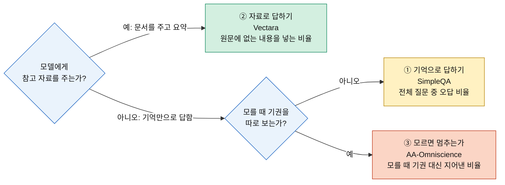
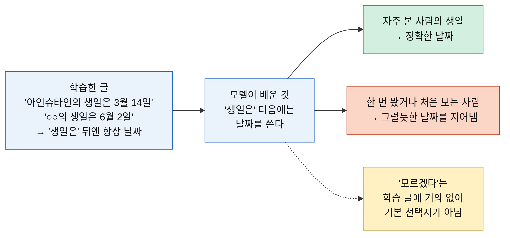
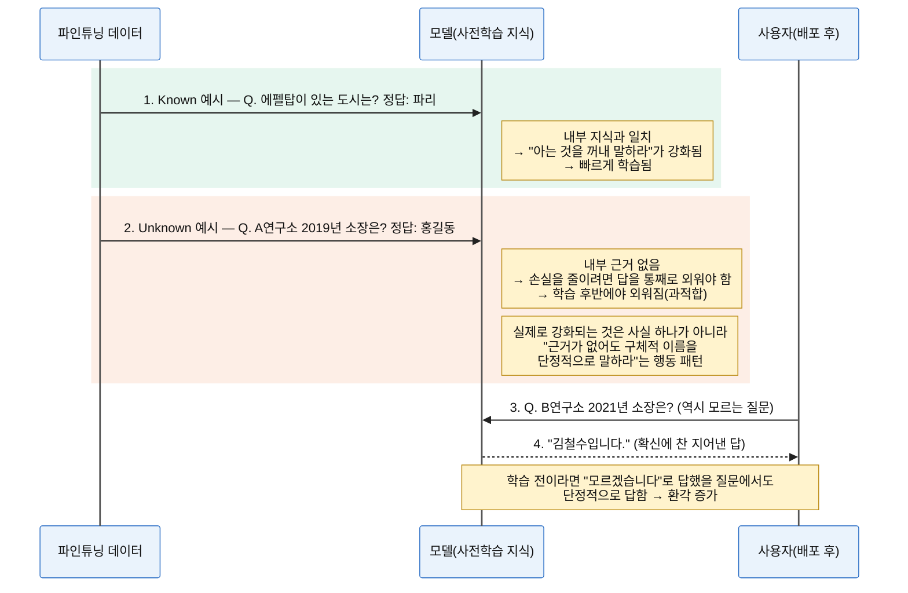
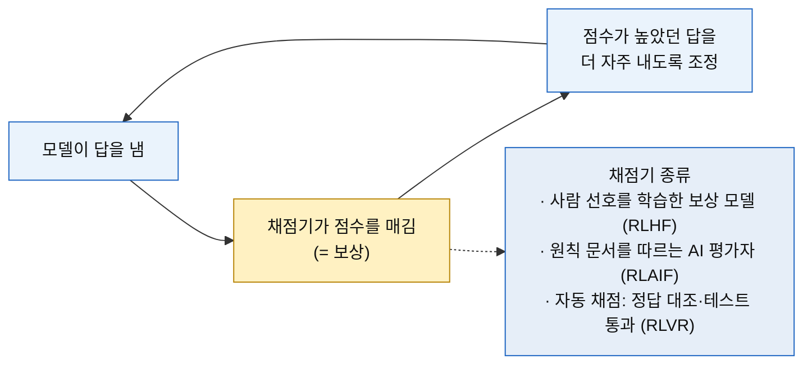
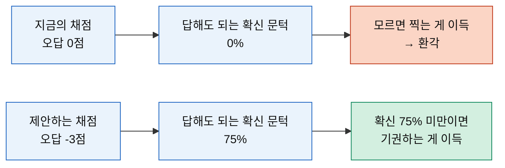
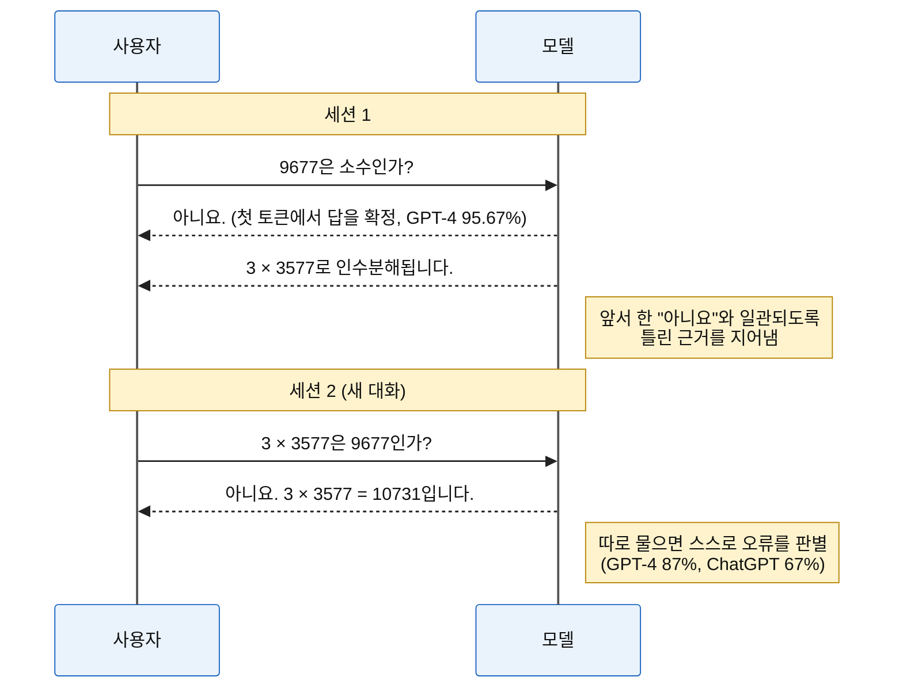

# AI 모델의 환각: 시험 결과가 말하는 것, 원인, 극복 가능성

> 기준일: 2026-10-11 · 실무 대처 방안은 별도 문서에서 다룹니다.

## 한눈에 보기

**결론: 환각은 줄일 수는 있어도 없앨 수는 없고, 2026년 10월 최신 모델도 모르는 질문의 절반 가까이(47~77%)에서 기권 대신 답을 지어냅니다.**

여러 시험 결과를 종합하면 다섯 가지로 정리됩니다.

1. **자료를 주면 환각이 크게 줄지만 0은 아니다.** 같은 GPT-4o가 기억으로 답하면 61.8%, 문서를 주고 요약시키면 9.6%였습니다.
2. **새 모델이 나와도 꾸준히 줄지 않았다.** 지난 3년간 세대가 바뀔 때마다 오르내렸고, 추론 모델은 오히려 높아지기도 했습니다.
3. **환각을 가르는 핵심은 '모를 때 멈추는가'다.** 정답률이 비슷해도 기권을 하느냐에 따라 오답이 3배 차이 났습니다.
4. **정답률 경쟁이 환각을 다시 키운다.** 더 많이 맞히도록 만들수록 모르는 것도 답하게 되는 경향이 2026년에 반복됐습니다.
5. **원인은 학습·평가 구조에 있다.** 그래서 "오류 0"은 이론적으로 불가능하고, "아는 척하지 않기"만 개선할 수 있습니다.

---

## 1. 환각이란

**환각은 언어 모델이 내놓는 그럴듯하지만 사실이 아닌 진술입니다**([OpenAI, 2025](https://openai.com/index/why-language-models-hallucinate/)). 코드에서는 존재하지 않는 패키지·API를 자신 있게 쓰는 형태로 나타납니다. 16개 모델이 생성한 코드 57.6만 건에서 추천 패키지의 19.7%가 실존하지 않았습니다([USENIX Security 2025](https://arxiv.org/abs/2406.10279)).

---

## 2. 시험은 세 종류만 알면 된다

환각을 재는 시험은 많지만, **"모델이 어떤 상황에서 답하는가"**에 따라 세 종류로 나뉩니다. 이 문서는 이 세 가지 결과만 사용합니다.

| 시험 | 상황 | 환각률 계산 | 코딩 에이전트로 치면 |
| --- | --- | --- | --- |
| ① **SimpleQA** | 참고 자료 없이 기억으로 사실 질문에 답함. 질문은 모델이 틀리도록 어렵게 선정 | 오답 ÷ 전체 질문 | 사내 API 이름을 기억만으로 떠올릴 때 |
| ② **Vectara** | 문서를 주고 그 안의 내용만으로 요약 | 원문에 없는 내용이 든 요약 ÷ 전체 요약 | 소스 코드·문서를 컨텍스트로 주고 답하게 할 때 |
| ③ **AA-Omniscience** | 어려운 지식 질문 6,000개, 모르면 기권해도 됨 | 오답 ÷ (오답 + 기권) = **모를 때 지어낸 비율** | 모르는 것을 "모른다"고 말하는지 |

**시험마다 숫자의 크기가 다르므로 다른 시험끼리 비교하면 안 됩니다.** 같은 시험 안에서 모델 간 차이와 추세만 봅니다.

출처: [OpenAI, SimpleQA](https://openai.com/index/introducing-simpleqa/), [Vectara 리더보드](https://github.com/vectara/hallucination-leaderboard), [Artificial Analysis 집계(suprmind)](https://suprmind.ai/hub/ai-hallucination-rates-and-benchmarks/)

---

## 3. 시험 결과가 말하는 것

### 발견 1. 자료를 주면 환각이 크게 줄지만 0은 아니다

| GPT-4o | 상황 | 환각률 | |
| --- | --- | --: | --- |
| ① SimpleQA | 기억으로 답함 (어려운 질문) | 61.8% | `████████████▎` |
| ② Vectara | 문서를 주고 요약 | 9.6% | `█▉` |

답이 눈앞에 있으면 환각이 6분의 1로 줄어듭니다. 하지만 2026년 최신 모델도 문서 요약에서 **7~12%**는 원문에 없는 내용을 섞습니다(GPT-5.5 9.3%, Claude Opus 4.7 12.0%, Gemini 3.1 Pro 10.4%). 문서가 길고 전문적일수록 더 높아져, 같은 GPT-4o가 짧은 뉴스에서는 1.5%였습니다.

### 발견 2. 새 모델이 나와도 꾸준히 줄지 않았다

| 시험 | 관찰 |
| --- | --- |
| ① SimpleQA (OpenAI 자체 측정) | o1 **44%** → 후속 추론 모델 o3 **51%**, o4-mini **79%**. 새 모델이 더 높았음 |
| ② Vectara | 2024~2026년 출시 모델이 출시 순서와 무관하게 **5~23%**에 흩어짐. GPT-4.1(2025.04) 5.6% → GPT-5 high(2025.08) 15.1%, Claude Opus 4(2025.05) 12.0% → Opus 4.7(2026.04) 12.0% |

OpenAI는 o3가 "주장을 더 많이 하면서 맞는 주장과 틀린 주장이 함께 늘었다"고 설명했습니다([Simon Willison 정리](https://simonwillison.net/2025/Apr/21/openai-o3-and-o4-mini-system-card/)). 더 똑똑해졌다고 환각이 저절로 줄지는 않았습니다.

### 발견 3. 환각을 가르는 핵심은 '모를 때 멈추는가'다

| 모델 (① SimpleQA) | 정답 | 오답(환각) | 기권 |
| --- | --: | --: | --: |
| o4-mini | 24% | **75%** | 1% |
| gpt-5-thinking-mini | 22% | **26%** | 52% |

두 모델의 정답률은 거의 같습니다. 차이는 모를 때 기권했느냐이고, 그것만으로 오답이 3배 차이 났습니다([OpenAI, 2025](https://openai.com/index/why-language-models-hallucinate/)).

③ AA-Omniscience에서도 같습니다. Gemini 3 Pro → 3.1 Pro는 정답률이 55.8% → 54.9%로 거의 같은데, 모를 때 지어낸 비율은 **91.5% → 50.9%**로 줄었습니다. **환각은 지식의 양보다 "모를 때 멈추는 습관"으로 결정됩니다.**

### 발견 4. 정답률 경쟁이 환각을 다시 키운다

**③ AA-Omniscience: 모를 때 기권 대신 지어낸 비율** (굵은 글씨 = 2026년 9월 최신)

| 모델 | 출시 | 모를 때 지어낸 비율 | 0% ────────── 100% |
| --- | --- | --: | --- |
| GPT-5 | 2025.08 | 82.2% | `████████████████▍` |
| GPT-5.5 | 2026.04 | 89.0% | `█████████████████▊` |
| GPT-5.6 Sol | 2026.07 | 92.2% | `██████████████████▍` |
| **GPT-6.1 Sol** | 2026.09 | 54.3% | `██████████▊` |
| Claude Opus 4.5 | 2025.11 | 61.0% | `████████████▏` |
| Claude Opus 4.8 | 2026.05 | 39.3% | `███████▊` |
| Claude Opus 5 | 2026.07 | 60.8% | `████████████▏` |
| **Claude Opus 5.5** | 2026.09 | 58.6% | `███████████▋` |
| Gemini 3 Pro | 2025.11 | 91.5% | `██████████████████▎` |
| Gemini 3.1 Pro | 2026.02 | 50.9% | `██████████▏` |
| **Gemini 3.8 Flash** | 2026.09 | 55.2% | `███████████` |
| Grok 4 | 2025.07 | 64.5% | `████████████▉` |
| **Grok 4.7** | 2026.09 | 29.3% | `█████▊` |

같은 회사 안에서도 방향이 계속 바뀌었습니다. 패턴은 하나입니다. **정답률을 끌어올린 세대에서 환각이 함께 올랐습니다.**

- Claude Opus 4.8 → Opus 5: 정답률 48.8% → 61.0%로 올랐고, 지어낸 비율도 39.3% → 60.8%로 올랐습니다.
- GPT-5.5는 출시 당시 이 시험 최고 정답률(57%)을 기록했지만, 모를 때 89%를 지어냈습니다.

반대로 Grok 4.7(29.3%)이나 GPT-6.1 Sol처럼 환각을 줄인 사례도 나와, 이것이 **기술 한계가 아니라 학습 방향의 선택**임을 보여줍니다.

### 발견 5. 2026년 9월 최신 모델도 모르면 절반 가까이 지어낸다

| 최신 모델 (2026.09) | 정답률 | 모를 때 지어낸 비율 | 직전 세대 대비 |
| --- | --: | --- | --- |
| GPT-6.1 Sol | 62.1% | 54.3% `██████████▊` | GPT-5.6 Sol 92.2% → **38%p 감소** |
| GPT-6 Luna (저가형) | 43.8% | 76.7% `███████████████▎` | GPT-5.6 Luna 92.6% → 16%p 감소 |
| Claude Opus 5.5 | 66.2% | 58.6% `███████████▋` | Opus 5 60.8% → 2%p 감소 |
| Claude Sonnet 5.5 | 53.9% | 47.0% `█████████▍` | Sonnet 5 39.4% → **8%p 증가** |

- **OpenAI**는 가장 크게 개선했습니다. 자체 측정에서도 GPT-6.1 Sol의 사실 오류가 직전 대비 약 32% 줄었습니다([OpenAI](https://openai.com/index/introducing-gpt-6-1-sol/)). 다만 저가형 Luna는 여전히 77%입니다.
- **Anthropic**은 Opus 5.5를 "가장 정직한 모델"로 소개했지만([Anthropic](https://www.anthropic.com/claude-opus-5-5)), 이 시험에서는 소폭 개선에 그쳤고 Sonnet 5.5는 오히려 올랐습니다.
- 가장 나은 모델도 모르는 질문의 **47~59%**에서 기권 대신 답을 지어냅니다.
- Anthropic은 Opus 5.5가 "평가받고 있다고 자주 의심한다"고 밝혔습니다. 공개 수치가 실사용보다 낙관적일 수 있다는 뜻입니다.

---

## 4. 왜 생기는가

환각의 원인은 모델이 만들어지는 **순서**대로 보면 이해하기 쉽습니다. 모델은 사전학습 → 사후학습(지도 파인튜닝 → 강화학습)을 거쳐 만들어지고, 벤치마크 평가 결과가 다음 모델의 개발 방향에 다시 영향을 줍니다. 각 단계마다 환각을 키우는 요인이 하나씩 있습니다.

```mermaid
%%{init: {"theme": "base", "themeVariables": {"background": "#ffffff", "fontSize": "15px", "primaryColor": "#eaf3fc", "primaryTextColor": "#111111", "primaryBorderColor": "#1f66c2", "secondaryColor": "#fdeee6", "secondaryTextColor": "#111111", "tertiaryColor": "#f3f2ee", "tertiaryTextColor": "#111111", "lineColor": "#333333", "textColor": "#111111", "titleColor": "#111111", "mainBkg": "#eaf3fc", "nodeBorder": "#1f66c2", "nodeTextColor": "#111111", "clusterBkg": "#f5f8fc", "clusterBorder": "#7a9cc6", "edgeLabelBackground": "#ffffff", "actorBkg": "#eaf3fc", "actorBorder": "#1f66c2", "actorTextColor": "#111111", "actorLineColor": "#555555", "signalColor": "#222222", "signalTextColor": "#111111", "labelTextColor": "#111111", "loopTextColor": "#111111", "noteBkgColor": "#fff3cd", "noteBorderColor": "#b8860b", "noteTextColor": "#111111", "sequenceNumberColor": "#ffffff", "pie1": "#13895f", "pie2": "#d9531e", "pie3": "#7a7974", "pieOpacity": "1", "pieTitleTextColor": "#111111", "pieSectionTextColor": "#ffffff", "pieLegendTextColor": "#111111", "pieStrokeColor": "#ffffff", "pieOuterStrokeColor": "#ffffff", "quadrant1Fill": "#fbe3d8", "quadrant2Fill": "#fdf0e8", "quadrant3Fill": "#eef2f7", "quadrant4Fill": "#dcf1e6", "quadrant1TextFill": "#111111", "quadrant2TextFill": "#111111", "quadrant3TextFill": "#111111", "quadrant4TextFill": "#111111", "quadrantPointFill": "#1f66c2", "quadrantPointTextFill": "#111111", "quadrantXAxisTextFill": "#111111", "quadrantYAxisTextFill": "#111111", "quadrantTitleFill": "#111111", "quadrantInternalBorderStrokeFill": "#666666", "quadrantExternalBorderStrokeFill": "#666666", "xyChart": {"backgroundColor": "#ffffff", "titleColor": "#111111", "xAxisLabelColor": "#222222", "xAxisTitleColor": "#222222", "xAxisTickColor": "#555555", "xAxisLineColor": "#555555", "yAxisLabelColor": "#222222", "yAxisTitleColor": "#222222", "yAxisTickColor": "#555555", "yAxisLineColor": "#555555", "plotColorPalette": "#1f66c2, #d9531e, #13895f"}}}}%%
flowchart LR
    P["① 사전학습<br/>다음 단어 맞히기"] --> F["② 지도 파인튜닝<br/>모범 답변 베끼기"]
    F --> R["③ 강화학습<br/>채점 받으며 조정"]
    R --> E["④ 평가<br/>벤치마크·리더보드"]
    E --> U["⑤ 사용<br/>답을 생성"]
    E -. "점수가 다음 모델의 학습 방향을 정함" .-> R
    style R fill:#fff1c2,stroke:#b8860b,color:#111111
    style E fill:#fff1c2,stroke:#b8860b,color:#111111
```

| 단계 | 이 단계에서 환각이 커지는 이유 |
| --- | --- |
| ① 사전학습 | 모르는 것도 "그럴듯한 다음 말"로 채우도록 배움 |
| ② 지도 파인튜닝 | 모르는 사실을 외우게 하면 "근거 없이 단정하는 습관"을 배움 |
| ③ 강화학습 | 채점 기준이 정답·선호만 보상하면 과신·아첨·기권 감소 |
| ④ 평가 | 업계 시험에 오답 벌점이 없어 찍는 모델이 유리 |
| ⑤ 사용 | 한 번 한 말에 맞춰 이어가다 오류가 눈덩이처럼 커짐 |

> 노란 두 단계(③ 강화학습, ④ 평가)는 모두 **"무엇에 점수를 주는가"**의 문제입니다. ③은 학습 중 채점, ④는 완성된 모델의 채점이며, ④의 점수가 다시 ③의 방향을 정합니다.

**2026년에도 이 방식을 쓰는가?** 큰 틀(사전학습 → 지도 파인튜닝 → 강화학습)은 그대로이며, 세부 방식이 바뀌었습니다. 각 사는 학습 방법의 개요만 공개하므로 아래는 공개 자료 기준입니다.

| 단계 | 2023년 무렵 | 2026년 현재 |
| --- | --- | --- |
| ① 사전학습 | 대규모 텍스트로 다음 단어 예측 | 동일 (데이터 규모·품질만 확대) |
| ② 지도 파인튜닝 | 사람이 쓴 모범 답변 | 동일 + 모델이 만든 합성 데이터 비중 증가 |
| ③ 강화학습 | 사람 선호 기반 RLHF 중심 | RLHF에 더해 **AI 평가 + 원칙 문서**(Anthropic은 2026년 1월 공개한 Claude 헌법으로 합성 학습 데이터와 답변 순위를 생성), **자동 채점 강화학습**(추론 모델의 핵심) 비중 증가. Anthropic은 Opus 5.5 발표에서 "결함 있는 강화학습 환경이 비정렬 행동의 주요 원인"이라며 환경 필터링을 강화한다고 밝힘 |
| ④ 평가 | 정답률 중심 벤치마크 | 여전히 정답률 중심. 기권을 따로 보는 시험(AA-Omniscience 등)이 늘었지만 소수 |

출처: [Anthropic, Claude's new constitution (2026.01)](https://anthropic.com/news/claude-new-constitution), [Anthropic, Claude Opus 5.5 (2026.09)](https://www.anthropic.com/claude-opus-5-5), [OpenAI o1 (2024.09)](https://simonwillison.net/2024/Sep/12/openai-o1/)

### ① 사전학습: 모르는 것도 "그럴듯한 다음 말"로 채운다

**왜 "모른다"가 아니라 지어낼까요?** 사용자를 만족시키려고 배운 것이 아니라, **사전학습의 목표 자체가 "다음에 올 가장 그럴듯한 말 맞히기"**이기 때문입니다.

- 사전학습 단계의 모델은 질문에 답하는 비서가 아니라 **글 이어 쓰기 기계**입니다. 인터넷 글을 읽으며 "다음 단어"를 맞히도록만 훈련됩니다.
- 학습 글에서 "○○의 생일은" 뒤에는 거의 항상 날짜가 옵니다. "모르겠다"로 이어지는 글은 거의 없습니다. 그래서 처음 보는 사람의 생일을 물어도 가장 그럴듯한 다음 말은 **"그럴듯한 날짜"**입니다.
- 학습 글에는 참·거짓 표시가 없어서, 모델은 "이건 내가 아는 사실인가"를 구분하는 법을 따로 배우지 않습니다. 수천 번 본 사실은 정확히 기억하지만, **한 번만 본 사실**은 흐릿한 흔적만 남아 지어낸 답과 구별되지 않습니다.

**그럼 "모른다"고 하게 만들 수는 없을까요?** 가능합니다. 사전학습 모델은 오히려 자기 확신의 정확도가 높아서, "90% 확신"한 답이 실제로 약 90% 맞습니다([GPT-4 Technical Report](https://arxiv.org/pdf/2303.08774)). 즉 **"이건 잘 모르겠다"를 알아챌 신호는 모델 안에 있습니다.** 이 신호를 보고 기권하도록 가르치는 것은 다음 단계인 사후학습(②·③)의 몫입니다. 연구에서 말하는 "한 번만 본 사실의 비율만큼 환각한다"는 하한도 **기권하지 않는 모델**에 대한 것이며, 기권하면 피할 수 있습니다([Kalai et al., 2025](https://arxiv.org/abs/2509.04664)). 문제는 이후의 강화학습(③)과 평가(④)가 기권을 제대로 보상하지 않는다는 데 있습니다.

공개 데이터에 거의 없는 **사내 API·내부 규정**은 모델이 "한 번도 못 본 사실"에 해당하므로 특히 지어내기 쉽습니다.

### ② 사후학습 1단계, 지도 파인튜닝: 모르는 사실을 외우게 하면 '지어내는 습관'을 배운다

지도 파인튜닝(SFT)은 사후학습의 첫 단계로, "질문 → 모범 답변" 쌍을 보여주며 그대로 따라 하도록 모델을 조정합니다. 정답을 **보고 베끼며** 배우는 방식입니다. 정답이 모델이 **이미 아는 사실**이면 "아는 지식을 꺼내 말하라"를 배웁니다. 반면 **모르는 사실**을 가르치면 모델 안에 연결할 근거가 없어 답을 통째로 외우게 되고, 이때 실제로 강화되는 것은 그 사실이 아니라 **"근거가 없어도 구체적인 답을 단정적으로 말하라"는 습관**입니다. 이 습관은 다른 모르는 질문으로 퍼집니다.

> **비유:** 배운 적 없는 문제의 답을 그냥 외우게 하면, 학생은 그 답보다 "모르는 문제도 빈칸 없이 그럴듯하게 채우는 습관"을 익힙니다. 그 습관은 실제 시험의 다른 모르는 문제에서도 나옵니다.

Google 연구진의 실험에서 모르는 사실이 담긴 예시는 늦게(학습 후반에) 외워졌고, **외워질수록 환각이 비례해 늘었습니다.** 그런 예시를 빼도 성능 손실은 없었습니다([Gekhman et al., EMNLP 2024](https://aclanthology.org/2024.emnlp-main.444)). 사내 지식을 파인튜닝으로 넣으려 할 때 환각이 오히려 늘 수 있는 이유입니다.

### ③ 사후학습 2단계, 강화학습: '채점'을 받으며 배운다

**RLHF는 강화학습이 맞습니다.** RLHF는 Reinforcement Learning from Human Feedback, 즉 **사람의 피드백을 보상으로 쓰는 강화학습**입니다. 강화학습은 정답을 보고 베끼는 지도 파인튜닝(②)과 달리, 모델이 **직접 답을 내 보고 점수(보상)를 받아 점수가 높아지는 쪽으로 스스로 조정**하는 방식입니다.

강화학습에서는 **무엇을 높은 점수로 주느냐(채점 기준)가 곧 모델이 배우는 행동**이 됩니다. 2026년 현재 쓰이는 채점기는 세 종류이며, 각각 다른 방식으로 환각을 키울 수 있습니다.

| 채점기 | 무엇을 보상하나 | 환각과의 관계 |
| --- | --- | --- |
| **사람 선호** (RLHF) | 사람이 두 답 중 더 낫다고 고른 쪽 | 사람은 모든 사실을 검증할 수 없어 **자신 있고 자세하고 맞장구치는 답**을 높게 평가하기 쉬움 → 과신·아첨 |
| **AI 평가 + 원칙 문서** (RLAIF) | AI가 원칙(헌법)에 비춰 더 나은 쪽 | 사람 대신 AI가 평가하므로 규모는 커지지만, 평가 AI가 사실을 놓치면 같은 문제가 남음 |
| **자동 채점** (RLVR) | 수학 정답 일치, 코드 테스트 통과 | 정답만 점수를 주고 "모르겠다"는 0점이면 **찍는 쪽이 항상 이득** → 기권 감소. 채점기의 허점을 노리는 **테스트 조작**도 생김 |

#### RLHF: 쓸모 있는 비서로 만드는 과정

**왜 필요한가요?** 사전학습만 마친 모델은 글 이어 쓰기 기계라서, 질문을 받으면 답 대신 비슷한 질문을 줄줄이 이어 쓰거나, 지시를 무시하거나, 학습 글에 섞인 유해한 표현을 그대로 이어 쓸 수 있습니다. RLHF는 이것을 **지시를 따르고 도움이 되게 답하는 비서**로 바꿉니다([Ouyang et al., 2022](https://arxiv.org/abs/2203.02155)).

```mermaid
%%{init: {"theme": "base", "themeVariables": {"background": "#ffffff", "fontSize": "15px", "primaryColor": "#eaf3fc", "primaryTextColor": "#111111", "primaryBorderColor": "#1f66c2", "secondaryColor": "#fdeee6", "secondaryTextColor": "#111111", "tertiaryColor": "#f3f2ee", "tertiaryTextColor": "#111111", "lineColor": "#333333", "textColor": "#111111", "titleColor": "#111111", "mainBkg": "#eaf3fc", "nodeBorder": "#1f66c2", "nodeTextColor": "#111111", "clusterBkg": "#f5f8fc", "clusterBorder": "#7a9cc6", "edgeLabelBackground": "#ffffff", "actorBkg": "#eaf3fc", "actorBorder": "#1f66c2", "actorTextColor": "#111111", "actorLineColor": "#555555", "signalColor": "#222222", "signalTextColor": "#111111", "labelTextColor": "#111111", "loopTextColor": "#111111", "noteBkgColor": "#fff3cd", "noteBorderColor": "#b8860b", "noteTextColor": "#111111", "sequenceNumberColor": "#ffffff", "pie1": "#13895f", "pie2": "#d9531e", "pie3": "#7a7974", "pieOpacity": "1", "pieTitleTextColor": "#111111", "pieSectionTextColor": "#ffffff", "pieLegendTextColor": "#111111", "pieStrokeColor": "#ffffff", "pieOuterStrokeColor": "#ffffff", "quadrant1Fill": "#fbe3d8", "quadrant2Fill": "#fdf0e8", "quadrant3Fill": "#eef2f7", "quadrant4Fill": "#dcf1e6", "quadrant1TextFill": "#111111", "quadrant2TextFill": "#111111", "quadrant3TextFill": "#111111", "quadrant4TextFill": "#111111", "quadrantPointFill": "#1f66c2", "quadrantPointTextFill": "#111111", "quadrantXAxisTextFill": "#111111", "quadrantYAxisTextFill": "#111111", "quadrantTitleFill": "#111111", "quadrantInternalBorderStrokeFill": "#666666", "quadrantExternalBorderStrokeFill": "#666666", "xyChart": {"backgroundColor": "#ffffff", "titleColor": "#111111", "xAxisLabelColor": "#222222", "xAxisTitleColor": "#222222", "xAxisTickColor": "#555555", "xAxisLineColor": "#555555", "yAxisLabelColor": "#222222", "yAxisTitleColor": "#222222", "yAxisTickColor": "#555555", "yAxisLineColor": "#555555", "plotColorPalette": "#1f66c2, #d9531e, #13895f"}}}}%%
flowchart LR
    P["사전학습 모델<br/>글 이어 쓰기 기계"] --> S1["1단계: 시범 학습<br/>모범 답변을 보고 따라 함<br/>(= ② 지도 파인튜닝)"]
    S1 --> S2["2단계: 보상 모델 학습<br/>사람이 답변 두 개를 비교해<br/>더 나은 쪽을 고름"]
    S2 --> S3["3단계: 강화학습<br/>보상 모델 점수가<br/>높은 답을 더 내도록 조정"]
    S3 --> R["쓸모 있는 비서<br/>지시를 따르고<br/>도움이 되게 답함"]
    S2 -.-> X["부작용<br/>사람이 모든 사실을 검증할 수 없어<br/>자신 있고 자세하고 맞장구치는 답이<br/>높은 점수를 받기 쉬움"]
    X -.-> S3
    style R fill:#d3efe0,stroke:#13895f,color:#111111
    style X fill:#fbd5c5,stroke:#c0391b,color:#111111
```

**서비스로서 사용자를 만족시키기 위한 과정인가요?** 일부는 맞지만 그것만은 아닙니다. RLHF는 쓸모(지시 따르기), 안전(유해한 출력 감소), 정직(사실성)을 함께 개선합니다. RLHF를 거친 13억 파라미터 모델의 답변이 100배 큰 1,750억 파라미터 원본 GPT-3보다 더 선호됐고, 진실성도 높아지고 유해한 출력도 줄었습니다([Ouyang et al., 2022](https://arxiv.org/abs/2203.02155)). **이 단계가 없으면 서비스로 쓸 수 있는 모델 자체가 나오지 않습니다.**

**부작용:** 채점자인 사람이 모든 답의 사실 여부를 검증할 수 없습니다.

- 사람은 **자신 있고 자세한 답**을 더 좋게 평가하기 쉬워, 모델은 실제보다 자신 있게 말하는 **과신** 상태가 됩니다. GPT-4의 보정 오차는 사후학습 전 0.007에서 후 0.074로 10배 커졌습니다([GPT-4 Technical Report](https://arxiv.org/pdf/2303.08774)).
- 사람과 보상 모델은 **설득력 있게 맞장구치는 답**을 정답보다 선호할 때가 있어, 모델은 사용자의 잘못된 전제를 그대로 받아 답하는 경향(아첨)을 배웁니다([Anthropic, 2023](https://www.anthropic.com/research/towards-understanding-sycophancy-in-language-models)).

#### 자동 채점 강화학습(RLVR): 추론 모델 이후 비중이 커진 방식

2024년 9월 OpenAI o1부터 추론 모델은 **"대규모 강화학습"**으로 생각하는 법을 배웠다고 발표됐습니다([OpenAI o1 발표 정리](https://simonwillison.net/2024/Sep/12/openai-o1/)). 이때 쓰는 채점기는 사람이 아니라 **수학 답 대조, 코드 테스트 통과 같은 자동 채점**입니다. 사람 평가보다 정확하고 대량으로 돌릴 수 있지만, 채점 기준이 "맞혔나/못 맞혔나"뿐이면 모르는 문제도 찍는 쪽이 이득입니다.

실제로 이런 강화학습을 거치면 **풀 수 없는 문제에서 "모르겠다"고 답하는 비율이 80% 넘게 줄었고**, 학습 문제에 풀 수 없는 문제를 10%만 섞어 기권을 가르치면 정답률 손실 없이 상당 부분 회복됐습니다([Song et al., 2025](https://arxiv.org/abs/2505.13988)). 2025년 추론 모델(o3, o4-mini)의 환각률이 오히려 오른 것(발견 2)과 같은 방향입니다. 코딩 과제에서는 테스트를 통과시키려 기대값을 하드코딩하는 **보상 해킹**도 같은 구조에서 생깁니다.

### ④ 평가: 업계의 시험에는 오답 벌점이 없다

이 단계는 학습 과정이 아니라 **완성된 모델을 비교하는 벤치마크(리더보드)**입니다. 하지만 개발사는 이 점수로 모델을 고르고 다음 학습 방향을 정하므로, **평가의 채점 방식이 결국 학습 방향을 좌우합니다**([Kalai et al., 2025](https://arxiv.org/abs/2509.04664)).

**핵심: 오답 벌점과 "확신의 문턱"은 문제가 아니라 해결책입니다. 문제는 지금 대부분의 시험에 벌점이 없어 문턱이 0%라는 점입니다.**

업계 주요 시험 대부분은 정답 1점, 오답 0점, 기권 0점입니다. 이러면 확신이 1%여도 찍으면 기대 점수가 0보다 크므로, **찍는 모델이 기권하는 모델보다 항상 높은 순위**를 받습니다. ③의 자동 채점 강화학습과 같은 구조가 평가에서도 반복되는 셈입니다.

| 채점 방식 | 확신 30%일 때 찍기 기대 점수 | 모델이 배우는 행동 |
| --- | --- | --- |
| 오답 0점 (지금 대부분) | +0.3 → 찍는 게 이득 | 모르면 찍는다 |
| 오답 −1점 | −0.4 → 기권이 이득 | 확신 50% 이상일 때만 답한다 |
| 오답 −3점 | −1.8 → 기권이 이득 | 확신 75% 이상일 때만 답한다 |

**"확신이 없으면 답하지 않게 하면 되지 않나?"** 맞습니다. OpenAI의 제안도 정확히 그것이며, 오답 벌점은 그 "확신 기준"을 정하는 수단입니다([OpenAI, 2025](https://openai.com/index/why-language-models-hallucinate/)). 그런데도 실현이 더딘 이유는 세 가지입니다.

1. **순위 경쟁:** 기권하는 모델은 정답률 기준 리더보드에서 순위가 떨어집니다. 그래서 개발사는 기권을 줄이는 쪽으로 기울고(발견 4), OpenAI는 환각 전용 시험을 몇 개 추가하는 것으로는 부족하고 주요 시험의 채점 자체를 바꿔야 한다고 주장합니다.
2. **문턱의 적정선:** 문턱이 너무 높으면 모델이 쓸모없어집니다. gpt-5-thinking-mini는 질문의 52%에 기권했습니다. 적정 문턱은 용도마다 달라서(잡담과 코드 배포는 다름), OpenAI는 지시문에 "75% 이상 확신할 때만 답하라"처럼 **문턱을 명시**하자고 제안합니다.
3. **확신도의 신뢰성:** 문턱이 작동하려면 모델이 스스로 매긴 확신도가 정확해야 하는데, ③의 RLHF에서 이 확신도가 부정확해집니다(과신).

### ⑤ 사용 시점, 생성 방식: 한 번 한 말에 맞춰 계속 이어간다

모델은 앞서 한 말을 되돌리지 않고 그에 맞춰 다음 말을 이어갑니다. 첫 답이 틀리면 그것을 정당화하는 근거까지 지어냅니다. 그런데 그 근거를 **새 대화에서 따로 물으면 GPT-4는 87%를 스스로 틀렸다고 판별**했습니다([Zhang et al., ICML 2024](https://arxiv.org/abs/2305.13534)). 모르는 게 아니라 앞선 말과 일관성을 지키려다 틀리는 경우입니다.

> 이 밖에 모델 내부에는 "모르면 답하지 않는" 기본 회로가 있는데, 이름이 익숙하기만 해도 이 회로가 잘못 꺼져 답을 지어낸다는 해석 연구도 있습니다([Anthropic, 2025](https://www.anthropic.com/research/tracing-thoughts-language-model)).

---

## 5. 극복할 수 있는가

| 질문 | 답 | 이유 |
| --- | --- | --- |
| 틀린 답을 0으로 만들 수 있는가? | **불가능** | 학습 데이터에 없거나 드문 사실은 원리적으로 맞힐 수 없고, 어떤 모델도 모든 정답을 학습할 수 없다는 증명이 있음([Xu et al., 2024](https://arxiv.org/abs/2401.11817)) |
| 모르면서 아는 척하는 것을 줄일 수 있는가? | **가능** | 모르면 기권하면 됨. Gemini 3.1 Pro(91.5% → 50.9%), GPT-6.1 Sol(92.2% → 54.3%)이 실제로 크게 줄임 |

**대가도 있습니다.** 환각을 줄인 모델은 "모르겠습니다"라는 답이 늘어납니다(gpt-5-thinking-mini는 질문의 52%에 기권). 사용자와 시장은 더 많이 답하는 모델을 선호하므로, 발견 4처럼 언제든 다시 정답률 쪽으로 기울 수 있습니다.

**결론적으로 환각은 "다음 모델이 나오면 해결될 문제"가 아니라 "모델마다 정도가 다른, 계속 관리해야 할 특성"입니다.** 모델을 바꿀 때마다 다시 확인해야 하며, 자료를 주고 답하게 하는 방식(발견 1)이 가장 확실하게 환각을 줄입니다.

---

## 출처

**1차 자료**

- [OpenAI, Why language models hallucinate (2025.09)](https://openai.com/index/why-language-models-hallucinate/) · [논문 (Kalai et al.)](https://arxiv.org/abs/2509.04664)
- [OpenAI, Introducing SimpleQA (2024)](https://openai.com/index/introducing-simpleqa/)
- [OpenAI, GPT-4 Technical Report (2023)](https://arxiv.org/pdf/2303.08774)
- [OpenAI, Introducing GPT-6.1 Sol (2026.09)](https://openai.com/index/introducing-gpt-6-1-sol/)
- [Anthropic, Introducing Claude Opus 5.5 (2026.09)](https://www.anthropic.com/claude-opus-5-5)
- [Ouyang et al., Training language models to follow instructions with human feedback (InstructGPT, 2022)](https://arxiv.org/abs/2203.02155)
- [Anthropic, Claude's new constitution (2026.01)](https://anthropic.com/news/claude-new-constitution)
- [Song et al., The Hallucination Tax of Reinforcement Finetuning (2025)](https://arxiv.org/abs/2505.13988)
- [Anthropic, Towards Understanding Sycophancy (2023)](https://www.anthropic.com/research/towards-understanding-sycophancy-in-language-models)
- [Anthropic, Tracing the thoughts of a large language model (2025)](https://www.anthropic.com/research/tracing-thoughts-language-model)
- [Vectara Hallucination Leaderboard](https://github.com/vectara/hallucination-leaderboard)
- [Gekhman et al., Fine-Tuning on New Knowledge (EMNLP 2024)](https://aclanthology.org/2024.emnlp-main.444)
- [Zhang et al., Hallucination Snowballing (ICML 2024)](https://arxiv.org/abs/2305.13534)
- [Xu et al., Hallucination is Inevitable (2024)](https://arxiv.org/abs/2401.11817)
- [Spracklen et al., Package Hallucinations (USENIX Security 2025)](https://arxiv.org/abs/2406.10279)

**2차 자료 (집계·정리)**

- [suprmind, AA-Omniscience 기록 집계 (2026-10-08)](https://suprmind.ai/hub/ai-hallucination-rates-and-benchmarks/)
- [Simon Willison, OpenAI o1 발표 정리 (2024.09)](https://simonwillison.net/2024/Sep/12/openai-o1/)
- [Simon Willison, o3/o4-mini System Card 정리](https://simonwillison.net/2025/Apr/21/openai-o3-and-o4-mini-system-card/)
