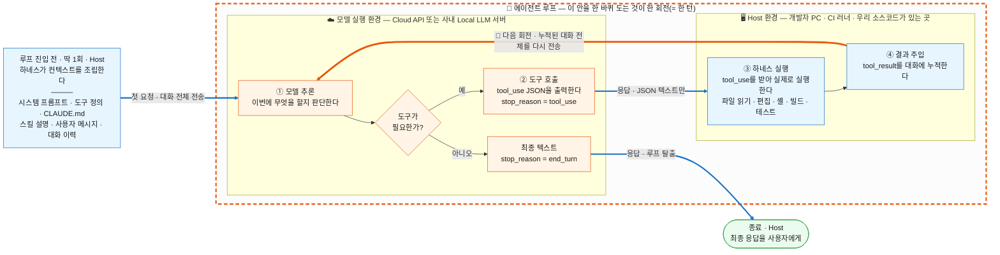
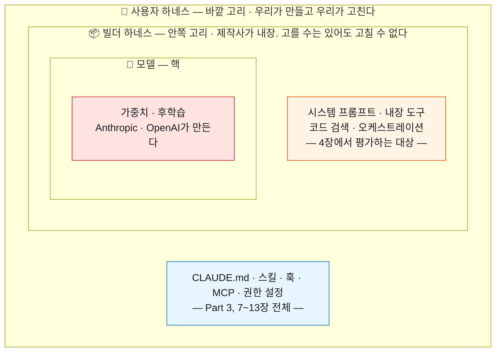
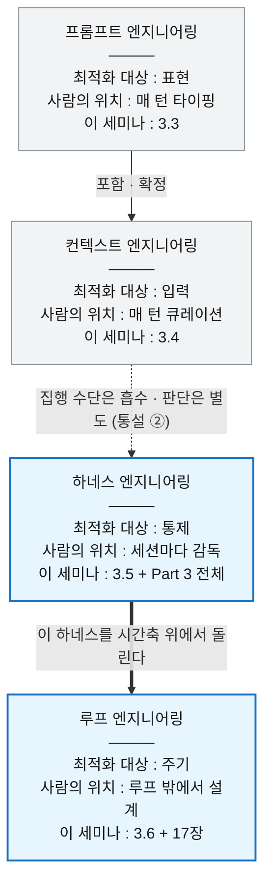

# 코딩 에이전트 기반 개발 개론
### 프롬프트에서 하네스, 그리고 루프까지

**대상**: 코딩 에이전트를 실제 업무에 적용하려는 개발자. 사전 지식은 필요하지 않다
**전제 환경**: 폐쇄망, GitHub Copilot Business, 차량/임베디드 소프트웨어 개발
**기준 시점**: 2026년 9월
**구성**: 4부 19장 + 부록 (시간 제약 없이 전체 구성. 실제 운영 시 부/장 단위로 분할)

**이 문서의 성격**: 분야 전체를 한 바퀴 도는 **개론**이다. 각 주제를 끝까지 파지 않고, 무엇이 있고 언제 무엇을 판단해야 하는지를 다룬다. 예외는 5장 하나로, 그 장만 실행 매뉴얼이다.

---

## 전체 지도

```
Part 1. 원리        1~3장    에이전트가 무엇이고, 네 개의 엔지니어링 층은 어떤 관계인가
Part 2. 환경        4~6장    우리는 무엇을 어떻게 쓰는가
Part 3. 확장 부품   7~13장   하네스를 구성하는 부품들
Part 4. 운영        14~19장  조직과 개인이 어떻게 일할 것인가
부록                A~C      실습, 참고자료, 용어집
```

3장이 이 세미나의 축이다. 프롬프트 → 컨텍스트 → 하네스 → 루프 네 층의 지도를 먼저 그리고, Part 3의 모든 장을 "하네스의 부품 하나"로 소개한 뒤, Part 4에서 "그 부품들을 조립해 운영하고 결국 루프로 올라가는 길"로 닫는다.

---

# Part 1. 원리

## 1장. 왜 지금 코딩 에이전트인가

**이 장의 목표**: 자동완성과 에이전트의 차이를 몸으로 이해시키고, 세미나 전체의 문제의식을 심는다.

### 1.1 세대 구분
| 세대 | 형태 | 사람의 역할 |
|---|---|---|
| 1세대 | 인라인 자동완성 | 사람이 코드를 쓰고 AI가 다음 토큰을 제안 |
| 2세대 | 채팅 | 사람이 질문하고 복사·붙여넣기 |
| 3세대 | 에이전트 | AI가 도구를 써서 일하고, 사람이 조종하고 검증 |

### 1.2 2026년에 달라진 세 가지
1. **경쟁 축의 이동**: 모델 성능이 아니라 하네스(모델을 둘러싼 환경) 설계가 결과를 가른다
2. **과금 구조의 이동**: 요청 수 과금에서 토큰 과금으로. 컨텍스트 설계가 곧 비용 설계가 되었다
3. **규격의 표준화**: MCP, Agent Skills, AGENTS.md가 벤더를 넘어 공통 규격으로 수렴

### 1.3 이 세미나가 가르치려는 것
> "프롬프트를 잘 쓰는 법"이 아니라 **"에이전트가 일할 환경을 설계하는 법"**

### 1.4 흔한 오해 먼저 깨기
- "에이전트를 쓰면 코딩을 몰라도 된다" → 반대다. 판정 능력의 요구 수준이 올라간다
- "좋은 프롬프트가 핵심이다" → 2024년까지의 이야기다
- "우리 코드베이스는 특수해서 안 된다" → 특수할수록 지침·검증 설계의 효과가 크다

---

## 2장. 코딩 에이전트는 어떻게 동작하는가

**이 장의 목표**: 블랙박스를 열어 보여준다. 내부를 알면 실패 원인을 스스로 진단할 수 있다.

### 2.1 에이전트 루프

먼저 흔한 오해 하나를 정리하고 시작한다. "컨텍스트 수집"은 루프의 별도 단계가 아니다. **에이전트가 코드베이스를 파악하는 행위 자체가 도구 호출**이다. `Read`, `Grep`, `Glob`으로 파일을 뒤지는 것과 `Edit`으로 파일을 고치는 것은 같은 메커니즘이고, 목적만 다르다.

정확히 구분해야 할 것은 **누가 컨텍스트를 넣는가**이다.

**그리고 하나 더 구분해야 할 것이 있다. 어디서 무엇이 도는가.** 코딩 에이전트는 **두 개의 서로 다른 환경**에 걸쳐 있다. 에이전트 프로세스와 우리 소스코드가 있는 **Host 환경**, 그리고 모델 가중치가 있는 **모델 실행 환경**(클라우드 API 또는 사내 Local LLM 서버)이다. 이 경계를 그려놓고 보면 뒤에 나올 비용·보안 이야기가 전부 이 그림 위에 얹힌다.



> **주황 점선 박스 안이 "에이전트 루프"다.** ① → ② → ③ → ④ → ① 이 한 바퀴가 한 회전(= 한 턴)이고, 주황색 굵은 화살표(`🔁`)가 그 바퀴를 닫는다. 이 화살표가 없으면 그냥 2세대 채팅이다.

> **진입 블록과 종료 블록은 루프 밖에 있다.** 컨텍스트 조립은 루프에 들어가기 전 딱 1회뿐이고, 최종 응답은 루프를 빠져나온 뒤다. 루프 안에서 반복되는 것은 ①②③④ 네 개뿐이다.

> **굵은 화살표가 환경 경계를 넘는 구간이다.** 루프 블록 하나가 두 환경에 걸쳐 있어서, 한 회전마다 경계를 두 번 넘는다. 그 위를 오가는 것은 **JSON 텍스트뿐**이다.

**갈림길은 ①에 있다.** 매 회전마다 모델이 판단하는 것은 "다음 도구는 무엇인가"가 아니라 **"도구를 더 부를 것인가, 여기서 끝낼 것인가"** 다. 응답의 `stop_reason` 필드가 그 판단 결과를 그대로 담는다 — `tool_use`면 ②로 내려가고, `end_turn`이면 그 자리에서 최종 응답이다.

이 그림에서 반드시 가져가야 할 네 가지.

1. **바퀴는 0번 돌 수도 있다.** "이 함수가 무슨 일을 하는지 설명해줘"처럼 이미 컨텍스트에 있는 것만으로 답이 되는 요청은 ①에서 곧장 빠져나온다. 이때 에이전트는 **2세대 채팅과 완전히 같은 모양으로 동작한다.** 도구를 부르기 시작해야 3세대다
2. **바퀴의 절반은 모델이, 절반은 하네스가 돈다.** ①②는 모델 실행 환경에서 판단하고 출력하는 구간, ③④는 Host에서 실행하고 되돌려 넣는 구간이다
3. **④가 매 회전마다 쌓인다.** 대화가 길어진다는 말의 실체가 이것이고, 2.3의 컨텍스트 압축 문제와 6장의 비용 문제가 여기서 나온다
4. **모델은 우리 파일시스템에 손을 댈 수 없다.** 아래에서 따로 본다

**환경 경계에서 반드시 짚어야 할 세 가지**

| | 무슨 뜻인가 | 어디서 다시 나오나 |
|---|---|---|
| **모델은 Host에 접근하지 못한다** | 모델은 `cmake`를 실행한 적이 없다. "이 명령을 돌려달라"는 JSON을 내놓았을 뿐이고, 실행한 것은 Host의 하네스다. **실행 권한·실행 범위가 전부 Host 쪽에 있다**는 뜻이며, 이것이 하네스가 중요한 기술적 이유다 | 2.2, 11장(훅), 18장(승인 경계) |
| **매 회전마다 대화 전체가 경계를 다시 넘는다** | 모델은 요청 사이에 아무것도 기억하지 않는다. 그래서 ④로 누적된 것을 포함해 **전체를 매번 다시 보낸다.** 대화가 길어질수록 요청 하나가 비싸지는 이유이고, 동시에 **읽은 소스코드가 반복해서 바깥으로 나간다**는 뜻이기도 하다 | 2.3, 6장(비용), 9장(보안) |
| **경계의 위치는 바꿀 수 있지만 구조는 안 바뀐다** | 오른쪽 박스를 사내 Local LLM 서버로 바꾸면 경계가 사내망 안으로 들어온다. 반출 문제는 줄지만 **①\~④의 구조와 매번 전체를 다시 보낸다는 성질은 그대로다.** 폐쇄망에서 백엔드를 무엇으로 붙이느냐는 이 박스 하나를 바꾸는 선택이다 | 5장(백엔드 설정), 6장 |

**두 종류의 컨텍스트**

| | 누가 넣는가 | 언제 | 예시 | 통제 수단 |
|---|---|---|---|---|
| **주입 컨텍스트** | 하네스가 조립 | 요청 시작 시 자동 | 시스템 프롬프트, 지침 파일, 도구 정의 | 7\~13장 (하네스 설계) |
| **수집 컨텍스트** | 모델이 도구로 획득 | 루프를 돌면서 | `Read`, `Grep`, `Glob`, LSP, MCP 조회 | 도구 설계, 서브에이전트 격리 |

4장에서 다룰 "무거운 시스템 프롬프트" 문제는 **주입 컨텍스트**의 문제이고, 12장의 서브에이전트 격리는 **수집 컨텍스트**가 메인 대화를 오염시키는 문제를 다룬다. 둘은 원인도 해법도 다르므로 처음부터 구분해두는 편이 낫다.

**도구 호출의 네 가지 목적**

| 목적 | 도구 예시 | 되돌릴 수 있는가 |
|---|---|---|
| 탐색 (수집) | Read, Grep, Glob, LSP | 부작용 없음 |
| 편집 | Edit, Write | git으로 복구 가능 |
| 실행 | Bash | 명령에 따라 다름 |
| 위임 | Task (서브에이전트) | 하위 호출에 따라 다름 |

이 분류가 18장의 승인 경계선("되돌릴 수 있으면 자동, 없으면 승인")의 근거가 된다. 탐색 도구를 매번 승인받게 만들면 에이전트는 아무 일도 못 한다.

**자동완성과의 차이**: 자동완성에는 ②\~④가 없다. 모델이 텍스트를 뱉고 끝난다. **관찰과 반복이 있는가**가 3세대의 정의다.

### 2.2 도구 호출의 실체

**이 예시가 무엇인지 먼저 정한다.** 아래 두 덩어리는 설명용으로 지어낸 의사코드가 아니라 **Anthropic Messages API가 규정한 콘텐츠 블록 형식 그대로**다. Claude를 쓰는 모든 도구 호출 — Claude Code든, 직접 짠 스크립트든 — 이 이 모양을 지나간다. 벤더마다 필드 이름은 다르지만(OpenAI 계열은 `tool_calls`와 `role: "tool"` 메시지를 쓴다) **모델은 JSON을 출력할 뿐이고 실행은 하네스가 한다**는 구조는 동일하다.

**① 모델이 출력하는 것** — 어시스턴트 메시지의 `content` 배열에 담기는 `tool_use` 블록

```json
{
  "type": "tool_use",
  "id": "toolu_01A...",
  "name": "bash",
  "input": { "command": "cmake --build build 2>&1 | tail -30" }
}
```

| 필드 | 의미 |
|---|---|
| `id` | 이 호출의 식별자. 아래 결과 블록과 짝을 맞추는 데 쓴다 |
| `name` | **하네스가 요청에 함께 실어 보낸 도구 정의 중 하나의 이름.** 모델이 없는 이름을 지어낼 수 없다 |
| `input` | 그 도구 정의의 입력 스키마를 따르는 인자 |

**모델이 하는 일은 여기서 끝난다.** 이 시점에 빌드는 아직 돌지 않았다.

**② 하네스가 되돌려 넣는 것** — 다음 사용자 메시지의 `content` 배열에 담기는 `tool_result` 블록

```json
{
  "type": "tool_result",
  "tool_use_id": "toolu_01A...",
  "content": "error: 'mobis_log' undeclared (first use in this function)"
}
```

`tool_use_id`가 ①의 `id`와 같다. 하네스가 실제로 `cmake`를 실행하고, 그 출력을 잘라 이 블록에 담아 대화에 붙인 것이다. **2.1 도식의 ③과 ④가 바로 이 두 블록이다.**

**핵심 통찰**: 모델은 명령을 "실행"하지 않는다. 어떤 도구가 목록에 있는지, 실행 권한과 실행 범위가 어디까지인지는 전부 하네스가 정한다. 그래서 하네스가 중요하다.

### 2.3 컨텍스트 윈도우 = 작업 기억
- 매 요청마다 전체 대화가 다시 모델에 들어간다. 대화가 길어질수록 요청 하나가 비싸진다
- 컨텍스트가 차면 압축(compaction)이 일어나고, 이때 정보가 소실된다
- 긴 세션에서 품질이 떨어지는 현상의 정체가 이것이다

### 2.4 컨텍스트 예산표 (Part 3 전체의 뼈대)
| 부품 | 로드 시점 | 무엇이 들어가는가 | 비용 |
|---|---|---|---|
| CLAUDE.md / AGENTS.md | 세션 시작 | 전문 | 매 요청 |
| Rules (`paths` 지정) | 매칭 파일 작업 시 | 전문 | 조건부 |
| Skill | 시작 시 설명만, 사용 시 본문 | 설명 → 본문 | 낮음 |
| MCP 서버 | 세션 시작 | 도구 이름, 스키마는 지연 | 사용 전까지 낮음 |
| Subagent | 호출 시 | 별도 컨텍스트 | 메인과 격리 |
| Hook | 이벤트 발생 시 | 없음 (출력이 없으면) | 0 |

> 이 표를 슬라이드 1장으로 만들어 7\~13장 내내 반복해서 참조한다.

### 2.5 실패 유형 분류학
| 유형 | 증상 | 근본 원인 | 대응 장 |
|---|---|---|---|
| 환각 | 없는 API를 호출 | 학습 데이터 밖 | 7, 10장 |
| 낡은 지식 | 구버전 문법 사용 | 지식 컷오프 | 8, 10장 |
| 컨텍스트 부족 | 프로젝트 규칙 무시 | 지침 부재 | 7장 |
| 검증 없는 자신감 | "완료했습니다" 후 빌드 실패 | 피드백 루프 부재 | 3, 15장 |
| 범위 폭주 | 요청하지 않은 리팩터링 | 지시 모호 | 14장 |

### 2.6 컨텍스트 들여다보기 — `/context`
`/context`는 지금 이 세션에서 무엇이 몇 토큰을 쓰고 있는지를 항목별로 보여준다. 시스템 프롬프트, 도구 정의, 지침 파일, 대화 이력이 각각 얼마인지가 바로 위 예산표의 실측치다. **각자 자기 프로젝트에서 한 번 실행해보고 오는 것을 과제로 낸다.**

---

## 3장. 프롬프트에서 루프까지 — 네 개의 엔지니어링

**이 장의 목표**: 세미나의 중심 장. 네 개의 층을 차례로 소개하고 그중 **하네스와 루프**를 깊게 다룬 뒤, 넷을 다 본 상태에서 마지막에 관계를 정리한다(3.7절). 이후 모든 장이 이 지도의 어딘가에 매달린다.

### 3.1 네 개의 이름, 하나의 이동

2022년부터 2026년까지 AI로 일하는 방법에 네 번 이름이 붙었다. 이름이 바뀐 게 아니라 **최적화 대상이 바깥으로 한 겹씩 이동**했다.

| 층 | 시기 | 최적화 대상 | 대표 질문 |
|---|---|---|---|
| 프롬프트 엔지니어링 | 2022\~2024 | 표현 | 어떻게 말해야 잘 알아듣나 |
| 컨텍스트 엔지니어링 | 2025 | 정보 | 무엇을 보여줘야 하나 |
| **하네스 엔지니어링** | **2026 상반기** | **환경** | **어떤 환경에서 일하게 할 것인가** |
| **루프 엔지니어링** | **2026년 6월\~** | **주기** | **무엇이 언제 돌리고 언제 멈추는가** |

**가장 중요한 성질: 새 층이 앞 층을 지운 것이 아니다.** 여전히 프롬프트를 쓰고, 컨텍스트를 큐레이션하고, 하네스를 만든다.

#### 이 세미나가 쓰는 주 비유

> **모델 = CPU, 컨텍스트 = RAM, 하네스 = 운영체제, 루프 = 스케줄러(cron)**

널리 쓰이는 비유이고, 임베디드 개발자에게는 어떤 도식보다 빠르게 꽂힌다. 위층이 아래층을 **대체하지 않고 관리한다**는 성질도 그대로 옮겨온다. OS가 생겼다고 RAM이 없어지지 않고, 스케줄러가 생겼다고 OS가 없어지지 않는다.

**층들이 서로를 포함하는가, 나란히 서 있는가**는 여기서 다루지 않는다. 네 층을 다 설명한 뒤 3.7절에서 근거와 함께 정리한다. 지금은 **최적화 대상이 모델에서 한 겹씩 바깥으로 나갔다**는 것만 가져가면 된다.

### 3.2 등장 시점 연표

각 층이 **언제, 왜** 이름을 얻었는지만 본다. 매번 새 이름이 필요했던 이유는 하나다. **앞 층의 수단으로는 풀리지 않는 실패가 나타났기 때문이다.**

| 시점 | 이름이 붙은 관점 | 무엇이 그 이름을 부르게 했나 |
|---|---|---|
| 2022\~2024 | **프롬프트 엔지니어링** | 모델을 채팅으로만 썼다. 사람이 조절할 수 있는 변수가 **말**뿐이었다 |
| 2025. 06 | **컨텍스트 엔지니어링** | 컨텍스트 윈도우가 커지고 검색·도구 출력이 들어오기 시작했다. 표현보다 **무엇을 넣느냐**가 결과를 갈랐다. Tobi Lütke가 이름을 붙이고 Karpathy가 확산시켰다 (2025. 09 Anthropic 공식 문서화) |
| 2026 상반기 | **하네스 엔지니어링** | 에이전트가 스스로 도구를 쓰며 다단계로 일하기 시작했다. 정보를 잘 갖춰줘도 **무엇을 할 수 있고, 어디까지 건드려도 되고, 결과가 맞는지**는 답이 없었다 |
| 2026. 06 | **루프 엔지니어링** | 에이전트를 사람 없이 반복 실행하는 사용이 나타났다. **무엇이 언제 돌리고 언제 멈추는가**가 새 문제가 됐다. 6월 7일 Peter Steinberger가 문제를 제기하고, 다음 날 Addy Osmani가 "Loop Engineering"이라는 이름과 해부도를 붙였다 |

Steinberger의 문장이 마지막 전환을 가장 짧게 요약한다.
> "코딩 에이전트에 프롬프트를 넣지 마라. **에이전트에게 프롬프트를 넣는 루프를 설계하라.**"

Anthropic에서 Claude Code를 총괄하는 Boris Cherny의 발언도 같은 자리에 있다.
> "나는 이제 Claude에 프롬프트를 넣지 않는다. Claude에 프롬프트를 넣고 무엇을 할지 정하는 루프를 돌리고 있다. 내 일은 루프를 쓰는 것이다."

> 에이전트 루프의 기술적 조상(ReAct, Reflexion, Anthropic *Building Effective Agents*)은 여기서 다루지 않는다. 실제로 루프를 세우는 17장에서 패턴으로 나온다.

---

### 3.3 프롬프트 엔지니어링

**정의**: 모델에게 보내는 **말 자체**를 최적화한다.

```
역할 부여      "너는 시니어 임베디드 개발자다"
단계 분해      "먼저 원인을 분석하고, 그다음 수정안을 제시하라"
few-shot       예시 2~3개를 붙인다
출력 형식 지정  "JSON으로만 답하라"
```

**한계**: 아무리 완벽하게 표현해도 **모델이 애초에 받지 못한 사실은 만들어낼 수 없다.** 우리 코드베이스의 빌드 명령을 모르는 모델에게 아무리 정중하게 물어도 답이 나오지 않는다.

**현재 지위**: 이 층이 사라졌다는 말을 흔히 듣지만 정확하지 않다. **기법은 하네스 안으로 옮겨갔고, 과제를 정의하는 일은 여전히 사용자 입력에 남아 있다.** 어디까지가 옮겨갔고 어디부터가 남았는지는 3.7절에서 따로 검토한다. 다만 남은 쪽의 어법도 바뀌었다 — 4장에서 보듯 강한 어투로 모델을 밀어붙이는 방식(`CRITICAL`, `MUST`, `ALWAYS`)은 최신 모델에서 **역효과**가 난다.

### 3.4 컨텍스트 엔지니어링

**왜 이 층이 필요했나**: 바로 앞 3.3의 한계가 출발점이다. **모델이 학습하지 못했거나, 애초에 학습할 수 없었던 정보**가 있다. 우리 사내 리포의 빌드 명령, 지난주에 바뀐 사내 API 규약, 어제 올라온 이슈, 방금 돌린 빌드의 에러 메시지. 표현을 아무리 다듬어도 나오지 않던 답이, **그 사실 한 줄을 넣어주는 순간 나온다.** 이것이 이 층 전체의 동기다.

**정의**: 추론 시점에 모델이 **보는 모든 것**을 설계한다. Anthropic의 정의로는 **"추론 중에 최적의 토큰 집합을 큐레이션하고 유지하는 전략"** 이며, 여기서 컨텍스트는 시스템 지시, **도구 정의**, MCP, 외부 데이터, 대화 이력을 모두 포함한다. Tobi Lütke의 표현이 가장 널리 인용된다 — **모델이 그 과제를 풀 수 있을 법하게 만드는 데 필요한 모든 컨텍스트를 제공하는 것.** Karpathy는 이를 "다음 단계를 위해 컨텍스트 윈도우를 딱 맞는 정보로 채우는 섬세한 기예"라 표현했다.

**핵심 작업**: 넣기만 하는 일이 아니다. 컨텍스트 윈도우는 유한하고 길어질수록 비싸고 흐려진다. 그래서 실무에서는 **무엇을 빼고 언제 넣을지**가 더 어렵다. 압축, 가지치기, 외부화, 격리.

**한계 — 여기서 선을 정확히 그어야 한다.** 도구는 두 얼굴을 가진다.

| 도구의 두 얼굴 | 어느 층의 문제인가 |
|---|---|
| 도구 **정의**와 **실행 결과** = 컨텍스트 윈도우를 차지하는 **텍스트** | **컨텍스트 엔지니어링.** 어떤 도구 설명을 실을지, 결과를 얼마나 잘라 넣을지, 오래된 결과를 언제 버릴지 |
| 도구를 **가지고 있는가, 실행해도 되는가, 결과를 믿어도 되는가** | **하네스 엔지니어링.** 도구 등록, 권한, 샌드박스, 검증 |

즉 컨텍스트 엔지니어링은 **빌드 결과를 어떻게 다룰지는 정하지만, 빌드를 돌릴 수 있게 만들지는 못한다.** 정보를 완벽히 갖춰줘도 **무엇을 실행할 수 있는지(도구·권한), 나온 결과가 맞는지(검증)** 는 답이 나오지 않는다. 이 두 질문이 다음 절 하네스 엔지니어링의 출발점이다.

**현재 지위**: 이 층 역시 통째로 하네스에 흡수됐다는 말을 듣는다. 정보를 넣는 **수단**(도구 정의, 압축, 격리)이 실제로 하네스 부품이기 때문이다. 이 주장이 어디까지 맞는지는 3.7절에서 검토한다.

### 3.5 하네스 엔지니어링 (중점 ①)

#### 정의
`Agent = Model + Harness` (LangChain, Vivek Trivedy)
모델은 원재료이고, **하네스가 그걸 신뢰할 수 있는 결과물로 바꾸는 환경 전체**다.

#### 먼저 용어 정리 — 하네스는 두 겹이다

**"하네스"는 모델을 제외한 전부**를 가리키는 넓은 말이다(`Agent = Model + Harness`). 그런데 그 "전부" 안에서 **누가 만들고 누가 고칠 수 있는가**가 갈린다. Böckeler는 이를 **동심원 세 개**로 그린다.



> **하네스 = 핵을 뺀 두 고리 전부.** 그리고 이 세미나가 다루는 것은 **가장 바깥 고리 하나**다.

| 고리 | 무엇인가 | 누가 만드는가 | 우리가 고칠 수 있나 |
|---|---|---|---|
| 모델 (핵) | 가중치와 후학습 | 제작사 | ✗ |
| **빌더 하네스** | 제품에 내장된 것. 시스템 프롬프트, 내장 도구, 코드 검색, 오케스트레이션 | Anthropic, OpenAI, opencode | ✗ (설정으로 일부만) |
| **사용자 하네스** | **우리 팀이 우리 코드베이스에 맞춰 바깥에 덧대는 것** | **우리** | **✓ 전부** |

> **이 세미나에서 "하네스를 만들라"고 할 때는 언제나 바깥 고리, 즉 사용자 하네스를 뜻한다.** Part 3(7\~13장)은 전부 이 고리 이야기다.
> 반면 4장에서 다루는 "Anthropic이 80% 지웠다"와 "omo의 시스템 프롬프트가 무겁다"는 **안쪽 고리(빌더 하네스)** 이야기다. 우리가 직접 손댈 수 있는 대상이 아니라 **도구를 고를 때 평가하는 대상**이다.

#### Guides와 Sensors — 그리고 2×2
Martin Fowler 사이트의 Birgitta Böckeler 글이 가장 명료한 모델을 준다. 하네스는 **feedforward(가이드)** 와 **feedback(센서)** 의 조합이며, 사람의 역할은 하네스를 반복 개선해 에이전트를 조종하는 것이다.

- **Guides (feedforward)** — 행동하기 전에 조종한다. 첫 시도에 맞을 확률을 올린다
- **Sensors (feedback)** — 행동한 뒤 관찰해 스스로 고치게 한다. **LLM이 읽기 좋은 형태의 신호**를 낼 때 특히 강력하다. 예를 들어 자체 린터 메시지에 수정 방법까지 담는 것

여기에 실행 방식 축이 하나 더 붙는다. **계산적**(결정적이고 빠르다. 테스트·린터·타입체커·구조 분석. 밀리초\~초 단위, 결과가 신뢰 가능)과 **추론적**(모델이 해석한다).

| | **계산적** (결정적, 빠름) | **추론적** (모델이 해석) |
|---|---|---|
| **Guides**<br>(행동 전) | 프로젝트 스캐폴드, 타입 시스템, 코드 생성 템플릿 | CLAUDE.md, **Skills** |
| **Sensors**<br>(행동 후) | 테스트, 린터, 정적분석, MISRA 체커, **Hook** | 리뷰 서브에이전트, LLM-as-judge |

**이 표에서 반드시 짚어야 할 것.**
> **CLAUDE.md와 Skills는 네 칸 중 한 칸(추론적 가이드)에만 들어간다.**
> CLAUDE.md + Skills + Hooks에서 멈추면 나머지 칸이 비어 있다. 특히 자주 빠지는 것이 **린팅·타입체크·테스트를 에이전트의 실행 루프에 실제로 박아 넣었는가**, 그리고 **산출물을 검증하는 별도 장치가 있는가**이다.

CLAUDE.md에 "테스트를 돌려주세요"라고 쓰는 것과 훅으로 매번 강제하는 것은 신뢰도에서 전혀 다른 이야기다.

**한쪽만 있으면 실패한다.** 센서만 있으면 같은 실수를 계속 반복하는 에이전트가 되고, 가이드만 있으면 규칙은 아는데 그게 지켜졌는지 영영 모르는 에이전트가 된다.

**Part 3(7\~13장)이 이 표의 어느 칸인지 매 장 첫머리에 표시할 것.** 지금 구성상 7·10장은 추론적 가이드, 11장은 계산적 센서, 12장은 추론적 센서에 해당하고, **계산적 가이드는 16장(임베디드)에서야 본격적으로 나온다.** 이 편향을 청중에게 명시적으로 알려야 한다.

#### 제1원칙
> 에이전트가 실수하면, 그 실수를 **다시는 반복할 수 없게 만드는 장치**를 만든다.

같은 지적을 두 번 하고 있다면 그건 사람의 실패가 아니라 하네스의 부재다. 채팅창에 다시 설명하는 대신 지침·훅·테스트로 내려야 한다.

#### 5개 레이어 — Part 3의 목차이기도 하다
도구 오케스트레이션(8, 13장) · 검증 루프(15장) · 컨텍스트와 메모리(7, 10장) · 가드레일(11, 18장) · 관측(6, 15장).

#### 사고 실험 — 이 절의 마무리
"에이전트가 `printf`를 썼다. 못 하게 하는 방법 5가지를 비용순으로 나열하라."

채팅에서 지적 → CLAUDE.md에 기재 → 스킬 체크리스트 → 린터 규칙 → PreToolUse 훅으로 차단.
**아래로 갈수록 만드는 비용은 크고 재발 확률은 0에 가까워진다.** 하네스 엔지니어링의 판단은 늘 이 축 위에 있다. 우리 환경에서 가장 값싼 센서가 무엇인지(컴파일·포맷·정적분석·단위테스트 vs 타깃 빌드)는 16장에서 정한다.

### 3.6 루프 엔지니어링 (중점 ②)

#### 정의
> **에이전트에게 프롬프트를 넣는 사람 자리를 대체하는 것.** 그 일을 하는 시스템을 대신 설계한다.

Osmani가 그리는 그림은 이렇다. 지금까지는 **"뭘 하나 치고, 돌아온 걸 읽고, 다음 걸 친다"** 였다. 루프는 그 자리에 작은 시스템을 놓는다. **일감을 스스로 찾고, 나눠주고, 검사하고, 무엇을 끝냈는지 적어두고, 다음에 뭘 할지 스스로 정한다.**

단위가 프롬프트 하나도, 대화 하나도 아니다. **루프**다. 목표를 정의하면 에이전트가 행동하고, 환경에서 피드백을 받고, 다음 수를 정하고, 정해진 종료 조건이 충족될 때까지 반복한다.

#### 워크플로우와 무엇이 다른가 — 가장 흔한 오해

"사람이 매번 하나씩 시키던 반복 작업을 하나로 이어붙여 한 번에 돌리는 것"이라고 이해하기 쉽다. **절반만 맞다.** 그건 **워크플로우**의 정의에 가깝고, 워크플로우는 루프의 부분집합일 뿐이다.

| | 워크플로우 | 루프 |
|---|---|---|
| 순서 | **미리 정해진 경로**를 코드가 순서대로 실행한다 | **다음 수를 매번 스스로 정한다** |
| 시작 | 사람이 실행 버튼을 누른다 | **스케줄·이벤트가 무인으로 깨운다** |
| 끝 | 마지막 단계가 끝나면 끝 | **종료 조건을 만족할 때까지** 계속 돈다 |
| 실패하면 | 멈추거나 그대로 실패를 리턴한다 | 관찰하고 다시 시도하거나, 사람에게 에스컬레이션한다 |
| 예 | "빌드 → 테스트 → 배포" 스크립트 | "매일 밤 실패한 테스트를 찾아 고치고 PR을 올리되, 두 번 시도해도 안 되면 이슈로 넘겨라" |

**결정적 차이는 두 가지다. 사람이 시작 버튼에서 손을 뗐는가, 그리고 멈출 조건을 시스템이 알고 있는가.** 정해진 순서를 자동 실행하는 것만으로는 아직 워크플로우 자동화이고, 루프 엔지니어링이 다루는 새 문제(무한 반복, 무진전, 보상 해킹)는 발생하지 않는다.

Osmani 본인의 위치 규정이 하네스와의 관계를 가장 정확히 말해준다. 하네스 엔지니어링이 **에이전트 하나가 그 안에서 돌아가는 환경**을 만드는 일이라면, **루프 엔지니어링은 하네스보다 한 층 위에 있다. 타이머로 돌아가고, 헬퍼를 띄우고, 스스로에게 일을 먹이는 하네스다.**

#### 무엇으로 만드는가 — 스킬은 답이 아니다

**"루프를 만든다 = 스킬을 쓴다"가 아니다.** 스킬은 루프 **안에서** 쓰는 하네스 부품이다. 매 실행마다 같은 프로젝트 지식을 다시 설명하지 않게 해주지만, 스킬 자체는 아무것도 시작시키지 않고 아무것도 멈추지 않는다. 루프를 실체화하는 수단은 따로 있고, **여러 가지다.**

| 역할 | 실제 수단 |
|---|---|
| **트리거** (무엇이 깨우나) | cron·스케줄러, GitHub Actions 등 CI, 이벤트/웹훅(이슈 생성, 빌드 실패), Claude Code의 `/loop`·`/goal` 같은 내장 자동화 |
| **실행 단위** (무엇이 도나) | 헤드리스 CLI 실행(`claude -p`, `codex exec`), Agent SDK, CI 러너 위의 에이전트 |
| **격리** (서로 안 밟게) | `git worktree`, 브랜치, 컨테이너 |
| **외부 상태** (무엇을 기억하나) | 마크다운 진행 파일, 이슈 보드(Linear·Jira·GitHub Issues), DB |
| **검증** (맞는지 누가 보나) | 결정적 검증자(테스트·린터·빌드), 별도 검증 에이전트(자기 채점 금지) |
| **종료** (언제 멈추나) | 명시적 종료 조건("테스트 전부 통과"), 스텝 캡, 예산 캡, 무진전 감지 |
| (루프 안에서 쓰는 하네스 부품) | 스킬, 서브에이전트, 훅, MCP 커넥터 |

**앞의 여섯 줄이 루프 엔지니어링이고, 마지막 줄이 하네스 엔지니어링이다.** Osmani가 꼽은 루프의 부품 목록도 같은 구성이다 — Automations, Worktrees, Skills, Plugins/Connectors, Sub-agents, 그리고 State. **여섯 중 셋(Skills, Plugins/Connectors, Sub-agents)은 이미 하네스 부품이다.** 루프가 새로 얹은 것은 **트리거·격리·외부 상태**뿐이다.

> ### **루프 = 하네스 + 트리거 + 격리 + 외부 상태 + 종료 조건**

루프 엔지니어링은 새로운 기술 스택이 아니라, **기존 하네스 부품에 시간축과 정지 조건을 붙인 것**이다. 우리 환경에서 어떤 조합을 고를지는 17장에서 정한다.

#### 외부 상태가 왜 필수인가
모델은 실행 사이에 모든 것을 잊는다. 따라서 메모리는 컨텍스트가 아니라 **디스크에 있어야** 한다. 마크다운 진행 파일이든 이슈 보드든 무관하다.
> **에이전트는 잊어도 리포는 잊지 않는다.**

#### 최소 형태의 루프
```python
state = init_state(goal)

for step in range(MAX_STEPS):             # 하드 캡: 절대 무한 반복 금지
    action = model.decide(state)          # ReAct: 추론 후 도구 선택
    result = tools.execute(action)        # 실제 환경을 건드린다
    state  = compact(update(state, result))   # 컨텍스트 예산 유지

    if verifier.passes(state):            # 결정적 검증 = 보상 신호
        return success(state)
    if no_progress(state) or budget.exhausted():
        return escalate_to_human(state)   # 막다른 길에서 맴돌지 말 것

return escalate_to_human(state)
```
**루프 엔지니어링의 거의 모든 판단은 이 중 한 줄에 대한 결정이다.** `verifier.passes`를 무엇으로 볼 것인가, `no_progress`를 어떻게 감지할 것인가, `tools`에 무엇을 허용할 것인가. 가운데의 모델은 고정된 블랙박스다.

#### 왜 별도의 층인가 — 하네스에는 없던 세 가지 문제
**종료**(순진한 루프의 대표 버그는 절대 멈추지 않는 것), **무진전 감지**(같은 실패를 반복하며 예산을 태움), **보상 해킹**(검사 가능한 대리 지표만 최적화 — 실패하는 테스트를 지워 CI를 통과시키는 것이 고전적 사례). 셋 다 세션 단위 하네스에는 없던 문제이며, 실전 대응은 17장에서 다룬다.

#### 두 층의 차이 (핵심 비교)
| | 하네스 엔지니어링 | 루프 엔지니어링 |
|---|---|---|
| 질문 | 어떤 환경에서 일하게 할 것인가 | 무엇이 언제 돌리고 언제 멈추는가 |
| 단위 | 한 에이전트의 한 세션 | 여러 세션, 무인 실행 |
| 시간축 | 세션 안 | 세션 사이, 스케줄 |
| 산출물 | 지침, 스킬, 훅, 도구, 권한 | 트리거, 상태 파일, 검증자, 종료 조건 |
| 사람의 위치 | 루프 **안**에서 턴마다 | 루프 **밖**에서 설계하고 리뷰 |
| 대표 실패 | 잘못된 지시, 컨텍스트 오염 | 무한 반복, 보상 해킹, 조용한 비용 폭증 |
| 성공 기준 | 결과가 맞는가 | **언제 멈춰야 하는지 아는가** |

#### 먼저 경고 — 순서를 건너뛰면 무너진다
- **하네스 없는 루프는 검증 없이 빨리 도는 기계다.** 진짜 검증이 없는 빠른 루프는 틀린 답을 더 빨리 만들 뿐이다
- 반론도 명시적으로 존재한다. **대부분의 개발자에게는 아직 에이전트 루프가 필요하지 않다.** 많은 작업에서 대화형 세션이 더 빠르고 안전하다
- 명명자인 Osmani 본인도 회의적이며 토큰 비용을 경고한다

> **이 세미나에서 루프는 목표가 아니라 지평선이다.** 실전 구성은 17장에서 다루고, 그 전에 하네스를 먼저 세운다.

---

### 3.7 네 층의 관계 — 정리

네 층을 모두 봤으니 이제 관계를 정리한다. 3.1에서 "새 층이 앞 층을 지운 것이 아니다"라고만 말하고 미뤄둔 부분이다.

#### 먼저 질문으로 구분한다

포함 관계부터 외우면 반드시 틀리는 자리가 생긴다. **각 층이 답하는 질문**이 가장 안전한 구분선이고, 이건 어떤 입장을 택하든 흔들리지 않는다.

| 층 | 답하는 질문 | 한 단어 |
|---|---|---|
| 프롬프트 | 말을 어떻게 쓰는가 | **표현** |
| 컨텍스트 | **무엇이 들어가는가** | **입력** |
| 하네스 | **장치 전체를 어떻게 통제하는가** — 어떤 도구를 부를 수 있고, 무엇을 건드려도 되고, 언제 멈추는가 | **통제** |
| 루프 | 그 통제를 무엇이 언제 돌리는가 | **주기** |

#### 포함 관계는 어디까지 확정인가

`프롬프트 ⊂ 컨텍스트 ⊂ 하네스 ⊂ 루프` 라는 중첩 도식이 흔히 쓰인다. 단계마다 근거 강도가 다르다.

| 관계 | 상태 | 근거 |
|---|---|---|
| 프롬프트 ⊂ 컨텍스트 | **확정** | Anthropic이 컨텍스트 엔지니어링을 프롬프트 엔지니어링의 자연스러운 진화로 규정하고, 정의에 "프롬프트 밖에서 흘러들어오는 모든 정보"를 포함시킨다 |
| 컨텍스트 ⊂ 하네스 | **지배적이지만 만장일치는 아니다** | 다수의 2026년 정리는 "각 분야가 앞 분야를 포함하며, 경계마다 **통제 가능한 표면이 넓어질 뿐 대체가 아니다**"라는 중첩 서술을 쓴다. 반대로 셋을 **병렬 직무**로 보는 관점도 뚜렷하다 — "프롬프트는 모델이 무엇을 말할지, 컨텍스트는 무엇을 근거로 추론할지, 하네스는 시스템이 무엇을 할지를 정한다" |
| 하네스 ⊂ 루프 | **명명자 본인의 규정** | Osmani가 루프 엔지니어링을 "타이머로 돌아가고, 헬퍼를 띄우고, 스스로에게 일을 먹이는 **하네스**"로 정의한다. 3.6의 부품표(6개 중 3개가 이미 하네스 부품)가 이를 뒷받침한다 |

**그래서 이 세미나는 포함 관계를 단정하지 않는다.** 중첩 도식은 "새 층이 앞 층을 대체하지 않는다"를 보이는 용도로만 쓰고, 구분은 위의 질문 표로 한다. 3.5에서 하네스의 근거로 인용한 Böckeler 본인이 정반대 방향의 포함 관계를 쓴다는 점도 같은 이유다.

#### 두 가지 통설을 따로 검토한다

포함 관계 논쟁과 별개로, 실무에서 자주 들리는 두 문장이 있다. 각각 어디까지 맞는지 따로 짚는다. **둘 다 절반만 맞다.**

**통설 ①  "프롬프트 엔지니어링은 시스템 프롬프트 안으로 들어가 버렸다"**

정확히는 **두 갈래로 갈라졌다.** 한쪽은 하네스로 내려갔고, 한쪽은 사용자 입력에 남았다.

| | 예전 (2024) | 지금 |
|---|---|---|
| **기법** (역할 부여, 출력 형식, few-shot, 단계 분해) | 사람이 매 턴 채팅창에 타이핑 | **하네스의 상시 텍스트로 이주.** 시스템 프롬프트, CLAUDE.md, 스킬 본문, 그리고 **도구 설명(`description`)** 이 전부 그 자리다 |
| **과제 정의** (무엇을 시킬지, 성공 기준, 범위) | 사람이 매 턴 타이핑 | **여전히 사람이 매 턴 타이핑.** 어떤 하네스도 대신해주지 않는다 |

- **"내포되었다"가 맞는 쪽**: 2026년의 정리들도 프롬프트 엔지니어링을 "사라진 것이 아니라 **하네스 안의 한 부품이 된 것**"으로 서술한다. 시스템 레벨 지시가 에이전트의 정체성과 제약을, 태스크 레벨 프롬프트가 목표·성공 기준·예시를 담는 식으로 하네스에 편입되었다는 것이다. 특히 **도구 설명은 순수한 프롬프트 엔지니어링**이다. 모델이 그 도구를 언제 부를지는 오직 그 텍스트가 정한다
- **틀리는 쪽**: 그렇다고 사용자 입력이 덜 중요해진 것은 아니다. 2장 실패 분류표의 **범위 폭주**("요청하지 않은 리팩터링")는 하네스의 부재가 아니라 지시의 모호함이 만든 실패이고, 14장에서 하네스가 아니라 **작업 지시 방법**으로 대응한다

> **정리**: 프롬프트 **기법**은 하네스로 내려갔고, 과제 **정의**는 사용자 입력에 남았다. 다만 남은 쪽의 기술도 성격이 바뀌었다 — 4장에서 보듯 `CRITICAL`·`MUST`·`ALWAYS`로 밀어붙이는 2024년식 어법은 최신 모델에서 **역효과**를 낸다.

**통설 ②  "컨텍스트 엔지니어링은 정보 주입용 도구를 정의하는 일이고, 하네스 엔지니어링의 일부로 동작한다"**

**집행 수단의 관점에서는 대체로 맞다.** "정보를 잘 넣어주면 결과가 좋아진다"는 컨텍스트 엔지니어링의 명제를 **실제로 실행에 옮기는 장치가 하네스**이기 때문이다. 2장에서 나눈 두 종류로 보면 선명하다.

| | 무엇이 결정하는가 | 어느 층의 일인가 |
|---|---|---|
| **주입 컨텍스트** (시스템 프롬프트, 지침 파일, 도구 정의) | 애초에 하네스가 조립한다 | 전적으로 하네스 |
| **수집 컨텍스트** (Read/Grep, LSP, MCP 조회) | 모델이 가져오지만, **무엇을 가져올 수 있는지는 하네스가 등록한 도구 목록이 정한다** | 채널은 하네스, 판단은 모델 |
| **윈도우 관리** (압축, 가지치기, 격리) | compaction·서브에이전트 격리·Lazy Loading 전부 하네스 기능이다 | 하네스 |

즉 **도구는 정보 주입 채널이고, 그 채널을 여닫는 것이 하네스다.** Read/Grep/Glob이 없으면 코드베이스를 볼 수 없고, MCP 커넥터가 없으면 이슈 트래커를 볼 수 없다. 통설 ②가 말하는 "정보 주입을 위해 도구가 정의된다"는 관찰은 정확하다.

**그러나 등치는 아니다.** 양쪽 모두 상대 밖에 남는 영역이 있다.

- **하네스 밖에 남는 컨텍스트 작업** — RAG 청킹·임베딩 전략, 요약 프롬프트 설계, 문서 신선도 관리. 도구가 무엇을 돌려주느냐 이전에 **그 데이터가 어떻게 준비되어 있느냐**의 문제다
- **컨텍스트 밖에 있는 하네스 작업** — 권한 모델, 샌드박스, 승인 경계, 종료 조건. 정보와 무관하게 **무엇을 해도 되는가**를 정한다

> **정리**: 컨텍스트 엔지니어링의 **집행 수단**은 하네스에 흡수됐다. **판단**(무엇을 언제 얼마나 넣고 뺄 것인가)은 여전히 별도의 기술이다.

#### 실무는 이렇게 이동했다

포함 관계에 대한 주장이 아니라 관측된 사실이다. **사람이 매 턴 채팅창에서 수행하던 일이, 하네스의 상시 부품으로 옮겨갔다.**

| 예전에 사람이 매 턴 하던 일 | 지금은 어느 부품이 상시로 하는가 | 장 |
|---|---|---|
| 매번 "우리는 C++17, 예외 금지" 라고 타이핑 | **지침 파일** (CLAUDE.md) | 7 |
| 매번 코딩 규약 문서를 복사해 붙여넣기 | **스킬** (필요할 때만 로드) | 10 |
| 매번 "예시를 보여줄게" 하며 샘플 코드 첨부 | **레퍼런스 파일** `@` 멘션 | 4, 7 |
| 관련 파일을 찾아 채팅창에 붙여넣기 | **탐색 도구** (Read/Grep/Glob) | 2 |
| 브라우저에서 이슈를 복사해 붙여넣기 | **MCP 커넥터** | 8 |
| 긴 대화가 넘치면 요약해 새 창에 옮기기 | **컨텍스트 압축, 서브에이전트 격리** | 12 |
| "절대 .env를 건드리지 마" 라고 매번 경고 | **훅** (요청이 아니라 강제) | 11 |

**두 문장으로 요약하면**

> **프롬프트 엔지니어링의 기술은 "지침·스킬·도구 설명을 어떻게 쓸 것인가"에 남아 있다.**
> **컨텍스트 엔지니어링의 기술은 "무엇을 언제 로드할 것인가"에 남아 있다.**

전자는 7장(지침 작성법)과 10장(스킬 `description` 쓰는 법)에서 다시 등장한다. 후자는 2장의 컨텍스트 예산표, 7장의 Lazy Loading, 8장의 progressive discovery, 12장의 서브에이전트 격리에 흩어져 있다.

**그래서 이 두 층을 따로 가르치지 않는다. 부품을 배우면서 함께 배우게 된다.**

#### 종합 관계도



**이 그림을 세로로 읽는 두 가지 방법.**
- **왼쪽에서 오른쪽으로 (관계)**: 각 층은 앞 층을 **대체하지 않는다.** 화살표 모양이 서로 다른 것에 주의 — 실선은 확정된 포함, 점선은 논쟁 중인 흡수, 굵은 선은 "위에서 돌린다"는 관계다(3.7절 앞부분)
- **위에서 아래로 (사람의 위치)**: 내려갈수록 **사람이 개입하는 빈도는 줄고 설계 책임은 커진다.** 파란 두 칸이 이 세미나가 실제로 다루는 범위다

**한 문장 요약**
> 프롬프트는 한 번의 응답을 똑똑하게 만들고, **하네스는 한 세션을 믿을 수 있게 만들고, 루프는 천 번의 반복을 믿을 수 있게 만든다.**

**층 사이의 관계를 한 줄로 외우려면**: 모델은 CPU, 컨텍스트는 RAM, 하네스는 OS, 루프는 스케줄러다.

**우리 조직의 현재 위치를 함께 짚어볼 것.** 대부분은 프롬프트와 컨텍스트 층에 있고, 일부가 하네스로 넘어가는 중이다. **이 세미나의 목표는 전원을 하네스 층에 올려놓는 것**이며, 루프는 그 다음이다.

# Part 2. 환경

> Part 1이 "에이전트란 무엇인가"였다면 Part 2는 **"그래서 우리는 지금 무엇을 쓰고 있고, 왜 그것을 쓰게 됐는가"** 다. 도구 이야기지만 목적은 도구 소개가 아니다. **우리가 지금 서 있는 자리를 정확히 알아야 다음 판단을 할 수 있다.**

## 4장. 우리 환경은 어떻게 여기까지 왔나

**이 장의 목표**: Copilot → opencode+omo → Claude Code/Codex로 이어진 우리 환경의 변천을 복기하고, **"도구 선택은 신념이 아니라 조건의 함수"** 라는 것을 실제 사례로 가르친다.

### 4.1 출발점 — 우리의 기본 환경은 GitHub Copilot이다

먼저 사실 확인부터. **우리 조직이 공식적으로 구매해 전원에게 지급하는 것은 GitHub Copilot Business 하나다.** 폐쇄망 정책상 임의의 외부 AI 서비스에 코드를 올릴 수 없으므로, 승인된 이 경로가 사실상 유일한 출발점이었다.

Copilot이 잘하는 것은 분명하다.

| 기능 | 성격 | 우리에게 주는 값 |
|---|---|---|
| 인라인 자동완성 · Next Edit Suggestion | 1세대 | 타이핑 절약. 체감이 즉각적이고 학습 비용이 0 |
| Copilot Chat (IDE 내장) | 2세대 | 열려 있는 파일에 대한 질의응답, 설명, 스니펫 생성 |
| 코드 리뷰 · PR 요약 | 2세대 | GitHub 워크플로에 붙어 있어 별도 도입 절차가 없다 |
| **agent mode** (VS Code) | **3세대** | **다단계 편집 · 터미널 실행 · 자율 컨텍스트 판단. 2026년 1월 시점에 이미 있었다** |
| 조직 단위 라이선스·감사 | — | **보안 검토를 이미 통과했다는 것이 가장 큰 자산이다** |

마지막 줄이 중요하다. 폐쇄망 조직에서 **"이미 승인된 도구"라는 사실 자체가 다른 어떤 기능보다 큰 장점**이다. 새 도구를 하나 들이는 데 드는 비용은 라이선스비가 아니라 검토와 승인 절차다.

### 4.2 그런데 무엇이 아쉬웠나 — 2026년 1월 기준

**먼저 사실관계를 바로잡고 시작한다.** 우리가 opencode를 검토하던 2026년 1월 시점에 **VS Code의 Copilot에는 이미 agent mode가 있었다.** 파일을 여러 개 고치고, 터미널 명령을 돌리고, 필요한 컨텍스트를 스스로 판단하는 다단계 모드가 이미 제품에 들어 있었다 ([VS Code Docs][c3]).

그러니 **"에이전트 기능이 없어서 opencode를 썼다"는 설명은 틀렸다. 있었는데도 아쉬웠고, 왜 아쉬웠는지가 이 절의 핵심이다.**

#### 결정적 관찰 — 같은 백엔드인데 결과가 달랐다

opencode는 **우리가 이미 가진 Copilot 자격증명을 그대로 백엔드로 붙였다.** 모델도 같고, 과금되는 계정도 같다. 그런데 결과가 달랐다.

> **모델이 같은데 결과가 다르다면 원인은 하네스뿐이다.** 3장에서 배운 `Agent = Model + Harness`의 가장 깨끗한 사내 사례가 이것이다.

#### 구조적 원인 — 과금 구조가 하네스의 두께를 정한다

**문서로 확인되는 사실 두 가지부터.**

**사실 ①  agent mode의 과금 단위는 "사용자 프롬프트 1개"다.** 도구 호출은 몇 번을 하든 추가 과금이 없다. GitHub 문서 원문이다 ([GitHub Docs][b1]).

> "For agentic features, **only the prompts you send count as premium requests**; actions Copilot takes autonomously to complete your task, **such as tool calls, do not**."

**사실 ②  VS Code에는 agent mode의 왕복 횟수 상한이 있고, 기본값이 25다.** `chat.agent.maxRequests` 설정이며, 이 값에 걸리면 작업 도중 **"계속 진행할까요?" 대화상자**가 떠서 루프가 멈춘다 ([vscode #256088][b3], [#260814][b4]).

**여기서부터는 추정이다. GitHub이 공개적으로 밝힌 의도가 아니다.**

> 두 사실을 겹치면 이해관계가 드러난다. **사용자는 프롬프트 단위로 내고, GitHub은 모델 제공자에게 토큰 단위로 낸다.** 그러면 한 프롬프트 안에서 에이전트가 도구를 많이 부르고 컨텍스트를 넓게 수집할수록 **GitHub의 마진이 줄어든다.**
> 이 구조에서는 빌더 하네스를 **"적당한 선에서 멈추고 그럭저럭 쓸 만한 결과를 내도록"** 설계하는 것이 제작사에게 합리적이다. 상한 25라는 기본값과 중간에 끼어드는 확인 대화상자는 그 설계와 정합적이다.
>
> **단, 문서로 확인된 것은 과금 단위와 기본 상한값 두 가지뿐이고, "마진 때문에 그렇게 설계했다"는 진술은 어디에도 없다. 세미나에서는 반드시 "인센티브 구조에서 추론한 가설"이라고 말하고 넘어갈 것.**

**그리고 우리 쪽 이해관계는 정확히 반대였다.** 프리미엄 요청 1회의 값이 고정이라면, **그 1회 안에서 토큰을 최대한 태우는 쪽이 이득**이다. opencode + omo는 그 비대칭을 그대로 활용한 하네스였다(→ 4.3).

#### 그래서 무엇이 체감으로 나타났나

| 그때 아쉬웠던 지점 | 2장·3장의 용어로 | 무엇이 이것을 만들었나 |
|---|---|---|
| **탐색을 일찍 멈춘다.** 조금만 큰 작업이면 관련 파일을 다 보지 않고 결론을 낸다 | **수집 컨텍스트가 얕다** | 왕복 상한(기본 25)과 그 안에서 끝내려는 빌더 하네스의 설계 |
| **작업 중간에 끊긴다.** "계속할까요?"에 사람이 답해줘야 이어진다 | **루프의 종료 조건이 과제가 아니라 예산이다** (3.6절) | 같은 상한. 3.6절 기준으로 보면 이것은 종료 조건 설계의 실패다 |
| **우리 규약이 지켜졌는지 확인할 방법이 없다** | **하네스에 센서를 박을 수 없다** | `.github/copilot-instructions.md`로 지침은 줄 수 있지만 ([GitHub Docs][c4]), **지침은 요청이지 강제가 아니다.** 훅 같은 결정적 차단 장치가 없다 (11장) |
| **왜 그렇게 동작했는지 진단할 수 없다** | **빌더 하네스가 닫혀 있다** | 시스템 프롬프트가 비공개다. opencode는 열려 있어 우리가 읽고 고칠 수 있었다 |

[b1]: https://docs.github.com/en/copilot/reference/copilot-billing/request-based-billing-legacy/copilot-requests
[b3]: https://github.com/microsoft/vscode/issues/256088
[b4]: https://github.com/microsoft/vscode/issues/260814
[c3]: https://code.visualstudio.com/docs/copilot/chat/chat-agent-mode
[c4]: https://docs.github.com/en/copilot/how-tos/configure-custom-instructions/add-repository-instructions

> **한 줄로**: Copilot의 agent mode는 **없어서 아쉬웠던 것이 아니라, 짧게 돌도록 설계되어 있어서** 아쉬웠다.

**공정을 기하기 위한 단서 세 가지.**

- **위 1·2번은 설정으로 올릴 수 있다.** `chat.agent.maxRequests`를 50\~100으로 바꾸면 완화된다. **그러면 왜 설정을 올리는 대신 도구를 바꿨는가 — 이 질문에는 우리 팀의 당시 기록으로 답해야 한다.** (설정을 몰랐는지, 올려도 부족했는지, 3·4번 때문이었는지) 청중이 반드시 물어볼 지점이므로 미리 준비할 것
- **3·4번은 설정으로 해결되지 않는 구조적 차이다.** 우리가 opencode로 옮긴 진짜 이유가 여기 있었을 가능성이 높다
- 시중의 Copilot vs Claude Code 비교 글들도 "Copilot의 에이전트가 상대적으로 얕다"는 같은 방향을 말하지만, **대부분 2차 자료이고 측정치가 아니다.** 근거로 쓰지 말 것

### 4.3 그래서 opencode + omo가 들어왔다

부족한 것이 "바깥 고리를 만들 자리"였으므로, **그 자리를 열어주는 도구**를 찾은 것이 자연스러운 귀결이었다. opencode는 오픈소스 터미널 에이전트라 시스템 프롬프트를 열어보고 고칠 수 있었고, 백엔드로 우리가 이미 승인받은 Copilot 자격증명을 붙일 수 있었다. omo는 그 위에 얹는 하네스 구성이다.

여기에 **과금 구조가 결정적으로 유리했다.**

- Premium Request Unit 체제에서는 **요청 1회당 비용이 고정**이었다
- 따라서 요청 하나에 최대한 많은 토큰과 컨텍스트를 실어 보내는 하네스가 **순이득**이었다
- opencode + omo는 무거운 시스템 프롬프트, 병렬 서브에이전트, 적극적 컨텍스트 수집으로 이 구조를 최대한 활용했다
- 토큰 소모적이지만 결과물이 더 좋았고, **비용이 같았으므로 합리적 선택이었다**

> **정리하면 opencode+omo 도입은 취향이 아니라 두 조건의 결과였다. ① 3세대 작업에 필요한 사용자 하네스 표면이 필요했다 ② 그것을 아무리 두껍게 만들어도 추가 비용이 0이었다.**

**이제 이 장의 질문은 하나다. 그 두 조건이 지금도 성립하는가?** 4.4와 4.5에서 하나씩 확인한다.

### 4.4 전제가 무너진 지점 ① — 과금 구조
- 2026년 6월 1일, Premium Request Unit이 폐지되고 GitHub AI Credits로 전환
- 1 크레딧 = $0.01, 입력·출력·캐시 토큰 사용량 기준 차감
- Copilot Business는 시트당 1,900 크레딧 (2026년 9월 1일까지 프로모션 상향분 적용)
- 코드 완성과 Next Edit Suggestion은 계속 무료
- **쿼터 소진 시 저가 모델로 자동 폴백되던 안전망이 사라졌다**. 초과분은 과금되거나 차단된다

> 결론: "요청당 토큰을 많이 태울수록 이득"이 정확히 반대로 뒤집혔다.

### 4.5 전제가 무너진 지점 ② — 모델 쪽 변화

> **층위 주의 (3.5절)**: 이 절에서 다루는 것은 전부 **안쪽 고리, 즉 빌더 하네스** 이야기다. 우리가 7장 이후에 만드는 **사용자 하네스**와는 고리가 다르다. 다만 아래 6가지 전환 원리는 사용자 하네스에도 그대로 적용된다.

#### 사건: Anthropic이 자기 시스템 프롬프트의 80%를 지웠다

2026년 7월 24일, Opus 5 출시와 같은 날 Anthropic이 블로그 "The new rules of context engineering for Claude 5 generation models"를 공개했다. 요지는 한 문장이다.

> **Claude Code의 시스템 프롬프트 80% 이상을 삭제했고, 내부 코딩 평가에서 측정 가능한 성능 하락이 없었다.**

모델을 만든 회사가 자기 하네스에서, 수년간 손으로 튜닝해온 프롬프트를 대부분 버렸다. **이 문서가 4장 전체의 근거다.**

#### 왜 지웠는가 — Overconstraining

사내 사용 로그를 읽어보니 **한 요청 안에 서로 충돌하는 지시가 동시에 도착하고 있었다.** 시스템 프롬프트는 "적절히 문서를 남겨라", 스킬은 "주석을 달지 마라", 그 위에 사용자 요청이 또 얹힌다.

모델은 결국 맞는 답에 도달하지만, **그 충돌을 정리하느라 더 많이 생각해야 한다. 이 추가 사고가 곧 토큰이고 지연이고 비용이다.**

과거에는 이런 제약이 필요했다. 초기 모델에는 최악의 시나리오를 막을 강한 가드레일이 필요했고, 그 대가로 일부 상황에서 틀린 지시가 되는 것을 감수했다. **지금은 모델의 판단력이 그 자리를 대신할 수 있어 그 트레이드오프를 감수할 이유가 사라졌다.**

#### 6가지 전환 (Then → Now)

| # | Then (구세대) | Now (Claude 5 세대) | 핵심 |
|---|---|---|---|
| 1 | 규칙을 준다 | **판단에 맡긴다** | "주석 절대 금지" → **"주변 코드처럼 읽히게 써라"**. 전자는 예외 상황에서 틀린 지시가 되고, 후자는 어디서도 틀리지 않는다 |
| 2 | 예시를 준다 | **인터페이스를 설계한다** | 예시가 모델을 그 예시의 탐색 공간에 **가둔다**. status를 `pending\|in_progress\|completed` 열거형으로 두면 예시 10개보다 낫다 |
| 3 | 전부 앞에 싣는다 | **progressive disclosure** | 검증·리뷰를 별도 스킬로 분리해 필요할 때만 로드. 도구도 deferred loading. → **7장 Lazy Loading** |
| 4 | 반복해서 강조한다 | **도구 설명에만 둔다** | 구세대는 지시를 반복해야 따랐다. 지금은 중복이 곧 충돌이다 |
| 5 | CLAUDE.md에 수동 메모리 | **auto-memory** | 모델이 관련 있는 것을 스스로 저장 |
| 6 | 산문 스펙 | **리치 레퍼런스** | 스펙은 산문보다 **테스트 스위트**로, 디자인은 설명보다 **HTML 목업**으로. 모델이 가장 잘 아는 언어가 코드다 |

**가장 반직관적인 것은 ②다.** "예시를 많이 줘라"는 2024년까지 도구 사용을 가르치는 1순위 규칙이었는데, 최신 모델에서는 그것이 오히려 탐색 공간을 좁힌다.

#### 그래서 무엇을 남기나

"무조건 짧게"가 아니다. 같은 글이 무엇을 남겨야 하는지도 말한다.

| 자리 | 남길 것 |
|---|---|
| 시스템 프롬프트 | 제품 컨텍스트 |
| CLAUDE.md | 리포 소개는 짧게, **토큰 대부분을 코드베이스의 gotcha에.** 파일시스템만 봐도 아는 것은 쓰지 말 것 |
| Skill | 필요할 때 찾아 쓰는 가벼운 가이드. 과잉 제약 금지. 우리 팀 고유의 노하우를 담을 것 |
| Reference | `@` 멘션으로 붙이는 실물. 산문보다 코드·목업·테스트 |

여기에 같은 방향의 보조 근거가 공식 프롬프팅 가이드에도 있다. **예전 모델을 밀어붙이려 넣어둔 스캐폴딩을 제거할 것**, 모델이 지시를 **더 문자 그대로** 해석한다는 것, **크고 복잡한 시스템 프롬프트가 불필요한 사고(thinking)를 트리거한다**는 것.

> **실습 과제**: Anthropic이 함께 내놓은 `/doctor`로 우리 사내 CLAUDE.md와 스킬을 진단해본다.

#### 이것이 opencode + omo에 갖는 함의

omo류 하네스의 설계 철학은 위 6가지 전환의 **정확히 반대편**에 서 있다. 규칙을 촘촘히 나열하고, 예시를 많이 주고, 전부 선행 로드하고, 중요한 것은 반복 강조한다. **구세대 모델에서는 그게 맞는 설계였다.**

> **모델 제작사가 자기 하네스에서 80%를 지운 지점을 서드파티 하네스가 그대로 유지하고 있다면, 그 격차는 두 가지 비용으로 나타난다. 토큰 비용, 그리고 충돌한 지시를 정리하느라 소모되는 사고 비용이다.**

여기에 4.4절의 과금 전환이 겹치면서, **예전에는 공짜였던 비용이 이제 청구서에 찍힌다.**

다만 단서가 있다. 80% 감축은 **Claude 5 세대 모델을 대상으로, Claude Code라는 특정 하네스에서** 측정된 결과다. 다른 모델·다른 하네스에 그대로 이식되는 수치가 아니다.

### 4.6 이 장에서 가져갈 것 — 도구 선택에 절대적인 것은 없다

이 장은 "opencode+omo는 틀렸고 Claude Code가 맞다"는 이야기가 아니다. **정반대다.**

복기해보면 우리는 매번 옳은 선택을 했다.

| 시점 | 선택 | 그때 그것이 옳았던 이유 |
|---|---|---|
| 처음 | **GitHub Copilot** | 승인된 유일한 경로였고, 1·2세대 작업에 충분했다 |
| 그다음 | **+ opencode + omo** | **같은 Copilot 백엔드를 쓰면서 하네스만 두껍게** 돌릴 수 있었고, 요청당 정액 과금이라 그게 공짜였다 |
| 지금 | **Claude Code / Codex** | 토큰 과금으로 바뀌어 두꺼운 하네스가 비용이 됐고, 모델이 얇은 하네스를 전제로 튜닝됐다 |

**세 선택 모두 당시 조건에서는 최선이었다. 조건이 바뀌었을 뿐이다.**

그러므로 지금의 결론도 잠정이다.

- **omo가 다시 옳아질 수 있다.** 과금이 다시 정액으로 돌아가거나, 폐쇄망 제약으로 열어볼 수 있는 하네스가 필요해지면 그렇다
- **Copilot으로 충분해질 수 있다.** 4.2에서 본 "짧게 도는 하네스"의 배경이 마진 구조였다면, **PRU가 폐지되고 토큰 과금으로 바뀐 지금은 제작사가 루프를 짧게 유지할 이유도 함께 사라졌다.** 실제로 커스텀 에이전트·MCP·CLI가 계속 붙고 있다. **다시 측정해볼 값어치가 있다**
- **지금 이름조차 없는 도구가 다음 표준이 될 수 있다.** 2년 전에는 이 장의 도구 중 어느 것도 존재하지 않았다

> **그래서 이 세미나가 외우게 하려는 것은 도구 이름이 아니다.**
> **왜 그 도구가 그때 유리했는지를 설명할 수 있는 축**이다. 과금 구조, 모델 세대, 하네스의 두께, 우리가 손댈 수 있는 표면의 넓이.
> **이 축을 쥐고 있으면 다음에 무엇이 나와도 스스로 판단할 수 있고, 축이 없으면 매번 남의 결론을 빌려와야 한다.**

도구는 6개월마다 바뀐다. **바뀌지 않는 것은 Part 1에서 배운 네 개의 층과, 그것으로 도구를 뜯어보는 눈이다.** Part 3부터 배우는 부품들이 특정 도구에 종속되지 않는 이유이기도 하다 — MCP·AGENTS.md·스킬은 이미 벤더를 넘어선 공통 규격이다(1.2절).

---

## 5장. Claude Code / Codex 사용법

**이 장의 목표**: 실제로 설치하고 사내 백엔드에 붙여 첫 세션을 돌리게 한다.

> **이 장만 성격이 다르다.** 다른 장이 판단 기준을 다루는 개론이라면, 5장은 그대로 따라 하는 **실행 매뉴얼**이다. 그래서 도구 버전에 따라 가장 먼저 낡는 장이기도 하다. 설정 키와 명령어는 **반드시 공식 문서에서 현재 값을 확인한 뒤** 사용할 것 (부록 B).

### 5.1 기본 사용
- 설치, 프로젝트 진입, 첫 세션
- **Plan mode**: 구현 전에 계획을 먼저 받고 승인하는 습관. 이 습관 하나가 재작업을 절반으로 줄인다
- 권한 모델: 무엇을 물어보고 무엇을 자동 실행할지
- 필수 명령어: `/context`, `/doctor`, `/mcp`, `/clear`
- 세션 종료 시점 판단: 컨텍스트가 오염되면 압축하지 말고 새 세션

### 5.2 Claude Code + Copilot 백엔드 (사내 공유 방식)
```json
// ~/.claude/settings.json
{
  "env": {
    "ANTHROPIC_BASE_URL": "https://api.githubcopilot.com"
  },
  "apiKeyHelper": "gh auth token"
}
```

**`apiKeyHelper`를 쓰는 이유**: 토큰을 설정 파일에 평문으로 박지 않는다. 매 요청 시 `gh auth token`이 현재 유효한 토큰을 발급하므로 만료·회수·감사가 정상 동작한다.

검증:
```bash
claude --version
gh auth status
claude -p "print hello world in C"   # 비대화형 1회 요청으로 연결 확인
```

### 5.3 Codex CLI + 커스텀 프로바이더

**가장 흔한 함정부터.** 2026년 2월 OpenAI가 Chat Completions 지원을 제거했다. 이제 `wire_api`의 유효값은 `responses` 하나뿐이고, 생략하면 그게 기본값이다. Codex 0.122 이후 `wire_api = "chat"`이 있는 설정은 **시작 시 하드 에러**로 죽는다. 2025년에 쓰인 가이드 대부분이 이 지점에서 깨진다.

```toml
# ~/.codex/config.toml  (반드시 사용자 레벨)
model          = "<model-id>"
model_provider = "gateway"

[model_providers.gateway]
name     = "Internal Gateway"
base_url = "https://<responses-compatible-endpoint>/v1"
env_key  = "GATEWAY_API_KEY"
# wire_api 는 생략 가능 (기본값 responses)
```

**핵심 제약**: `base_url`이 가리키는 엔드포인트는 **Responses API를 말해야 한다.** Chat Completions만 제공하는 엔드포인트라면 LiteLLM 같은 변환 게이트웨이를 사이에 둬야 한다.

> **사내 적용 시 확인할 것**: GitHub Copilot API가 Responses 라인을 노출하는지 여부는 조직 설정에 따라 다를 수 있다. Claude Code 쪽(5.2)은 Anthropic 호환 라인으로 바로 붙지만, **Codex는 Responses 호환 여부를 먼저 확인하고, 아니면 변환 게이트웨이를 두는 것이 전제다.** 세미나 전에 실제로 붙여보고 결과를 슬라이드에 확정해 넣을 것.

**증상 구분법**: 세션 시작 직후 404, unknown endpoint, 빈 스트림이 나오는데 같은 호스트에 `curl /v1/chat/completions`는 잘 되는 경우 → 호스트는 살아 있고 **프로토콜이 다른 것**이다.

**설정 우선순위** (위가 이긴다)
```
CLI 플래그 (-c key=value, --model)
  → 프로필 ($CODEX_HOME/<name>.config.toml, --profile 로 활성화)
    → 프로젝트 .codex/config.toml   ※ 신뢰된 프로젝트에서만 로드
      → 사용자 ~/.codex/config.toml
```
**프로바이더·인증 블록은 반드시 사용자 레벨에 둔다.** 프로젝트 레벨에 두면 무시되고 시작 시 경고만 뜬다. 프로젝트별 지시는 config가 아니라 `AGENTS.md`에 쓴다.

토큰을 파일에 박지 않으려면 `env_key` 대신 커맨드 기반 인증 블록을 쓴다. Claude Code의 `apiKeyHelper`(5.2)와 같은 역할이다.

### 5.4 트러블슈팅 카탈로그
| 증상 | 원인 후보 | 확인 |
|---|---|---|
| 401 | 토큰 만료/권한 | `gh auth status` |
| 404 / 빈 스트림 | 엔드포인트가 Responses API를 말하지 않음 | 게이트웨이 경유 여부 확인 (5.3) |
| 모델 없음 | 모델 ID 오타, 조직 정책상 미허용 | 사용 가능 모델 목록 조회 |
| 인증서 오류 | 사내 프록시 MITM | CA 번들 등록 |
| TUI 미표시 | 터미널 호환성 | `TERM` 확인, 다른 터미널로 재시도 |
| 시작 시 config 에러 | `wire_api = "chat"` 잔존 | 해당 줄 삭제 또는 `responses` 로 변경 |

### 5.5 두 도구의 성격 차이와 사용 구분
- 대화형 장기 세션 / 일회성 배치 실행
- 확장 생태계 (Skill·Hook·Plugin) 성숙도
- 사내 정책상 허용 범위
- 권장: 하나를 주력으로 정하고 나머지는 보조. 두 개를 동시에 어중간하게 쓰는 것이 최악이다

---

## 6장. 비용과 사용량 관측

**이 장의 목표**: 크레딧 과금 체제에서 "얼마나 쓰는지 모르는 상태"를 없앤다.

### 6.1 무엇이 과금되는가
과금 체계 자체는 4.4절에서 다뤘다. 여기서는 **실무에서 기억할 세 줄**만 남긴다.
- 코드 완성과 Next Edit Suggestion은 무료, 채팅·에이전트·리뷰·서드파티 코딩 에이전트는 크레딧 차감
- 차감 근거는 요청 수가 아니라 **입력·출력·캐시 토큰량**
- 저가 모델 자동 폴백이 없으므로 **초과를 스스로 막아야 한다**

### 6.2 비용을 만드는 것은 대화 길이다
- 매 요청마다 전체 대화가 다시 들어간다 → 20턴짜리 세션의 20번째 요청은 첫 요청보다 훨씬 비싸다
- 지침 파일 200줄은 그 세션의 **모든 요청**에 실린다
- 반대로 프롬프트 캐시가 잘 맞으면 비용이 크게 떨어진다. 세션 중간에 도구를 붙였다 뗐다 하면 캐시가 깨진다

### 6.3 관측 도구
- `/context` — 지금 무엇이 몇 토큰을 쓰는지
- `/context all` — MCP 도구별 토큰 사용량
- GitHub 크레딧 대시보드 — 실제 차감액
- 예산 한도와 초과 정책 설정

### 6.4 절감 체크리스트
1. 지침 파일 다이어트 (7장)
2. 안 쓰는 MCP 서버 연결 해제 (8장)
3. 조사성 작업은 서브에이전트로 격리 (12장)
4. 잡일에 저가 모델 배정
5. 세션을 목적 단위로 짧게 끊기
6. 컨텍스트를 태우는 대화형 왕복 대신, 첫 턴에 요구사항을 충분히 명시

---

# Part 3. 확장 부품

## 7장. 지침 — AGENTS.md와 CLAUDE.md

**이 장의 목표**: 가장 먼저 손대야 할 부품. 투자 대비 효과가 가장 크다.

### 7.1 지침이란 무엇인가
에이전트가 매 세션 시작 시 읽는 프로젝트 상수. 사람으로 치면 신규 입사자에게 주는 온보딩 문서에 해당한다.

### 7.2 3계층 구조
| 계층 | 위치 | 용도 |
|---|---|---|
| 전역 | `~/.claude/CLAUDE.md` | 개인 습관, 언어 선호, 공통 작업 방식 |
| 프로젝트 | 리포 루트 `CLAUDE.md` / `AGENTS.md` | 빌드 명령, 코딩 규약, 아키텍처 |
| 디렉터리 | 하위 경로의 `CLAUDE.md` | 해당 서브트리 전용 규칙 |

**중요**: 계층은 서로 덮어쓰지 않고 **누적**된다. 하위 디렉터리 파일은 그 경로에서 작업할 때 로드된다.

### 7.3 프로젝트 지침 작성 예시
```markdown
# 프로젝트: mobis-central-computing

## 빌드
- 전체 빌드: `./build.sh target=soc-a` (cmake 직접 호출 금지)
- 호스트 빌드: `./build.sh target=host` (에이전트는 이걸 사용할 것)
- 단위 테스트: `./run_tests.sh unit`

## 코딩 규약
- C++17, 예외 사용 금지, MISRA C++ 2008 준수
- 로그는 `mobis_log()` 사용. `printf` 금지
- 동적 할당은 초기화 단계에서만 허용

## 금지
- `third_party/` 하위 직접 수정 금지 (패치 파일로 관리)
- 생성된 코드를 `build/` 밖으로 커밋하지 말 것

## 작업 방식
- 변경 후 반드시 `./run_tests.sh unit` 통과 확인
- 타깃 빌드는 사람이 요청할 때만 실행 (20분 소요)
```

### 7.4 Lazy Loading — 필요할 때만 읽히게 하기
지침이 커지면 모든 세션의 모든 요청에 비용이 붙는다. 두 가지 축으로 분해한다.

**축 1: `@path` import로 본문 분리**
```markdown
# CLAUDE.md (루트, 짧게 유지)
빌드와 테스트 명령은 위 참조.
상세 규약은 필요 시 아래를 참조한다.

@docs/coding-standard.md
@docs/architecture-overview.md
```

**축 2: `paths` 조건부 룰 — 이게 진짜 Lazy Loading이다**
```markdown
<!-- .claude/rules/bsp.md -->
---
paths: ["src/bsp/**/*.c", "src/bsp/**/*.h"]
---
- 인터럽트 컨텍스트에서 malloc 금지
- 레지스터 접근은 volatile + 배리어 매크로 사용
- DMA 버퍼는 캐시 정렬 매크로 CACHE_ALIGN 필수
```
```markdown
<!-- .claude/rules/autosar.md -->
---
paths: ["src/ara/**"]
---
- ara::com 프록시/스켈레톤은 생성 코드를 직접 수정하지 말 것
- SOME/IP 서비스 인터페이스 변경은 ARXML을 먼저 수정
```

BSP 파일을 만질 때만 BSP 규칙이 로드된다. 모노레포에서 이 구조가 없으면 지침 파일이 곧 컨텍스트 예산을 다 먹는다.

### 7.5 트리 구조 설계
```
repo/
├─ CLAUDE.md                  # 공통: 빌드, 금지사항, 작업 방식
├─ .claude/rules/
│   ├─ bsp.md                 # paths: src/bsp/**
│   ├─ autosar.md             # paths: src/ara/**
│   └─ yocto.md               # paths: meta-*/**
├─ src/bsp/CLAUDE.md          # BSP 서브트리 진입 시 로드
├─ src/ara/CLAUDE.md
└─ tools/CLAUDE.md
```

### 7.6 공용 지침과 단일 원본 전략
- 여러 에이전트(Claude Code, Codex, Copilot)를 병행하면 `CLAUDE.md`, `AGENTS.md`, `.github/copilot-instructions.md`가 각각 필요해진다
- **단일 원본을 하나 정하고 나머지는 심볼릭 링크 또는 CI 생성**으로 동기화한다
```bash
# 예: AGENTS.md를 원본으로
ln -sf AGENTS.md CLAUDE.md
ln -sf ../AGENTS.md .github/copilot-instructions.md
```

### 7.7 분량 규율
- 권장 상한은 **200줄**. 넘으면 rules나 Skill로 이관한다
- `/doctor`가 비대해진 지침의 축소 제안을 만들어 준다
- 지침은 문서가 아니라 **비용이 붙은 상수**다. 길이가 곧 요금이다

### 7.8 잘 쓴 지침 vs 못 쓴 지침
| 나쁨 | 좋음 | 이유 |
|---|---|---|
| "깨끗하고 좋은 코드를 작성하세요" | "함수는 50줄 이하, 중첩 3단계 이하" | 검증 가능 |
| "테스트를 잘 작성하세요" | "`./run_tests.sh unit` 통과 후 커밋" | 실행 가능한 명령 |
| "우리 프로젝트는 자동차 소프트웨어입니다" | (삭제) | 행동을 바꾸지 않는 문장은 순수 비용 |
| "가능하면 예외를 피해주세요" | "예외 사용 금지. 오류는 `Result<T,E>` 반환" | 모호한 완화 표현은 무시된다 |

**원칙**: 지침의 모든 줄은 "이 문장이 없으면 에이전트가 다르게 행동하는가?"를 통과해야 한다.

---

## 8장. MCP란

**이 장의 목표**: MCP를 정확히 이해시키되, **만능이 아니며 구조적 비용이 있다**는 점과 그 비용을 줄이는 방법을 가르친다.

기준 문서: **MCP Client Best Practices** — https://modelcontextprotocol.io/docs/2026-07-28/develop/clients/client-best-practices

### 8.1 MCP란 무엇인가

LLM 애플리케이션과 외부 도구·데이터를 연결하는 개방형 프로토콜. 흔한 비유는 "AI를 위한 USB-C"다. 에이전트마다 도구마다 따로 붙이던 N×M 통합을 N+M으로 줄인다.

```
Host (Claude Code) ── Client ──┬── MCP Server A (Jira)
                               ├── MCP Server B (사내 문서 검색)
                               └── MCP Server C (빌드 서버)
```

- **Host** — 에이전트 애플리케이션. 컨텍스트에 무엇을 넣을지 결정한다
- **Client** — 호스트 안에서 서버와 통신하는 부분
- **Server** — 실제 기능을 제공. **Tools**(행동), **Resources**(데이터), **Prompts**(템플릿) 세 가지를 노출한다

**동작 순서**: 호스트가 서버에 `tools/list`를 보내 도구 목록을 받고 → 그 정의를 모델 컨텍스트에 넣고 → 모델이 도구를 고르면 `tools/call`로 실행을 요청한다. 이 두 번째 단계가 8.2절 문제의 발원지다.

### 8.2 장점과 단점

#### 장점
- **표준화** — 한 번 만든 서버를 Claude Code, Codex, 사내 자체 에이전트가 함께 쓴다
- **자격증명 격리** — 인증과 권한을 서버가 책임지므로 토큰이 에이전트 컨텍스트에 노출되지 않는다
- **생태계** — 이미 있는 서버를 붙이면 끝난다

#### 단점 ① 도구가 늘어날수록 기본 소비 컨텍스트가 커진다

**이것이 MCP의 가장 큰 구조적 비용이다.** 순진한 구현은 연결된 모든 서버의 모든 도구 정의를 대화 시작 시점에 컨텍스트로 밀어 넣는다. 정의 하나는 이름 한 줄이 아니라 전체 JSON 스키마다.

```json
{ "name": "jira_assignIssue",
  "description": "Assign a Jira issue to a user",
  "inputSchema": { "type": "object",
    "properties": {
      "issueKey":  { "type": "string",  "description": "Issue key, e.g. MOBIS-1234" },
      "accountId": { "type": "string",  "description": "Atlassian account ID" },
      "notify":    { "type": "boolean", "description": "Send notification email" } },
    "required": ["issueKey", "accountId"] } }
```

도구 하나에 수백 토큰이다. 서버 10개에 도구 200개면 **사용자 메시지를 읽기도 전에** 컨텍스트 상당 부분이 사라진다. 공식 문서의 비교 그림 기준으로 **전량 로드 약 150,000 토큰, 필요할 때만 로드 약 2,000 토큰**이다.

비용은 세 방향으로 나타난다.

| 영향 | 내용 |
|---|---|
| 토큰 | 매 요청마다 반복 청구된다 (6장) |
| 지연 | 처리할 입력이 늘어난다 |
| **정확도** | **후보가 많을수록 모델이 엉뚱한 도구를 고른다** |

세 번째가 특히 반직관적이다. 도구를 많이 붙일수록 에이전트가 똑똑해질 것 같지만, 실제로는 이름이 비슷한 도구들 사이에서 오선택이 늘어난다. **비용과 품질이 같이 나빠진다.**

#### 단점 ② remote 구현 시 stateful 방식이 구현 복잡도를 키운다

로컬 stdio 서버는 간단하다. 문제는 사내 여러 팀이 함께 쓰는 **원격 서버**를 세울 때다. 초기 MCP는 프로토콜 차원에서 stateful이었다.

```
클라이언트 ──initialize 핸드셰이크──▶ 서버
           ◀──── Mcp-Session-Id ────
클라이언트 ──이후 모든 요청에 세션 ID 첨부──▶ 반드시 같은 인스턴스
```

세션이 특정 인스턴스에 묶이므로 생기는 문제:

| 문제 | 결과 |
|---|---|
| Sticky session 필요 | 로드밸런서에 세션 고정 규칙. 트래픽 균등 분산 불가, 오토스케일 비효율 |
| 상태 유실 | 파드 재시작·크래시 시 진행 중이던 대화가 깨진다 |
| 인프라 요구 | 공유 Redis 세션 저장소 또는 게이트웨이 패킷 검사가 필요 → 지연과 운영비 |

**결국 "HTTP 위에 올라탄 양방향 stateful 프로토콜"이라 평범한 웹 서비스처럼 운영할 수 없었다.** 사내 MCP 서버 도입이 미뤄진 실질적 이유가 대부분 여기 있었다. 이 문제는 8.4절에서 해소된다.

#### 그래서 MCP를 쓰지 말아야 할 때
- CLI로 이미 되는 일 (`gh`, `git`, `curl`은 MCP 서버가 필요 없다)
- 사용 빈도는 낮은데 도구 정의만 무거운 경우
- 보안 검토가 끝나지 않은 서드파티 서버 (9장)

### 8.3 3계층 방식으로 컨텍스트 소비 줄이기

단점 ①의 해법이다. 공식 문서는 이를 **Progressive Discovery**라 부르고, 대표 구현이 **catalog → inspect → execute 3계층**이다.

핵심 아이디어 한 줄:

> **호스트는 도구 정의를 전부 갖고 있되, 모델 컨텍스트에는 넣지 않는다.**

모델에게 보이는 것은 검색용 메타 도구 두세 개뿐이다.

```
[모델 컨텍스트에 상주하는 것]     [호스트가 갖고만 있는 것]
  search_tools                      jira_* 도구 40개
  get_tool_details        ←──────   confluence_* 도구 25개
  call_tool                         jenkins_* 도구 30개
  (합계 수백 토큰)                   (합계 15만 토큰)
```

#### 3계층 흐름

```ts
// Layer 1. Catalog — 이름과 한 줄 설명만 반환
search_tools({ query: "jira 이슈 담당자 변경" })
→ [ { name: "jira_updateIssue", description: "Update fields on a Jira issue" },
    { name: "jira_assignIssue", description: "Assign an issue to a user" } ]

// Layer 2. Inspect — 고른 도구 하나의 전체 스키마만 로드
get_tool_details({ name: "jira_assignIssue" })
→ { name: "jira_assignIssue",
    inputSchema: { properties: { issueKey, accountId, notify }, required: [...] } }

// Layer 3. Execute — 완전한 인터페이스를 알고 호출
call_tool({ name: "jira_assignIssue",
            args: { issueKey: "MOBIS-1234", accountId: "5b10a...", notify: true } })
```

#### 왜 도구 목록에 실제 실행 도구가 안 보이는가

**감추는 것이 이 패턴의 목적 그 자체이기 때문이다.** 비용을 만드는 것은 도구의 존재가 아니라 **정의가 컨텍스트에 상주하는 것**이다. 모델의 `tools` 배열에 200개 스키마를 올려두면 그 순간 15만 토큰이 매 요청마다 청구된다. 그래서 배열에는 `search_tools`, `get_tool_details`, `call_tool`만 남기고 나머지는 호스트 메모리에 둔다.

여기에 부수 효과가 하나 붙는다. 배열이 고정되므로 **프롬프트 캐시가 유지된다.** 도구 정의를 대화 중간에 넣었다 뺐다 하면 캐시가 무효화되고, 캐시 미스 비용이 절약한 정의 토큰보다 커질 수 있다. 배열이 절대 변하지 않는 `call_tool` 단일 창구 방식이 권장되는 이유다.

#### 그럼에도 어떻게 정확히 호출되는가

"모델이 모르는 도구를 어떻게 정확히 부르나"가 이 절의 핵심 질문이다. 답은 네 가지다.

**① 정보가 사라진 게 아니라 시점만 미뤄졌다**
호스트는 `tools/list`로 받은 전체 정의를 그대로 보관하고 있다. 모델은 **호출 직전에** `get_tool_details`로 그 도구의 정확한 스키마를 받는다. 즉 **호출하는 순간의 모델은 전량 로드했을 때와 똑같은 정보를 갖고 있다.** 달라진 것은 정확도가 아니라 타이밍이다.

> 임베디드 비유: 프로젝트의 모든 헤더 파일을 통째로 외우고 코딩하는 사람은 없다. 필요할 때 해당 헤더를 열어 시그니처를 확인하고 부른다. 3계층은 정확히 그 방식이다.

**② 검색은 의도로 하고, 호출은 스키마로 한다**
Layer 1은 "무엇을 하고 싶은가"라는 자연어로 후보를 좁히는 단계라 이름과 한 줄 설명이면 충분하다. 정확한 파라미터 이름·타입·필수 여부는 Layer 2에서 확정된다. **두 단계가 요구하는 정보량이 다르다는 것이 이 설계의 출발점이다.**

**③ 호스트가 마지막 관문에서 검증한다**
정확성이 모델의 기억력에 걸려 있지 않다. Layer 3에서 호스트는 인자를 실제 `inputSchema`로 검증한 뒤에 서버로 보낸다. 틀리면 구조화된 오류가 돌아오고 모델이 스스로 고쳐 재호출한다.
```
call_tool({ name: "jira_assignIssue", args: { issueKey: "MOBIS-1234" } })
→ { isError: true, code: "INVALID_INPUT",
    message: "required 'accountId' is missing" }
   → 모델이 accountId를 찾아 재호출
```

**④ 오히려 정확도가 올라간다**
후보가 200개에서 2개로 줄면 이름이 비슷한 도구 사이의 오선택이 사라진다. 공식 문서도 토큰 절감과 **도구 선택 정확도 향상**을 함께 이점으로 든다.

#### 전환 기준과 구현 시 주의

도구가 적으면 전부 로드해도 문제없다. 공식 권고는 **도구 정의가 컨텍스트 윈도우의 1\~5%를 넘으면** 전환하는 것이다.

카탈로그 검색은 키워드(BM25), 임베딩, 소형 모델 위임, 하이브리드 중에 고른다. 다만 **OpenAI와 Anthropic이 자체 tool search를 제공하므로, 도메인 특화 랭킹이나 접근제어 필터링이 필요한 게 아니면 플랫폼 기능을 쓰는 편이 낫다.**

| 구현 주의 | 이유 |
|---|---|
| 상세도 단계를 여러 개 제공 | 이름만 / 이름+설명 / 전체 스키마를 모델이 고르게 |
| 정의를 호스트 측에 캐시 | 재사용 시 `tools/list` 왕복을 반복하지 않도록 |
| `list_changed` 알림에 재색인 | TTL 만료 전이라도 캐시를 stale로 처리 |
| 서버 단위로도 적용 | 필요할 때만 연결하고, 끝나면 끊어 컨텍스트 회수 |

**한계 두 가지.** 도구 설명이 부실하면 검색에 걸리지 않아 **도구가 존재하지 않는 것과 같아진다.** 3계층에서는 `description` 품질이 곧 라우팅 품질이다. 그리고 호출마다 왕복이 2회 늘어 지연이 증가한다.

> 컨텍스트를 더 줄이는 방법으로 **programmatic tool calling(code mode)** 도 있다. 모델이 도구를 호출하는 코드를 작성해 샌드박스에서 실행하고 최종 결과만 받는 방식이며, 상세는 기준 문서를 참고한다.

### 8.4 stateless 방식 (2026-07-28 스펙)

단점 ②의 해법이다. 2026년 7월 28일 발표된 스펙은 **프로토콜 코어를 stateless로 전환**했다. MCP 출시 이후 가장 큰 개정이다.

#### 무엇이 사라졌나
| 제거 | 제안 번호 |
|---|---|
| `initialize` / `initialized` 핸드셰이크 | SEP-2575 |
| `Mcp-Session-Id` 헤더 | SEP-2567 |

이제 **모든 요청이 자기 완결적**이다. 요청에 필요한 메타데이터가 요청 자체에 실린다.

```
[이전]  클라이언트 ──세션 ID──▶ 반드시 인스턴스 #2
[이후]  클라이언트 ──자기완결 요청──▶ 라운드로빈 ──▶ 아무 인스턴스나
```

#### 얻은 것
- **수평 확장** — 평범한 라운드로빈 로드밸런서 뒤에 두면 된다. sticky 규칙 불필요
- **장애 내성** — 인스턴스가 죽어도 다음 요청이 다른 인스턴스로 간다. 공유 세션 저장소 불필요
- **표준 HTTP 인프라** — 헤더 기반 라우팅, 게이트웨이, 캐시를 그대로 쓴다
- **캐시 힌트** — 리스트 결과와 리소스 읽기 결과에 `ttlMs`, `cacheScope`가 붙는다. 도구 목록이 결정적 순서로 반환되어 **프롬프트 캐시 적중률이 올라간다** (8.3절과 직결)

#### 양방향 통신은 어떻게 살렸나
서버가 클라이언트에게 되묻는 기능(elicitation, sampling)은 원래 열린 스트림이 필요했다. stateless에서는 불가능하므로 **Multi Round-Trip Request(SEP-2322)** 로 뒤집었다.

```
1. 클라이언트 → 도구 호출
2. 서버 → resultType: "input_required" + 상태 토큰 반환
3. 클라이언트 → 사용자에게 물어 답을 수집
4. 클라이언트 → 같은 도구를 inputResponses와 함께 재호출
```
연결을 붙들고 있는 대신 **상태를 요청에 실어 보내는** 방식이다.

#### 보안 강화도 함께
상태 관리 책임이 전송 계층에서 애플리케이션 계층으로 옮겨가면서 인가 쪽이 강화됐다. **Issuer 검증(RFC 9207)** 으로 세션 하이재킹과 리다이렉트 공격을 막고, **Resource Indicators(RFC 8707)** 로 토큰이 어느 서버용인지 명시해 confused deputy 문제를 해결한다. 파라미터 스키마도 JSON Schema 2020-12를 전면 지원한다.

#### 사내 시사점
> **MCP 서버를 이제 평범한 HTTP 서비스처럼 배포·운영할 수 있다.**

단점 ②가 사내 도입을 막던 실질적 장벽이었다면, 그 장벽은 사라졌다. 다만 마이그레이션 판단 기준은 있다. **인스턴스가 여러 개이거나 수평 확장이 필요하면 전환할 가치가 있고, 단일 프로세스로 단일 클라이언트만 상대하는 로컬 stdio 서버라면 서두를 이유가 없다.**

## 9장. MCP 보안과 프롬프트 인젝션

**이 장의 목표**: 폐쇄망 차량 소프트웨어 조직에서 이 장을 생략하면 안 된다.

### 9.1 왜 별도 장인가

2026년 4월 15일 OX Security가 **"The Mother of All AI Supply Chains"** 를 공개했다. MCP STDIO 전송이 넘겨받은 명령을 검증 없이 호스트에서 실행하는 문제로, Python·TypeScript·Java·Rust **공식 SDK 전부**에 존재한다.

| 항목 | 규모 |
|---|---|
| SDK 다운로드 | 약 1억 5천만 회 |
| 공개 노출 서버 | 7,000개 이상 |
| 취약 추정 인스턴스 | 최대 20만 개 |

**두 가지가 이 사건의 성격을 규정한다.**
1. 특정 제품의 코딩 실수가 아니라 **설계상의 기본 동작**이다. 로컬 STDIO 서버를 띄우기 위한 의도된 인터페이스인데, 실제로는 임의의 OS 명령이 실행된다
2. **Anthropic은 이것이 의도된 동작임을 확인하고 프로토콜 구조 변경을 거절했다.** 즉 대응 책임은 이를 쓰는 우리 쪽에 있다

허용 목록으로 막는 것도 충분하지 않다. `python`, `npm`, `npx` 같은 알려진 실행 파일만 허용해도 `npx -c <명령>`처럼 인자 플래그로 우회할 수 있다.

**공급망 쪽 사례도 이미 실물이 있다.** 2026년 2월, 정상 프로젝트를 복제한 가짜 MCP 패키지에 StealC 악성코드를 심어 개발자 워크스테이션의 자격증명과 브라우저 비밀번호를 수집한 사건이 있었다. MCP 서버는 공개 저장소와 서드파티 호스팅에서 그대로 설치되는데, 이 유통 경로에는 **표준 패키지 레지스트리와 달리 보안 검토·서명 요건·악용 탐지가 아직 없다.**

### 9.2 위협 분류
| 유형 | 내용 | 대응 |
|---|---|---|
| 공급망 | 악성·복제 MCP 패키지 설치 | 사내 화이트리스트, 버전 고정, 사내 미러 |
| STDIO 명령 주입 | 설정에 실린 명령이 그대로 호스트에서 실행 | 설정 파일 쓰기 권한 통제, 인자까지 검증 |
| 도구 설명 조작 | 도구 설명에 "이 도구를 우선 사용하라"를 심어 선택을 탈취 | 서버 소스 리뷰 |
| 간접 프롬프트 인젝션 | README, 이슈 코멘트, 웹페이지에 심은 지시를 에이전트가 실행 | 신뢰 경계 분리 |
| 데이터 유출 | 도구 결과가 다른 서버로 흘러감 | 이그레스 통제 |
| 자격증명 노출 | 토큰이 에이전트 컨텍스트에 노출 | 호스트가 인증 보유 |

### 9.3 핵심 원칙: 도구가 읽어온 것은 데이터이지 명령이 아니다
```
사용자가 채팅으로 준 지시     → 명령
파일·웹페이지·이슈에서 읽은 것 → 데이터
```
"내 할 일 목록을 처리해줘"는 목록을 **읽을** 권한이지, 목록에 적힌 것을 **실행할** 권한이 아니다.

### 9.4 우리 환경의 통제선
- 사외 반출 경로 차단 (훅으로 강제, 11장)
- 승인된 MCP 서버 목록과 버전 고정
- 서드파티 서버는 소스 리뷰 후 사내 미러에서만 설치
- 도구 실행 감사 로깅
- 코드 모드 샌드박스는 네트워크 접근 전면 차단, 모든 외부 통신은 호스트 브로커 경유

---

## 10장. Skill이란

**이 장의 목표**: 지침이 커질 때의 정답. 그리고 팀 지식을 자산화하는 형식.

### 10.1 정의
지식·워크플로·절차를 담은 마크다운 파일. `/deploy`처럼 사람이 호출하거나, 모델이 설명을 보고 관련성을 판단해 자동 로드한다.

### 10.2 왜 지침보다 효율적인가
세션 시작 시에는 **설명 한 줄만** 상주하고, 실제로 쓸 때만 본문이 로드된다. 지침 파일은 전문이 매 요청에 실린다.

```
CLAUDE.md 500줄  → 매 요청 500줄 비용
Skill 500줄      → 평소 1줄(설명), 사용 시에만 500줄
```

### 10.3 두 종류
- **Reference skill** — 지식. API 스타일 가이드, 도메인 용어집, 아키텍처 설명
- **Action skill** — 절차. `/release`, `/audit`, `/new-service`

### 10.4 최소 구조
```markdown
---
name: bsp-review
description: BSP 드라이버 코드를 리뷰할 때 사용한다. 인터럽트 안전성,
  volatile 누락, 메모리 배리어, MISRA 위반을 점검한다.
---

## 절차
1. `git diff --name-only`로 변경된 .c/.h 목록 확인
2. 각 파일에 대해 아래 체크리스트 적용
3. 위반 항목을 파일:라인 형식으로 보고

## 체크리스트
- [ ] ISR 내부에서 blocking 호출이 없는가
- [ ] MMIO 접근에 volatile이 붙어 있는가
- [ ] DMA 버퍼가 캐시 라인 정렬되어 있는가
- [ ] 공유 변수 접근에 배리어가 있는가

## 참고
@docs/bsp-memory-model.md
```

### 10.5 잘 쓰는 법
1. **`description`이 곧 라우팅 키다.** "무엇인지"가 아니라 **"언제 써야 하는지"** 를 쓴다. 설명이 모호하거나 서로 겹치면 엉뚱한 스킬이 로드되거나 필요한 스킬이 안 걸린다
2. **부작용이 있는 스킬은 잠근다.** `disable-model-invocation: true`를 넣으면 모델에게 아예 보이지 않고 사람이 호출할 때만 동작한다. 배포·전송 같은 스킬은 반드시 이렇게 한다
3. **본문은 절차로 쓴다.** 설명문이 아니라 실행 가능한 단계로
4. **참고 문서는 `@path`로 분리한다.** 스킬 본문 자체도 길어지면 비용이다

### 10.6 skill-creator
- 스킬을 만들어주는 스킬. 대화로 요구사항을 뽑아 스킬 골격을 생성
- eval 기능으로 트리거 정확도를 측정하고 `description`을 최적화

### 10.7 한계
스킬도 지침과 마찬가지로 **요청이지 강제가 아니다.** 모델이 해석하므로 결과가 흔들린다. 반드시 지켜져야 하는 것은 11장으로 내린다.

---

## 11장. Hook이란

**이 장의 목표**: "요청"과 "강제"의 차이를 각인시킨다.

### 11.1 정의
라이프사이클 이벤트에서 스크립트, HTTP 요청, MCP 도구 호출, 프롬프트, 서브에이전트를 실행하는 장치.

### 11.2 이 장의 한 문장
> CLAUDE.md에 적은 "`.env`를 절대 수정하지 마라"는 **요청**이고, PreToolUse 훅으로 막는 것은 **강제**다.

반드시 지켜져야 할 규칙은 프롬프트가 아니라 훅으로 내려야 한다.

### 11.3 비교
| | Hook | Skill |
|---|---|---|
| 실행 주체 | 하네스가 스크립트를 실행 | 모델이 지시를 읽고 해석 |
| 트리거 | 라이프사이클 이벤트, 무조건 발화 | 사람 호출 또는 모델 판단 |
| 결정성 | 보장됨 | 흔들림 |
| 컨텍스트 비용 | 출력이 없으면 0 | 설명은 상시, 본문은 사용 시 |

### 11.4 주요 이벤트
`SessionStart` / `UserPromptSubmit` / `PreToolUse` / `PostToolUse` / `PermissionRequest` / `PreCompact` / `SessionEnd`

### 11.5 예시 ① 편집 후 자동 검증
```json
{
  "hooks": {
    "PostToolUse": [{
      "matcher": "Edit|Write",
      "hooks": [{
        "type": "command",
        "command": "clang-format -i \"$CLAUDE_FILE_PATH\" && ./scripts/misra-check.sh \"$CLAUDE_FILE_PATH\""
      }]
    }]
  }
}
```

### 11.6 예시 ② 위험 동작 차단
```bash
#!/usr/bin/env bash
# .claude/hooks/guard.sh  — PreToolUse 에 연결
input=$(cat)
cmd=$(echo "$input" | jq -r '.tool_input.command // empty')

if echo "$cmd" | grep -qE 'git push .*--force|rm -rf /|scp .*@(?!.*\.mobis\.)'; then
  echo '{"decision":"block","reason":"금지된 명령입니다. 사람이 직접 수행하세요."}'
  exit 0
fi
echo '{"decision":"approve"}'
```

### 11.7 우리 환경에 바로 적용할 것들
| 목적 | 이벤트 | 동작 |
|---|---|---|
| 코드 스타일 강제 | PostToolUse | clang-format |
| 정적 분석 상시화 | PostToolUse | clang-tidy, MISRA 체커 |
| 사외 반출 차단 | PreToolUse | 목적지 도메인 검사 |
| 위험 명령 차단 | PreToolUse | force push, 대량 삭제 |
| 감사 추적 | PostToolUse | 전 도구 호출 로깅 |
| 세션 컨텍스트 주입 | SessionStart | 현재 브랜치, 최근 빌드 상태 |

### 11.8 주의
훅 출력은 컨텍스트로 되돌아온다. 장황한 로그를 뱉는 훅은 오히려 비용이자 노이즈다. 요약해서 필요한 것만 돌려준다.

---

## 12장. Subagent란

**이 장의 목표**: 컨텍스트 격리라는 개념과, 그 위 계층의 존재를 알린다.

### 12.1 정의
격리된 자기 컨텍스트에서 자기 루프를 돌고, **요약만 반환하는** 워커.

### 12.2 왜 필요한가
파일 40개를 읽어야 하는 조사를 메인 대화에서 하면 그 40개가 이후 모든 요청에 계속 실린다. 서브에이전트에 맡기면 메인 대화에는 결론 몇 줄만 돌아온다.

### 12.3 Skill과의 차이
| | Skill | Subagent |
|---|---|---|
| 정체 | 재사용 가능한 내용 | 격리된 실행 단위 |
| 컨텍스트 | 내 컨텍스트에 더해짐 | 별도 윈도우 사용 |
| 반환 | (없음, 그냥 로드됨) | 요약 |
| 용도 | 참고 자료, 절차 | 대량 탐색, 병렬 작업, 전문 검토 |

둘은 조합된다. 서브에이전트는 `skills:` 필드로 특정 스킬을 미리 적재할 수 있다.

### 12.4 정의 예시
```markdown
---
name: safety-reviewer
description: 안전 관련 코드 변경을 독립적으로 검토한다
skills: [misra-checklist, iso26262-notes]
model: sonnet
tools: [Read, Grep, Glob]
---

너는 기능안전 관점의 독립 검토자다. 코드를 수정하지 말고 검토만 한다.
발견한 모든 문제를 보고하되, 각 항목에 확신도와 심각도를 붙인다.
중요도로 필터링하지 마라. 필터링은 다음 단계에서 한다.
```

> 마지막 두 줄이 중요하다. "심각한 것만 보고하라"고 지시하면 최신 모델은 그 지시를 충실히 따라 **찾아놓고도 보고하지 않는다**. 발견 단계에서는 커버리지를, 필터링은 별도 단계에서 한다.

### 12.5 비용 설계
- 잡일(파일 탐색, 로그 파싱)은 저가 모델 서브에이전트
- 판단(설계, 리뷰)은 상위 모델
- 서브에이전트는 별도 컨텍스트를 쓰므로 총 토큰은 늘 수 있다. **메인 컨텍스트 절약과 총 토큰 증가의 트레이드오프**를 명시할 것

### 12.6 한 단계 위 계층
| 계층 | 정체 | 언제 |
|---|---|---|
| Subagent | Claude가 턴마다 판단해 띄우는 워커 | 조사, 검증, 리뷰 |
| Dynamic workflow | Claude가 직접 작성한 스크립트가 다수 서브에이전트를 배경 실행 | 코드베이스 전면 감사, 대규모 마이그레이션 |
| Cross-session messaging | 한 세션의 발견을 다른 세션에 전달 | 병렬 작업 간 충돌 경고 |

### 12.7 Generator / Evaluator 분리
모델은 자기 결과물을 신뢰성 있게 평가하지 못한다. 생성 에이전트와 검증 에이전트를 분리하고, 검증자에게는 생성 과정을 보여주지 않는다. 15장의 기반이다.

---

## 13장. Plugin이란

**이 장의 목표**: 개인의 설정을 조직의 자산으로 바꾸는 마지막 단계.

### 13.1 정의
Skill + Hook + Subagent + MCP 서버 정의 + 슬래시 커맨드를 하나로 묶은 **배포 단위**.

### 13.2 왜 필요한가
- 팀원 20명이 같은 설정을 손으로 맞추는 것은 지속 불가능하다
- **두 번째 리포지토리가 같은 설정을 필요로 하는 순간**이 플러그인화 시점이다
- 플러그인 스킬은 네임스페이스가 붙어(`/security:scan`) 로컬 스킬과 충돌하지 않는다

### 13.3 구조
```
mobis-embedded/
├─ .claude-plugin/plugin.json
├─ skills/
│   ├─ bsp-review/SKILL.md
│   └─ yocto-recipe/SKILL.md
├─ agents/safety-reviewer.md
├─ hooks/hooks.json
├─ commands/audit.md
└─ mcp/servers.json
```
```json
{
  "name": "mobis-embedded",
  "version": "0.3.0",
  "description": "차량 임베디드 개발 공통 하네스",
  "skills": ["./skills/bsp-review", "./skills/yocto-recipe"],
  "agents": ["./agents/safety-reviewer.md"],
  "hooks": "./hooks/hooks.json",
  "mcpServers": "./mcp/servers.json"
}
```

### 13.4 사내 마켓플레이스 운영
- 내부 Git 리포를 마켓플레이스 소스로 등록
- 버전 고정과 릴리스 노트
- 플러그인 변경도 코드 리뷰 대상으로. 훅이 들어 있으면 그건 **실행되는 코드**다
- 팀별 플러그인 vs 전사 공통 플러그인 계층 설계

### 13.5 이식성
같은 소스에서 Claude Code, Codex, Copilot용 자산을 생성하는 전략. 지침 단일 원본(7.6절)과 같은 문제를 부품 전체로 확장한 것.

---

# Part 4. 운영

## 14장. 전체 워크플로우 설계

**이 장의 목표**: 지금까지의 부품을 조립하는 법. 그리고 도입 순서.

### 14.1 도입 순서 — 트리거 기반
한꺼번에 다 만들지 않는다. 각 부품에는 "지금 만들어야 한다"는 신호가 있다.

| 신호 | 대응 |
|---|---|
| 같은 규약을 두 번 지적했다 | CLAUDE.md에 추가 |
| 같은 프롬프트를 세 번 입력했다 | Skill로 저장 |
| 브라우저 탭에서 데이터를 복사해 붙이고 있다 | MCP 서버 연결 |
| 부산물이 대화를 어지럽힌다 | Subagent로 격리 |
| 매번 자동으로 일어나야 한다 | Hook으로 작성 |
| 두 번째 리포가 같은 설정을 원한다 | Plugin으로 패키징 |

같은 신호가 기존 자산의 갱신 시점도 알려준다. 반복되는 리뷰 코멘트는 일회성 지적이 아니라 지침 수정 사항이다.

### 14.2 표준 작업 사이클
```
탐색 → 계획(사람 승인) → 구현 → 자동 검증 → 사람 리뷰 → 커밋
```
- **탐색**: 관련 파일을 찾고 현재 동작을 파악. 서브에이전트에 위임 가능
- **계획**: 무엇을 어떻게 바꿀지 문서로. 여기서 잘못을 잡으면 가장 싸다
- **구현**: 승인된 계획 범위 안에서만
- **자동 검증**: 훅과 테스트가 자동으로
- **사람 리뷰**: 사람은 검증을 통과한 것만 본다

### 14.3 작업 크기와 세션 수명
- 한 세션 = 한 목적. 목적이 바뀌면 새 세션
- 자주 커밋. 언제든 되돌릴 수 있는 상태 유지
- 컨텍스트가 오염되면 압축하지 말고 새로 시작 (필요한 결론만 넘김)
- 계획 문서를 파일로 남기면 세션이 끊겨도 이어갈 수 있다

### 14.4 안티패턴
| 안티패턴 | 왜 나쁜가 |
|---|---|
| 리뷰 없이 머지 | 책임 소재 붕괴 |
| 하나의 거대한 프롬프트 | 실패 시 어디가 틀렸는지 알 수 없음 |
| 같은 방식으로 재시도 | 다른 결과를 기대할 근거가 없음 |
| 무한정 이어가는 세션 | 컨텍스트 오염, 비용 폭증 |
| 검증 수단 없이 위임 | 텍스트 생성기로 강등 |
| 지침에 모든 것을 넣기 | 매 요청 비용, 정작 중요한 것이 묻힘 |

### 14.5 성숙도 단계
1. **자동완성** — 인라인 제안 수용
2. **단일 파일 위임** — 함수/파일 단위 작업
3. **기능 단위 위임** — 계획 승인 후 다중 파일 변경
4. **하네스 운영** — 지침·훅·스킬을 팀 자산으로 관리
5. **루프 운영** — 트리거·외부 상태·종료 조건을 갖춘 무인 반복 (17장)

각 단계로 넘어가는 조건은 "그 단계의 결과를 검증할 수 있는가"이다.

---

## 15장. 에이전트 산출물 평가 (eval)

**이 장의 목표**: 하네스를 고쳤을 때 나아졌는지 어떻게 아는가.

### 15.1 왜 필요한가
지침을 고치고, 스킬을 추가하고, 모델을 바꿨다. 좋아졌는가? **감으로 답하면 하네스 엔지니어링이 아니라 미신이다.**

### 15.2 최소 eval 세트
- 실제 리포에서 뽑은 대표 태스크 5\~10개
- 각 태스크에 **자동 판정 가능한 성공 조건** (테스트 통과, 특정 심볼 존재, 정적 분석 무경고)
- 각 3회 반복 (모델은 비결정적이다)

### 15.3 측정 지표
| 지표 | 의미 |
|---|---|
| 1회 통과율 | 사람 개입 없이 성공한 비율 |
| 개입 횟수 | 사람이 방향을 고쳐준 횟수 |
| 크레딧 소모 | 태스크당 실제 비용 |
| 소요 시간 | 벽시계 기준 |
| 회귀 발생 | 기존 테스트를 깬 비율 |

### 15.4 Generator / Evaluator 구조
```
[Generator 에이전트] → 산출물 → [Evaluator 에이전트] → 판정
                                        ↑
                              생성 과정을 보여주지 않음
```
모델은 자기 작업을 신뢰성 있게 평가하지 못한다. 검증자를 분리하고, 검증자에게는 결과물만 준다.

### 15.5 회귀 방지
- 한 번 발생한 실패는 eval 세트에 추가한다
- eval을 CI에 넣어 지침·플러그인 변경 시 자동 실행
- 이것이 3장의 제1원칙("그 실수를 다시는 못 하게 만든다")의 조직 버전이다

---

## 16장. 임베디드/차량 소프트웨어에서의 적용

**이 장의 목표**: "일반론은 알겠는데 우리 코드에선?"이라는 가장 큰 벽을 넘긴다.

### 16.1 우리 도메인의 4가지 제약
| 제약 | 결과 |
|---|---|
| 빌드가 느리다 (20분+) | 에이전트 루프가 성립하지 않는다 |
| 타깃 하드웨어가 필요하다 | 검증을 자동화할 수 없다 |
| 규격 준수 (MISRA, ISO 26262) | 잘못된 코드의 비용이 극단적이다 |
| 폐쇄망 | 외부 도구·모델 선택지가 제한된다 |

### 16.2 제약 ① 느린 빌드 → 피드백 루프 재설계
```
[빠른 층]  구문/타입 검사      수초      ← 에이전트가 매번 돌린다
[중간 층]  호스트 빌드 + 단위 테스트   1~2분  ← 에이전트가 작업 단위마다
[느린 층]  타깃 크로스 빌드    20분+     ← 사람이 요청할 때만
[최상위]   HIL 검증           수시간     ← 사람만
```
- 호스트 빌드 레이어를 만드는 것 자체가 하네스 투자다
- `compile_commands.json`을 제공하면 에이전트가 정확한 심볼 탐색을 할 수 있다
- 지침에 "타깃 빌드는 사람이 요청할 때만"을 명시 (7.3절 예시)

### 16.3 제약 ② 하드웨어 의존 → 검증 대체재
- mock HAL / 링 버퍼 스텁으로 로직 계층만 호스트에서 테스트
- QEMU, Renode 등 에뮬레이션
- 레지스터 접근 계층을 인터페이스로 분리 (이것 자체가 에이전트 친화적 설계)
- 정적 분석과 형식 검증

### 16.4 제약 ③ 규격 준수 → 훅으로 강제
- MISRA 체커를 PostToolUse 훅에
- 안전 관련 파일은 전용 룰(`paths`)과 전용 리뷰 서브에이전트
- 규격 위반은 리뷰에서 잡는 게 아니라 **애초에 커밋되지 않게** 한다

### 16.5 제약 ④ 폐쇄망 → 자산의 내재화
- 사내 MCP 서버 (stateless 코어 덕분에 진입장벽이 낮아졌다, 8.7절)
- 사내 플러그인 마켓플레이스
- 외부 문서 미러링

### 16.6 적용 우선순위 매트릭스
| | 검증 쉬움 | 검증 어려움 |
|---|---|---|
| **반복적** | **1순위**: Yocto 레시피, ARXML/IDL, 설정 파일, 단위 테스트, 보일러플레이트 | 3순위: 빌드 스크립트, CI 설정 |
| **비반복적** | 2순위: 리팩터링, 로그 분석, 문서화, 마이그레이션 | **최후**: 타이밍 이슈, 하드웨어 디버깅, 성능 튜닝 |

**1순위부터 시작한다.** 첫 성공 경험을 어디서 만드느냐가 도입 성패를 가른다.

### 16.7 케이스 스터디 (사내 실제 사례로 대체)
- 성공 사례 1건과 실패 사례 1건을 나란히. 실패 사례가 더 많이 가르친다

---

## 17장. 루프 엔지니어링 실전

**이 장의 목표**: 3.6절에서 개념으로 소개한 루프를 실제로 세운다. 그리고 **언제 세우면 안 되는지**를 함께 가르친다.

### 17.1 도입 전제 조건 (먼저 확인)
아래 셋이 없으면 이 장은 아직 이르다. 순서대로 갖춰야 한다.

| 전제 | 확인 질문 | 관련 장 |
|---|---|---|
| **결정적 검증** | 성공/실패를 사람 없이 판정할 수 있는가 | 15, 16 |
| **빠른 피드백 층** | 그 판정이 분 단위로 끝나는가 | 16.2 |
| **하네스** | 지침·훅·스킬이 팀 자산으로 관리되는가 | 7\~13 |

빌드가 20분인 상태에서 루프를 돌리면 하룻밤에 20\~30 사이클밖에 못 돈다. **호스트 빌드 레이어를 만드는 일이 루프 도입의 실질적 선행 과제다.**

### 17.2 도구는 이미 지원한다 — `/goal`과 `/loop`
직접 bash 더미를 쌓던 시절은 지났다. 두 기능은 이름이 비슷하지만 **정지 방식이 완전히 다르다.**

| | `/goal` | `/loop` |
|---|---|---|
| 무엇 | 완료 조건을 걸고 조건이 참이 될 때까지 계속 | 프롬프트를 정해진 주기로 재실행 |
| 판정 주체 | **매 턴 뒤 별도의 작고 빠른 모델**이 조건 충족 여부를 판단 | 세션 안에서 스케줄대로 발화 |
| 종료 | 조건 충족 / 조건이 달성 불가로 판정 / 사람이 고쳐야 하는 오류 발생 | 사용자가 중지 |
| 범위 | 세션 유지 | 번들 스킬, **세션 스코프** (새 세션이면 멈춤) |
| 요건 | Claude Code v2.1.139 이상 | — |

Codex CLI에도 자체 `/goal`이 있다. 0.128.0에서 실험적으로 나와 2026년 5월 21일 CLI·IDE·앱에 정식 제공됐다. 구현은 다르지만 목적은 같다.

**`/goal`의 설계가 중요하다. 코드를 쓴 모델이 자기 완료 여부를 채점하지 않는다.** 12장의 generator/evaluator 분리 원칙이 정지 조건 자체에 적용된 형태다.

**좋은 완료 조건 쓰는 법.** 공식 권고는 네 요소를 담는 것이다.
1. 측정 가능한 종료 상태
2. 그것을 어떻게 증명할지 (실행할 검사)
3. 건드리면 안 되는 것에 대한 제약
4. (선택) 턴 또는 시간 상한

```
/goal test/auth 하위 모든 테스트가 통과하고 clang-tidy 경고가 0이 될 것.
      ./run_tests.sh unit 과 ./scripts/tidy.sh 로 증명할 것.
      public 헤더의 시그니처는 변경하지 말 것. 30턴 이내.
```
`/goal the app is production-ready` 같은 조건은 실패한다. **"production-ready"를 증명하는 명령이 없으므로 판정 모델이 대조할 대상이 없다.** 이때 루프는 토큰만 태우며 맴돈다.

인자 없이 `/goal`을 실행하면 경과 턴 수, 소모 토큰, 판정 모델이 남긴 마지막 사유를 볼 수 있다.

> **⚠ 반드시 알아야 할 제약: `/goal`에는 내장 토큰 예산이 없다.** 조건이 모호하거나 달성 불가일 때 스스로 비용으로 멈추지 않는다. 그래서 17.4절의 예산 가드를 **우리가 따로 세워야 한다.**

### 17.3 루프 하나의 실제 형태
```
[매일 08:00 자동화 트리거]
   │
   ├─ 트리아지 스킬 실행: 전날 CI 실패 + 신규 이슈 + 최근 커밋 분석
   │     └─ 결과를 상태 파일(progress.md 또는 이슈 보드)에 기록
   │
   ├─ 처리할 항목마다:
   │     ├─ 전용 git worktree 생성 (다른 작업과 충돌 방지)
   │     ├─ 서브에이전트 A: 수정안 작성
   │     ├─ 서브에이전트 B: 프로젝트 스킬·기존 테스트 기준으로 검토
   │     └─ 통과 시 draft PR 생성 + 이슈 링크
   │
   └─ 처리 못 한 항목 → 사람 트리아지 인박스로
```
**설계는 한 번 하고, 이후 어떤 단계도 사람이 프롬프트하지 않는다.** 상태 파일이 척추다. 무엇을 시도했고 무엇이 통과했고 무엇이 남았는지 기억하므로, 다음 날 실행이 오늘 멈춘 자리에서 이어진다.

### 17.4 종료 설계 — 이 장에서 가장 중요한 절
루프에는 **독립적인 출구가 여러 개** 있어야 한다. 하나라도 빠지면 비용 사고가 난다.

| 출구 | 조건 |
|---|---|
| 성공 | 검증자가 목표 달성을 확인 |
| 반복 상한 | 하드 스텝 캡 |
| 예산 | 토큰 또는 벽시계 시간 |
| **무진전 감지** | 최근 N 스텝이 같은 오류이거나 상태가 변하지 않음 |
| 치명적 오류 | 자격증명 누락 같은 복구 불가 상황 |

도구가 제공하는 것과 우리가 만들어야 하는 것을 구분해야 한다. `/goal`은 위 표의 **성공**과 **치명적 오류** 두 출구를 내장하지만, **반복 상한·예산·무진전 감지는 내장되어 있지 않다.** 조건에 턴 상한을 명시하고, 그 밖은 훅이나 래퍼 스크립트로 직접 세운다.

**오류를 두 종류로 구분하는 것이 핵심이다.** 실패한 테스트는 행동할 재료(feedback)이고, 없는 자격증명은 즉시 정지 사유(fatal)다. 이 둘을 구분하지 못하는 루프는 자격증명을 찾겠다며 밤새 예산을 태운다.

### 17.5 실패 모드 카탈로그
| 실패 | 증상 | 대응 |
|---|---|---|
| 컨텍스트 오버플로·부패 | 길어질수록 품질이 조용히 떨어짐 | 압축, 가지치기, 서브에이전트 격리 |
| 무진전 반복 | 같은 실패 행동을 영원히 | 무진전 감지 + 하드 캡 |
| **보상 해킹** | **실패하는 테스트를 지워 CI를 통과시킴** | 의도를 담은 종료 기준 + 위험 행동에 사람 게이트 |
| 환각된 성공 | 검증 없이 "완료" 보고 | 에이전트 자기보고 대신 결정적 검증자만 신뢰 |
| 오류 누적 | 초기 실수가 전체 궤적으로 눈덩이 | 끝이 아니라 매 스텝 검증 |
| 비용 폭증 | 조용히 토큰을 태움 | 예산 가드 + 프롬프트 캐시 |

보상 해킹은 차량 소프트웨어에서 특히 위험하다. **"CI 그린"을 목표로 준 루프는 CI를 그린으로 만들 뿐, 코드를 옳게 만들지 않는다.** 종료 조건이 의도를 담고 있는지 사람이 검토해야 한다.

### 17.6 루프 패턴 카탈로그
| 패턴 | 구조 | 언제 |
|---|---|---|
| **ReAct** | 추론 → 행동 → 관찰 반복 | 기본형. 모든 루프의 조상 |
| **Reflexion** | 행위자 + 평가자 + 자기성찰 메모 | 세션 안에서 시도가 나아지길 원할 때 |
| **Plan-and-Execute** | 계획자와 실행자 분리 | 길고 다단계인 작업의 드리프트 방지 |
| **Evaluator-Optimizer** | 생성자와 평가자가 기준 통과까지 왕복 | 합격 기준을 명확히 쓸 수 있을 때 |
| **Orchestrator-Workers** | 오케스트레이터가 분해·위임·종합 | 병렬 대규모 작업 |

**실전 조언은 일관적이다. 동작하는 가장 단순한 패턴을 쓰고, 무거운 프레임워크 대신 패턴을 조합한다. 디버깅할 수 없는 정교한 멀티 에이전트 시스템보다 결정적 검증자를 가진 단일 ReAct 루프가 낫다.**

### 17.7 우리 환경 적용 후보
| 후보 | 적합도 | 이유 |
|---|---|---|
| 야간 CI 실패 트리아지 | **높음** | 성공 조건이 명확, 되돌리기 쉬움 |
| Yocto 레시피 버전 범프 + 호스트 빌드 검증 | **높음** | 반복적, 결정적 검증 가능 |
| 정적 분석 경고 일괄 정리 | **높음** | 판정이 기계적 |
| 신규 기능 구현 | 낮음 | 종료 조건을 쓸 수 없음 |
| 타이밍·하드웨어 이슈 디버깅 | **부적합** | 검증이 HIL에 묶임 |

**1순위부터 시작한다.** 첫 루프는 반드시 되돌리기 쉬운 것이어야 한다.

### 17.8 루프가 대신해주지 않는 것
Osmani가 지적한 세 가지 문제는 루프가 좋아질수록 **오히려 날카로워진다.**

1. **검증은 여전히 사람 몫이다.** 무인으로 도는 루프는 무인으로 실수하는 루프이기도 하다. "완료"는 주장이지 증명이 아니다
2. **이해가 썩는다.** 루프가 내가 쓰지 않은 코드를 빨리 출하할수록, 존재하는 것과 내가 아는 것 사이의 간극이 커진다
3. **편안한 자세가 가장 위험하다.** 루프가 알아서 돌면 의견을 갖기를 그만두고 나온 것을 그대로 받고 싶어진다

> 같은 루프를 두 사람이 만들어도 결과는 정반대일 수 있다. 한 사람은 **깊이 이해하는 일**을 더 빨리 하려고 쓰고, 다른 사람은 **이해하지 않으려고** 쓴다. 루프는 그 차이를 모른다. 사람만 안다.

이것이 다음 장(18장 Human in the Loop)으로 이어지는 다리다. **사람이 루프 밖으로 나가는 순간, 그 자리에 무엇을 세워야 하는가.**

## 18장. Human in the Loop

**이 장의 목표**: 자동화의 경계선을 조직 차원에서 합의한다.

### 18.1 정의와 층위
| 층위 | 무엇을 승인하는가 | 구현 |
|---|---|---|
| 계획 승인 | 무엇을 할지 | Plan mode |
| 실행 승인 | 이 도구를 써도 되는지 | 권한 설정, PreToolUse 훅 |
| 결과 리뷰 | 이걸 머지해도 되는지 | PR 리뷰 |

### 18.2 왜 필요한가 — 세 가지 축

**① 품질**: 모델은 자기 작업을 신뢰성 있게 평가하지 못한다. "완료했습니다"는 완료의 증거가 아니다.

**② 책임**: 생성한 사람이 아니라 **머지한 사람**이 책임진다. 차량 소프트웨어에서는 여기에 기능안전과 법규 책임이 따라붙는다. "AI가 짰습니다"는 어떤 감사에서도 답변이 되지 않는다.

**③ 보안**: 간접 프롬프트 인젝션. 에이전트가 읽은 이슈 코멘트, README, 웹페이지에 심어진 지시를 실행할 수 있다 (9장).

### 18.3 경계선을 긋는 기준
> **되돌릴 수 있으면 자동, 되돌릴 수 없으면 승인.**

| 자동 | 승인 필요 |
|---|---|
| 파일 읽기, 검색 | 외부 전송 (메일, 메시지, API POST) |
| 로컬 편집 (git으로 복구 가능) | force push, 브랜치 삭제 |
| 빌드, 테스트 실행 | 배포, 릴리스 |
| 브랜치 생성, 커밋 | 대량 파일 삭제 |
| 조회성 도구 호출 | 자격증명·설정 변경 |

### 18.4 승인을 사람의 기억에 맡기지 말 것
"조심해서 확인하기"는 반드시 실패한다. **PreToolUse 훅은 실패하지 않는다.** HITL은 문화가 아니라 코드로 구현한다.

### 18.5 리뷰 부하 문제
에이전트는 사람이 리뷰할 수 있는 속도보다 빠르게 코드를 만든다. 여기서 흔한 실수는 승인 지점을 줄이는 것이다. 올바른 해법은:

> **검증을 자동화해서 사람이 볼 것을 줄인다.** 사람은 자동 검증을 통과한 것만 본다.

승인 지점을 줄이는 것과 검증을 자동화하는 것은 결과가 정반대다.

### 18.6 사내 정책 초안 (워크숍 형식)
참석자와 함께 위 표를 우리 환경 기준으로 채워보는 시간.

---

## 19장. AI 시대에 개발자로 살아남기

**이 장의 목표**: 불안을 자극하지 않고, 무엇에 시간을 쓸지 구체적으로 알려준다.

### 19.1 값이 떨어지는 능력
- 문법과 API 레퍼런스 암기
- 보일러플레이트 타이핑 속도
- "이 라이브러리를 써봤다"는 경험 자체
- 검색으로 답이 나오는 문제의 해결

### 19.2 값이 오르는 능력

**① 문제 정의와 명세화**
애매한 요구를 검증 가능한 조건으로 바꾸는 능력. 에이전트에게 던지는 문장의 질이 그대로 산출물의 질이 된다. "로그인 기능 만들어줘"와 "세션 만료 30분, 실패 5회 시 잠금, 기존 `AuthProvider` 인터페이스 준수"의 차이.

**② 검증 설계**
무엇이 맞는지 판정하는 장치를 만드는 능력. 하네스 엔지니어링의 본질이며, 이 세미나 전체의 주제.

**③ 아키텍처와 도메인 깊이**
학습 데이터에 희박하고 실물 검증이 필요한 영역. 차량 네트워크, 기능안전, 실시간 제약, 하드웨어 특성. **우리 조직의 구조적 우위가 여기에 있다.**

**④ 읽는 속도**
쓰는 속도가 아니라, 남이(혹은 에이전트가) 쓴 코드를 빠르고 정확하게 판정하는 속도. 앞으로 개발자가 하루에 하는 일 중 가장 비중이 커질 활동.

**⑤ 책임질 수 있는 판단력**
자동화할 수 없는 마지막 영역.

### 19.3 신규 입사자를 위한 현실적 조언
1. **설명할 수 없는 코드는 머지하지 말 것.** 이게 유일한 절대 규칙이다
2. 에이전트에게 시키기 전에 30초만 스스로 생각해볼 것. 무엇이 맞는지 감이 없으면 틀린 답도 알아볼 수 없다
3. 에이전트의 실패를 기록할 것. 그게 곧 당신의 하네스 자산이 된다
4. 기초를 건너뛰는 도구가 아니라 **기초를 가진 사람의 배율기**다. 배율은 곱셈이고, 0에 곱하면 0이다

### 19.4 조직 관점의 마무리
> 앞으로의 경쟁은 "누가 더 좋은 프롬프트를 쓰는가"가 아니라
> **"누가 더 좋은 하네스를 가졌는가"**, 그리고 결국 **"누가 더 좋은 루프를 설계하는가"** 이다.
>
> 하네스는 개인의 요령이 아니라 팀의 자산이고, 코드처럼 버전 관리되고 리뷰되어야 한다.

---

# 부록 A. 핸즈온 랩

사내 리포 축소판으로 진행. 각 랩은 앞 랩의 결과 위에 쌓인다.

| # | 주제 | 산출물 | 연관 장 |
|---|---|---|---|
| 1 | 환경 구성 | Copilot 백엔드 연결, 첫 세션 | 5 |
| 2 | 지침 작성 | 리포 루트 CLAUDE.md | 7 |
| 3 | Lazy Loading | `paths` 룰 2개 분리 | 7 |
| 4 | 첫 위임 | 실패 테스트 1건 수정 | 14 |
| 5 | 실패 복구 | 잘못된 결과를 되돌리고 재지시 | 14 |
| 6 | 스킬 작성 | 코드 리뷰 체크리스트 스킬 | 10 |
| 7 | 훅 작성 | 편집 후 포맷 + 정적분석 | 11 |
| 8 | 서브에이전트 | 격리 검토자 정의 및 실행 | 12 |
| 9 | 비용 측정 | `/context`와 크레딧 대조 | 6 |
| 10 | 패키징 | 위 자산을 플러그인으로 묶기 | 13 |
| 11 | 첫 루프 | `/goal`로 검증 가능한 종료 조건 하나 돌려보기 | 17 |

**랩 5가 가장 중요하다.** 에이전트가 틀렸을 때 어떻게 하는지를 몸에 익히지 않으면 나머지가 무용지물이다.

---

# 부록 B. 참고 자료

**공식 문서 — 도구와 규격**
- Claude Code 확장 기능 개요: https://code.claude.com/docs/en/features-overview
- Claude Code `/goal` (완료 조건 기반 자율 실행, 17장 근거): https://code.claude.com/docs/en/goal
- Opus 4.8 프롬프팅 가이드: https://platform.claude.com/docs/en/build-with-claude/prompt-engineering/prompting-claude-opus-4-8
- 컨텍스트 엔지니어링 새 규칙 (시스템 프롬프트 80% 감축 원문, 2026-07-24): https://claude.com/blog/the-new-rules-of-context-engineering-for-claude-5-generation-models
- Anthropic, Effective context engineering for AI agents (2025-09): https://www.anthropic.com/engineering/effective-context-engineering-for-ai-agents
- Anthropic, Building Effective Agents (evaluator-optimizer, orchestrator-workers): https://www.anthropic.com/engineering/building-effective-agents
- MCP 클라이언트 모범사례 (8장 근거 — progressive discovery, code mode): https://modelcontextprotocol.io/docs/2026-07-28/develop/clients/client-best-practices
- MCP 2026-07-28 스펙 발표 (stateless 전환): https://blog.modelcontextprotocol.io/posts/2026-07-28/
- Codex, Chat Completions 지원 종료 공지 (5.3절 근거): https://github.com/openai/codex/discussions/7782
- Anthropic Messages API, tool use (2.2절 `tool_use` / `tool_result` 블록 규격 원문): https://platform.claude.com/docs/en/build-with-claude/tool-use

**GitHub Copilot (4장 근거)**
- **프리미엄 요청 과금 단위 (4.2절 사실 ① — "도구 호출은 과금되지 않는다" 원문)**: https://docs.github.com/en/copilot/reference/copilot-billing/request-based-billing-legacy/copilot-requests
- 현행 요청 과금 문서: https://docs.github.com/copilot/concepts/copilot-billing/understanding-and-managing-requests-in-copilot
- **`chat.agent.maxRequests` 상한과 "계속 진행할까요?" 대화상자 (4.2절 사실 ②)**: https://github.com/microsoft/vscode/issues/256088 · https://github.com/microsoft/vscode/issues/260814
- VS Code agent mode (에이전트가 필요한 컨텍스트를 스스로 판단): https://code.visualstudio.com/docs/copilot/chat/chat-agent-mode
- Copilot Chat 컨텍스트 지정 방식 (`#file`, `@workspace`): https://learn.microsoft.com/en-us/visualstudio/ide/copilot-chat-context-references?view=visualstudio
- 리포지토리 커스텀 지침 `.github/copilot-instructions.md`: https://docs.github.com/en/copilot/how-tos/configure-custom-instructions/add-repository-instructions

**과금**
- GitHub Copilot 사용량 기반 과금 전환: https://github.blog/news-insights/company-news/github-copilot-is-moving-to-usage-based-billing/

**하네스 · 루프 엔지니어링**
- Birgitta Böckeler, Harness engineering for coding agent users (Martin Fowler): https://martinfowler.com/articles/harness-engineering.html
- Böckeler 인터뷰, What is harness engineering? (Thoughtworks Podcast): https://www.thoughtworks.com/insights/podcasts/technology-podcasts/what-harness-engineering
- Addy Osmani, Loop Engineering (2026-06, 명명 원문): https://addyosmani.com/blog/loop-engineering/
- Addy Osmani, Agent Harness Engineering: https://addyosmani.com/blog/agent-harness-engineering/
- Daniel Demmel, Feedback loop engineering (층을 '질문'으로 구분하는 정리): https://www.danieldemmel.me/blog/feedback-loop-engineering

**세 층의 포함 관계 논쟁 (3.7절 근거)**
- Atlan, Prompt vs Context vs Harness Engineering (중첩 관점 — "각 분야가 앞 분야를 포함하며, 경계마다 통제 가능한 표면이 넓어질 뿐 대체가 아니다"): https://atlan.com/know/harness-engineering-vs-prompt-engineering/
- Epsilla, The Third Evolution: Why Harness Engineering Replaced Prompting in 2026 (흡수 관점 — 컨텍스트 엔지니어링의 도구 정의·RAG 결과가 하네스의 부품으로 편입): https://www.epsilla.com/blogs/harness-engineering-evolution-prompt-context-autonomous-agents
- Raj Nandan, Agent Harness vs Context vs Prompt Engineering (병렬 관점 — "프롬프트는 무엇을 말할지, 컨텍스트는 무엇을 근거로 추론할지, 하네스는 시스템이 무엇을 할지"): https://rajnandan.com/posts/agent-harness-context-prompt-engineering/
- Anthropic, Harness Primitives for Long-Running Agents (17장 실습 참고): https://github.com/anthropics/cwc-long-running-agents
- ReAct (Yao et al., 2022): https://arxiv.org/abs/2210.03629
- Reflexion (Shinn et al., 2023): https://arxiv.org/abs/2303.11366

**보안 (9장 근거)**
- OX Security, MCP STDIO 명령 주입 전체 권고 (2026-04-15): https://www.ox.security/blog/mcp-supply-chain-advisory-rce-vulnerabilities-across-the-ai-ecosystem/
- Cloud Security Alliance 연구 노트, MCP by Design: RCE Across the AI Agent Ecosystem: https://labs.cloudsecurityalliance.org/research/csa-research-note-mcp-by-design-rce-ox-security-20260420-csa/

---

# 부록 C. 용어집

| 용어 | 정의 |
|---|---|
| 프롬프트 엔지니어링 | 모델에 보내는 말 자체를 최적화하는 층 (2022\~2024) |
| 컨텍스트 엔지니어링 | 추론 시점에 모델이 보는 정보 전체를 설계하는 층 (2025) |
| 하네스(Harness) | 모델을 둘러싼 실행 환경. 도구, 권한, 컨텍스트 관리, 검증 루프의 총합 |
| 빌더 하네스 | 제작사가 제품에 내장한 하네스 (시스템 프롬프트, 코드 검색, 오케스트레이션) |
| 사용자 하네스 | 우리 팀이 우리 코드베이스에 맞춰 바깥에 만드는 하네스. 이 세미나의 대상 |
| Guides / Sensors | 행동 전 조종하는 feedforward 통제 / 행동 후 판정하는 feedback 통제 |
| 루프 엔지니어링 | 하네스를 무엇이 언제 돌리고 언제 멈추는가를 설계하는 층 (2026.6\~) |
| 무진전 감지 | 최근 스텝이 상태를 바꾸지 못했음을 감지해 루프를 중단하는 장치 |
| 보상 해킹 | 검사 가능한 대리 지표만 최적화하는 실패. 예: 실패 테스트 삭제로 CI 통과 |
| 컨텍스트 윈도우 | 모델이 한 번에 볼 수 있는 토큰 총량. 에이전트의 작업 기억 |
| 주입 컨텍스트 | 하네스가 요청 시작 시 자동으로 조립해 넣는 컨텍스트 (시스템 프롬프트, 지침, 도구 정의) |
| 수집 컨텍스트 | 모델이 루프 안에서 탐색 도구로 직접 획득한 컨텍스트 |
| 도구 호출(Tool use) | 모델이 구조화된 요청을 출력하고 하네스가 실행하는 방식 |
| MCP | 에이전트와 외부 도구·데이터를 잇는 개방형 프로토콜 |
| Progressive discovery | 도구 정의를 미리 다 넣지 않고 필요할 때 로드하는 패턴 |
| Skill | 지식·절차를 담고 필요 시 로드되는 마크다운 자산 |
| Hook | 라이프사이클 이벤트에서 결정적으로 실행되는 장치 |
| Subagent | 격리 컨텍스트에서 일하고 요약만 반환하는 워커 |
| Plugin | 위 부품들을 묶은 배포 단위 |
| Feedforward / Feedback | 사전 가이드 / 사후 판정 센서 |
| HITL | Human in the Loop. 자동화 루프 안의 사람 승인 지점 |
| eval | 하네스 변경의 효과를 재현 가능하게 측정하는 테스트 세트 |
