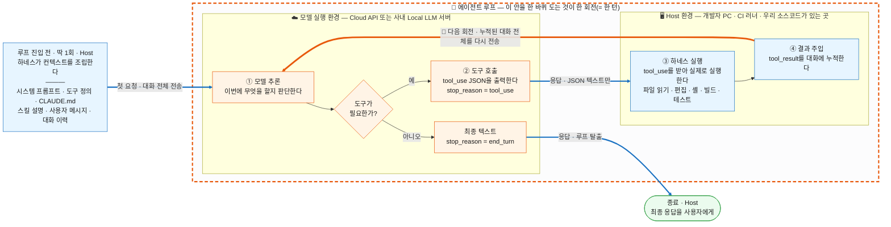
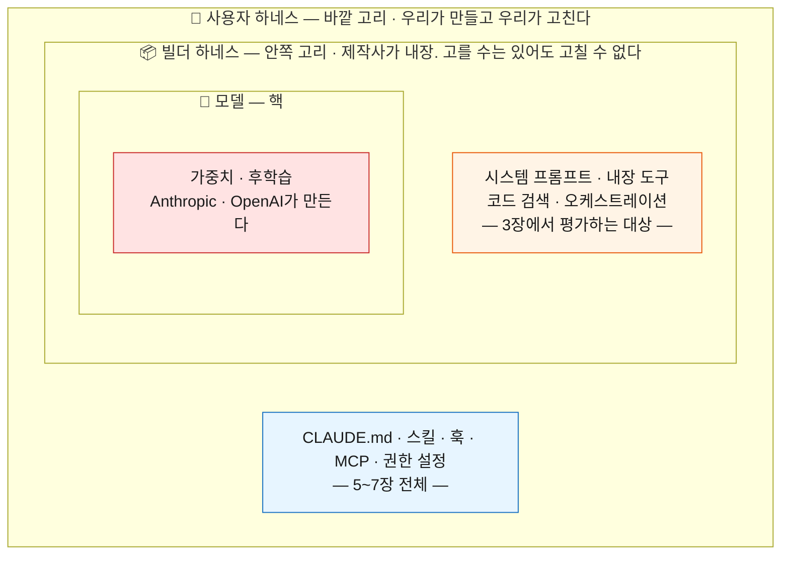

# Part 1. 코딩 에이전트 도구 ① 원리 (1~2장)

> 범위: 1~2장 · 예상 시간: 30분 · 기준 시점: 2026년 10월

> 목적: 에이전트 도구의 배경지식을 쌓아, 각자의 개발 환경에 맞게 도구를 고르고 셋업할 수 있게 한다.

---

## 1장. 코딩 에이전트는 어떻게 동작하는가

> 예상 시간: 15분

- **핵심 질문**: 에이전트가 "일한다"는 것은 실제로 무슨 일이 일어나는 것인가
- **도달 목표**: 에이전트 루프를 그릴 수 있고, 결과가 나쁠 때 원인이 모델인지 컨텍스트인지 구분한다

0장에서 자동완성, 채팅, 에이전트의 세 세대를 구분했다. 에이전트는 사람이 맡긴 일을 여러 단계에 걸쳐 스스로 처리한다. 이 장은 그 안을 연다. 에이전트가 파일을 읽고, 고치고, 빌드를 돌리는 동안 실제로 무엇이 오가는지 본다.

내부를 알면 결과가 나쁠 때 "모델이 못해서"라고 넘기지 않게 된다. 모델이 무엇을 받지 못했는지부터 따질 수 있다. 이 장의 다섯 절은 모두 그 진단을 위한 준비다.

### 1.1 에이전트 루프

에이전트가 하는 일은 네 단계의 반복이다. **모델이 추론하고, 도구 호출을 출력하고, 하네스가 그것을 실행하고, 결과를 대화에 다시 넣는다.** 이 반복을 에이전트 루프라고 부르고, 한 바퀴를 한 회전(턴)이라고 한다. 하네스(harness)는 모델을 감싸는 프로그램이다. 컨텍스트를 조립하고 도구를 실행한다. Claude Code나 Codex CLI 같은 도구의 본체가 하네스이고, 정의는 2장에서 다듬는다.

그림을 보기 전에 두 가지를 구분해 둔다. 첫째, 코드베이스를 파악하는 일은 루프의 별도 단계가 아니다. 파일을 찾아 읽는 것과 파일을 고치는 것은 같은 도구 호출이고 목적만 다르다. 둘째, 코딩 에이전트는 **두 개의 환경**에 걸쳐 있다. 에이전트 프로세스와 우리 소스 코드가 있는 Host 환경, 그리고 모델 가중치가 있는 모델 실행 환경(클라우드 API 또는 사내 Local LLM 서버)이다. 뒤에 나올 비용과 보안 이야기는 모두 이 경계 위에 얹힌다.



그림은 다음 순서로 읽는다.

- **주황 점선 박스 안이 에이전트 루프다.** ① → ② → ③ → ④ → ①의 한 바퀴가 한 회전이고, 주황색 굵은 화살표가 바퀴를 닫는다. 이 화살표가 없으면 채팅과 같다.
- **진입 블록과 종료 블록은 루프 밖에 있다.** 컨텍스트 조립은 루프에 들어가기 전에 한 번 하고, 최종 응답은 루프를 빠져나온 뒤에 나온다. 루프 안에서 반복되는 것은 ①②③④뿐이다.
- **굵은 화살표는 환경 경계를 넘는 구간이다.** 한 회전마다 경계를 두 번 넘고, 그 위를 오가는 것은 JSON 텍스트뿐이다.

갈림길은 ①에 있다. 회전마다 모델이 정하는 것은 "도구를 더 부를 것인가, 여기서 끝낼 것인가"이다. 응답의 `stop_reason` 필드가 그 결정을 담는다. `tool_use`이면 ②로 내려가고, `end_turn`이면 그 자리에서 최종 응답이 된다.

이 그림에서 가져갈 것은 네 가지다.

1. **바퀴는 0번 돌 수도 있다.** "이 함수가 무슨 일을 하는지 설명해 줘"처럼 이미 컨텍스트에 있는 것만으로 답할 수 있는 요청은 ①에서 곧장 빠져나온다. 이때 에이전트는 채팅과 같은 모양으로 동작한다. 자동완성과 채팅에는 ②~④가 없다. 관찰과 반복이 있어야 에이전트다.
2. **바퀴의 절반은 모델이, 절반은 하네스가 돈다.** ①②는 모델 실행 환경에서 판단하고 출력하는 구간이고, ③④는 Host에서 실행하고 되돌려 넣는 구간이다.
3. **④가 회전마다 쌓인다.** 대화가 길어진다는 말의 실체가 이것이다. 1.3절의 압축과 4장의 비용 문제가 여기서 나온다.
4. **모델은 우리 파일 시스템에 손을 댈 수 없다.** 1.2절에서 따로 본다.

환경 경계에서는 세 가지를 짚는다.

| 사실 | 무슨 뜻인가 | 다시 나오는 곳 |
| --- | --- | --- |
| 모델은 Host에 접근하지 못한다 | 모델은 `cmake`를 실행한 적이 없다. "이 명령을 실행해 달라"는 JSON을 냈을 뿐이고, 실행한 것은 Host의 하네스다. 실행 권한과 실행 범위가 모두 Host 쪽에 있다 | 1.2절, 5.5절(Hook), 13.2절(경계선 긋기) |
| 회전마다 대화 전체가 경계를 다시 넘는다 | 모델은 요청 사이에 기억하지 않으므로 ④로 쌓인 것까지 전부 다시 보낸다. 요청 하나가 점점 비싸지고, 읽은 소스 코드가 반복해서 Host 밖으로 나간다 | 1.4절, 4장(비용), 3.5절(승인된 백엔드) |
| 경계의 위치는 바꿀 수 있지만 구조는 그대로다 | 모델 실행 환경을 사내 Local LLM 서버로 바꾸면 경계가 사내망 안으로 들어온다. 반출 문제는 줄지만 ①~④의 구조와 매번 전부 다시 보내는 성질은 같다 | 3.5절, 부록 A(백엔드 연결) |

도구 호출은 목적으로 보면 탐색(`Read`, 검색), 편집(`Edit`, `Write`), 실행(`Bash`), 위임(`Agent`, 별도 컨텍스트의 서브에이전트에게 맡기기)의 네 가지다. 탐색은 부작용이 없고, 편집은 git으로 되돌릴 수 있고, 실행과 위임은 명령에 따라 다르다. 되돌릴 수 있는 정도가 다르다는 이 구분이 13.2절에서 어디까지 자동으로 두고 어디서 승인을 받을지 정하는 근거가 된다.

### 1.2 도구 호출의 실체

그림의 ②와 ④에서 실제로 오가는 것을 본다. 아래 두 덩어리는 설명용 의사 코드가 아니라 **Anthropic Messages API가 정한 콘텐츠 블록 형식 그대로**다. Claude를 쓰는 도구 호출은 Claude Code든 직접 짠 스크립트든 이 모양을 지난다. 다른 벤더의 API는 필드 이름이 다르지만(OpenAI 계열은 `tool_calls`, `function_call` 같은 이름을 쓴다) 구조는 같다.

먼저 모델이 출력하는 것이다. 어시스턴트 메시지의 `content` 배열에 `tool_use` 블록이 담기고, 응답의 `stop_reason`은 `tool_use`가 된다.

```json
{
  "type": "tool_use",
  "id": "toolu_01A09q90qw90lq917835lq9",
  "name": "Bash",
  "input": { "command": "cmake --build build 2>&1 | tail -30" }
}
```

| 필드 | 의미 |
| --- | --- |
| `id` | 이 호출의 식별자. 아래 결과 블록과 짝을 맞추는 데 쓴다 |
| `name` | 하네스가 요청에 실어 보낸 도구 정의 가운데 하나의 이름. 목록에 없는 이름은 하네스가 실행하지 않는다 |
| `input` | 그 도구 정의의 입력 스키마를 따르는 인자 |

모델이 하는 일은 여기서 끝난다. 이 시점에 빌드는 아직 돌지 않았다.

다음은 하네스가 되돌려 넣는 것이다. 하네스가 명령을 실제로 실행하고, 출력을 `tool_result` 블록에 담아 다음 사용자 메시지의 `content` 배열에 붙인다.

```json
{
  "type": "tool_result",
  "tool_use_id": "toolu_01A09q90qw90lq917835lq9",
  "content": "error: 'CAN_RX_BUF_SIZE' undeclared (first use in this function)"
}
```

`tool_use_id`가 앞 블록의 `id`와 같다. 1.1절 그림의 ②가 첫 블록이고, ③에서 실행한 결과를 ④에서 대화에 넣는 것이 둘째 블록이다. 모델이 본 것은 빌드 로그 전체가 아니라 이 블록에 담긴 텍스트뿐이라는 점도 봐 둔다. Claude API 문서는 이 왕복을 이렇게 적는다.

> "Claude responds with `stop_reason: "tool_use"` and one or more `tool_use` blocks. Your code executes the operation and sends back a `tool_result`."
> (Claude는 `stop_reason: "tool_use"`와 하나 이상의 `tool_use` 블록으로 응답한다. 그 동작을 실행하고 `tool_result`를 돌려보내는 것은 당신의 코드다.)
> 출처: [Claude API 문서, Tool use with Claude](https://platform.claude.com/docs/en/agents-and-tools/tool-use/overview), 2026-10 확인

코딩 에이전트에서는 문서가 말하는 "당신의 코드"가 하네스다. 결론은 한 문장이다. **모델은 JSON을 출력할 뿐이고 실행은 하네스가 한다.** 어떤 도구가 목록에 있는지, 실행해도 되는지, 어디까지 건드릴 수 있는지는 모두 하네스가 정한다.

> **질문**: 에이전트가 "빌드를 돌려 봤고 통과했다"고 답했다. 빌드를 돌린 것은 누구이고, 모델은 그 결과를 어떤 형태로 봤는가?

### 1.3 컨텍스트 윈도우

컨텍스트 윈도우는 모델이 한 번의 호출에서 볼 수 있는 텍스트 전체이고, 에이전트의 **작업 기억**이다. 시스템 프롬프트(도구 제작사가 써 둔 기본 지침), 도구 정의, 지침 파일(`AGENTS.md`나 `CLAUDE.md`처럼 프로젝트 규칙을 적어 두는 파일), 대화, 도구 결과가 모두 여기에 들어간다. 여기에 없는 것은 모델에게 없는 것이다. 임베디드 개발자에게는 RAM에 빗대면 빠르다. CPU가 아무리 좋아도 RAM에 올라오지 않은 데이터는 계산에 쓰이지 않는다.

크기는 유한하고, 토큰(모델이 텍스트를 세는 단위)으로 잰다. Claude Code 문서의 예시는 20만 토큰 윈도우를 기준으로 하고, 최신 모델은 100만 토큰 윈도우도 지원한다(출처: [Claude Code 문서, Explore the context window](https://code.claude.com/docs/en/context-window), 2026-10 확인). 컨텍스트는 누가 넣느냐에 따라 둘로 나뉜다.

| | 누가 넣는가 | 언제 | 예시 | 어디서 다루나 |
| --- | --- | --- | --- | --- |
| **주입 컨텍스트** | 하네스가 조립한다 | 요청을 시작할 때 자동으로 | 시스템 프롬프트, 지침 파일, 도구 정의, 스킬 설명 | 2.5절, 4장, 5장 |
| **수집 컨텍스트** | 모델이 도구로 가져온다 | 루프를 돌면서 | 읽은 파일, 검색 결과, 빌드 로그, 외부 시스템 조회 결과(MCP, 6.1절) | 6.3절(Subagent), 7.5절(세션 관리), 9장 |

둘은 원인도 해법도 다르다. 주입 컨텍스트의 문제는 쓰지 않아도 매번 실린다는 것이고, 4장의 비용 이야기로 이어진다. 수집 컨텍스트의 문제는 읽은 만큼만 알고 읽을수록 쌓인다는 것이고, 9장의 첫 번째 한계로 이어진다.

#### 압축 때 정보가 사라진다

컨텍스트가 차면 하네스가 압축(compaction)을 한다. Claude Code는 오래된 도구 출력부터 지우고, 그래도 모자라면 대화를 요약본으로 바꾼다. 문서에 따르면 이때 요청과 핵심 코드 조각은 보존되지만 **대화 초반에 준 세부 지시는 사라질 수 있다**(출처: [Claude Code 문서, How Claude Code works](https://code.claude.com/docs/en/how-claude-code-works), 2026-10 확인). 무엇이 남는지는 그것이 어떻게 들어왔는지에 달려 있다.

| 무엇 | 압축 뒤 |
| --- | --- |
| 시스템 프롬프트, 프로젝트 루트의 지침 파일 | 그대로 적용되거나 디스크에서 다시 주입된다 |
| 대화로만 준 지시, 오래된 도구 출력 | 요약본에 섞인다. 세부는 사라질 수 있다 |
| 읽거나 고친 파일 | 최근에 수정된 것부터 최대 5개만 다시 읽는다 |
| `paths` 조건부 룰, 하위 디렉터리의 지침 파일 | 요약되면서 빠지고, 해당 파일을 다시 다룰 때 다시 로드된다 |

(출처: [Claude Code 문서, What survives compaction](https://code.claude.com/docs/en/context-window#what-survives-compaction), 2026-10 확인. 다른 도구는 세부 동작이 다를 수 있다.)

긴 세션에서 에이전트가 초반 지시를 잊거나 이미 정한 것을 뒤집는다면 압축을 먼저 의심한다. 계속 지켜야 하는 규칙은 대화가 아니라 지침 파일에 둔다(5.2절).

#### 모델 탓인가, 컨텍스트 탓인가

결과가 나쁠 때는 모델을 탓하기 전에 세 가지를 먼저 묻는다.

1. **모델이 그 정보를 받았는가.** 프로젝트 규칙이 지침 파일에 있는가, 그 파일이 실제로 로드됐는가. (주입 컨텍스트)
2. **모델이 그 파일을 읽었는가.** 대화 기록에 해당 파일을 읽거나 검색한 도구 호출이 있는가. (수집 컨텍스트)
3. **받은 정보가 아직 남아 있는가.** 압축이 일어난 뒤인가, 세션이 얼마나 길어졌는가. (압축)

셋 다 "그렇다"인데도 틀렸다면 그때 모델 쪽 한계를 의심한다. 그 한계가 Part 2의 주제다.

### 1.4 매 호출마다 전부 다시 보낸다

모델은 요청 사이에 아무것도 기억하지 않는다. 그래서 하네스는 회전마다 **처음부터 지금까지의 전부**를 다시 보낸다. Claude Code 문서의 표현은 다음과 같다.

> "The model doesn't remember anything between requests, so Claude Code re-sends the full context: the system prompt, your project context, every prior message and tool result, and your new message."
> (모델은 요청 사이에 아무것도 기억하지 않는다. 그래서 Claude Code는 시스템 프롬프트, 프로젝트 컨텍스트, 앞선 모든 메시지와 도구 결과, 새 메시지까지 컨텍스트 전체를 다시 보낸다.)
> 출처: [Claude Code 문서, Prompt caching](https://code.claude.com/docs/en/prompt-caching), 2026-10 확인

도구를 40번 호출하는 작업이라면 API 호출도 40번 안팎이다(설명을 위한 가정이다). 각 호출이 싣고 가는 것을 그리면 다음과 같다.

```text
호출 1  : [시스템 프롬프트][도구 정의][지침] [요청]
호출 2  : [시스템 프롬프트][도구 정의][지침] [요청][응답 1][도구 결과 1]
호출 3  : [시스템 프롬프트][도구 정의][지침] [요청][응답 1][도구 결과 1][응답 2][도구 결과 2]
  ...
호출 40 : [시스템 프롬프트][도구 정의][지침] [ ......... 지금까지 전부 ......... ]
          └─────────── 고정 영역 ───────────┘ └─────────── 누적 영역 ───────────┘
```

| 영역 | 무엇이 들어 있나 | 호출마다 어떻게 되나 |
| --- | --- | --- |
| 고정 영역 | 시스템 프롬프트, 도구 정의, 지침 파일, 스킬 설명 (주입 컨텍스트) | 크기는 그대로인데 호출할 때마다 다시 실린다 |
| 누적 영역 | 대화, 모델의 응답, 도구 결과 (수집 컨텍스트) | 호출할 때마다 커진다 |

이 구조 하나에서 두 가지 문제가 함께 나온다.

- **비용.** 입력 토큰은 호출마다 다시 계산되고, 도구 정의도 입력 토큰에 포함된다(출처: [Claude API 문서, Tool use with Claude](https://platform.claude.com/docs/en/agents-and-tools/tool-use/overview)의 Pricing 항목, 2026-10 확인). 고정 영역은 쓰든 안 쓰든 **고정 영역 × 호출 수**만큼 청구 대상이 된다. 지침에 넣은 한 문단, 연결해 둔 MCP 서버 하나가 호출 수만큼 곱해진다는 뜻이다. 반복되는 앞부분은 prompt caching(같은 앞부분을 할인 단가로 계산하는 기능, 4.9절)으로 싸게 처리되지만 다시 보내는 구조는 바뀌지 않는다. 얼마나 차이가 나는지와 줄이는 방법은 4장에서 다룬다.
- **품질 저하.** 누적 영역은 스스로 줄지 않는다. 길어지면 압축으로 정보가 빠지고, 압축 전에도 컨텍스트가 찰수록 앞쪽 지시를 놓치거나 실수가 늘어난다(출처: [Claude Code 문서, Best practices](https://code.claude.com/docs/en/best-practices), 2026-10 확인). 긴 세션에서 품질이 떨어지는 현상의 정체이고, 9장에서 한계로 다시 다룬다.

이 절의 결론은 이것이다. 비용과 품질 저하는 서로 다른 문제가 아니다. **모델은 기억하지 않으므로 매번 전부 다시 보낸다**는 같은 뿌리에서 나온다. 그래서 컨텍스트를 가볍게 유지하는 조치는 대개 두 문제를 함께 줄인다.

### 1.5 컨텍스트 들여다보기 (시연)

1.3~1.4절의 설명을 화면으로 확인한다. Claude Code의 `/context` 명령은 지금 세션의 컨텍스트 윈도우를 무엇이 얼마나 차지하는지 범주별로 보여 준다. 문서가 밝힌 범주는 시스템 프롬프트, 시스템 도구, MCP 도구, 커스텀 서브에이전트, 지침 파일(화면에는 `Memory files`로 나온다), 스킬, 대화 메시지다(출처: [Claude Code 문서, Debug your configuration](https://code.claude.com/docs/en/debug-your-config), 2026-10 확인).

**시연 순서**

1. **준비물**: 백엔드에 연결된 Claude Code(연결 절차는 부록 A), 지침 파일이 있는 실습용 리포지토리, 연결된 MCP 서버 한두 개. 터미널 글자를 키워 둔다.
2. **새 세션에서 바로 실행한다.** 아무 요청도 하지 않고 `/context`를 입력한다. 항목별 내역이 접혀 보이면 `/context all`을 쓴다.
3. **짚어 줄 것 ①**: 아직 아무것도 시키지 않았는데 이미 차 있다. 이것이 1.4절의 고정 영역이다. `Messages` 행은 거의 0이다.
4. **파일 하나를 읽게 한다.** 입력 예: `src/can/can_rx.c를 읽고 수신 버퍼 구조를 세 줄로 요약해 줘`
5. **다시 `/context`를 실행한다.**
6. **짚어 줄 것 ②**: 위쪽 행은 거의 그대로이고 `Messages` 행만 늘었다. 방금 읽은 파일이 대화에 쌓였고, 다음 호출부터 매번 함께 실린다. 이것이 누적 영역이다.
7. **짚어 줄 것 ③**: 가장 큰 행이 무엇인지 청중에게 묻는다. tool search(도구 정의를 필요할 때만 싣는 기능, 4.8절)가 꺼진 환경에서 MCP 서버를 여러 개 연결했다면 `MCP tools`가 가장 큰 경우가 많다. 사내 환경은 기본값이 꺼짐이다. 이 행이 4장의 출발점이다.
8. **시연이 안 될 때**: 미리 찍어 둔 요청 전후 화면 두 장을 보여 주거나, 아래 예시 출력으로 설명한다.

아래는 화면의 구성을 설명하려고 만든 **예시이며 값은 환경마다 다르다.** 실제 측정값이 아니고, 행 이름과 순서도 버전에 따라 다를 수 있다.

```text
> /context
  Context Usage   118k / 1M tokens (12%)      아직 아무 요청도 하지 않은 상태

  System prompt      4.1k   0.4%
  System tools      17.3k   1.7%
  MCP tools         89.0k   8.9%
  Custom agents      1.2k   0.1%
  Memory files       2.4k   0.2%
  Skills             3.6k   0.4%
  Messages           0.1k   0.0%
  Free space         882k  88.2%
```

> **발표 전 확인**: 위 예시 출력은 문서에 나온 범주 이름으로 구성한 것이다. 발표 환경에서 `/context`를 실제로 실행해 행 이름과 순서를 대조하고, 가능하면 실제 화면으로 바꾼다.

각 행을 1.3~1.4절의 개념에 대응시키면 다음과 같다.

| `/context`의 행 | 무엇인가 | 영역 | 누가 줄일 수 있나 |
| --- | --- | --- | --- |
| System prompt | 제작사가 쓴 기본 지침 | 고정 | 사용자는 줄일 수 없다 (2장) |
| System tools | `Read`, `Edit`, `Bash` 같은 내장 도구의 정의 | 고정 | 거의 줄일 수 없다 |
| MCP tools | 연결한 MCP 서버의 도구 정의 | 고정 | 서버 연결과 tool search 설정 (4장) |
| Custom agents | 서브에이전트 정의의 이름과 설명 | 고정 | 정의 개수 (6.3절) |
| Memory files | 지침 파일과 자동 메모리 | 고정 | 직접 쓴 분량 (5.2절) |
| Skills | 스킬의 이름과 설명 | 고정 | 스킬 개수와 설명 길이 (5.4절) |
| Messages | 대화, 도구 호출과 그 결과 | 누적 | 세션을 목적 단위로 끊는다 (7.5절) |

이 화면은 두 가지로 다시 쓰인다. 첫째, 1.3절의 세 질문 중 첫째와 셋째를 확인하는 도구다. 세션 시작 때 로드돼야 할 지침 파일이 `Memory files`에 없으면 모델은 그 규칙을 받은 적이 없다. 하위 디렉터리의 지침 파일은 필요할 때 로드되므로 이 목록에 나오지 않는다. 둘째, 4장 비용 이야기의 출발점이다. `Messages`를 뺀 나머지 행의 합이 매 호출에 실리는 고정 비용이고, 4장은 그중 내가 줄일 수 있는 행부터 손댄다.

> **발표자 노트**: 각자 자기 프로젝트에서 `/context`를 실행하고 가장 큰 행을 적어 오게 하면 4장 도입이 쉬워진다. GitHub Copilot CLI에도 같은 이름의 `/context` 명령이 있다(출처: [GitHub Docs, GitHub Copilot CLI command reference](https://docs.github.com/en/copilot/reference/copilot-cli-reference/cli-command-reference), 2026-10 확인). 4.8절 시연(tool search 켜기 전후 비교)과 이어지도록, 여기서는 tool search를 켜지 않은 상태로 보여 주는 편이 흐름이 자연스럽다. Claude Code v2.1.280 이전 버전은 직접 읽은 `AGENTS.md`를 `/context`에 표시하지 않으므로, 시연 전에 버전을 확인한다(출처: [Claude Code 문서, Memory](https://code.claude.com/docs/en/memory), 2026-10 확인).

### 핵심 정리

- 에이전트 루프는 모델 추론, 도구 호출, 하네스 실행, 결과 주입의 반복이고, 모델은 JSON을 출력할 뿐 실행은 Host의 하네스가 한다.
- 컨텍스트 윈도우에 있는 것이 모델이 아는 전부이므로, 결과가 나쁘면 받았는가, 읽었는가, 남아 있는가를 먼저 확인한다.
- 모델은 기억하지 않아 매 호출마다 전부 다시 보내며, 이것이 비용(4장)과 품질 저하(9장)의 공통 뿌리다.

**다음 장으로**: 모델이 실행하지 않는다면, 결과의 차이는 어디서 생기는가

---

## 2장. 하네스: 같은 모델, 다른 결과

> 예상 시간: 15분

- **핵심 질문**: 모델이 같은데 왜 도구마다 결과가 다른가
- **도달 목표**: 빌더 하네스와 사용자 하네스를 구분하고, 내가 손댈 수 있는 범위를 안다

1장은 "모델이 실행하지 않는다면, 결과의 차이는 어디서 생기는가"로 끝났다. 답은 하네스다. 무엇을 컨텍스트에 넣을지, 어떤 도구를 줄지, 실행해도 되는지를 하네스가 정한다. 그래서 같은 모델을 백엔드로 붙여도 도구가 다르면 얼마나 깊이 탐색하는지, 어디서 멈추는지, 결과를 검증하는지가 달라진다.

이 장은 하네스를 두 겹으로 나눈다. 제작사가 만든 겹과 우리가 만드는 겹이다. 앞의 것은 고르는 대상이고(3장), 뒤의 것은 만드는 대상이다(5~7장). 이 구분이 Part 1 나머지 장의 지도다.

### 2.1 Agent = Model + Harness

출발점은 식 하나다. `Agent = Model + Harness`. LangChain 블로그의 글 "The anatomy of an agent harness"가 쓴 식이고, 에이전트에서 **모델을 뺀 전부**를 하네스라고 부른다는 뜻이다. 모델은 원재료이고, 하네스는 그것을 믿을 수 있는 결과물로 바꾸는 환경 전체다.

그런데 그 "전부" 안에서 누가 만들고 누가 고칠 수 있는지가 갈린다. Birgitta Böckeler는 이를 세 개의 고리로 그린다(출처: [Böckeler, Harness engineering for coding agent users](https://martinfowler.com/articles/harness-engineering.html), 2026-04-02).



하네스는 핵을 뺀 두 고리 전부다. 고리마다 만드는 사람과 고칠 수 있는 사람이 다르다.

| 고리 | 무엇인가 | 누가 만드는가 | 우리가 고칠 수 있는가 |
| --- | --- | --- | --- |
| 모델 (핵) | 가중치와 후학습 | 모델 제작사 | 없다. 고를 수만 있다 |
| **빌더 하네스** | 제품에 내장된 것. 시스템 프롬프트, 내장 도구, 코드 검색, 오케스트레이션 | 도구 제작사 | 거의 없다. 설정으로 일부만 바꾼다 |
| **사용자 하네스** | 우리 팀이 우리 코드베이스에 맞춰 바깥에 덧대는 것. 지침 파일, 스킬, 훅, MCP, 권한 설정 (5~7장) | 우리 | 전부 |

세 고리는 1.5절의 `/context` 화면에서도 보인다. `System prompt`와 `System tools` 행은 빌더 하네스가 넣은 것이고, `MCP tools`, `Memory files`, `Skills`, `Custom agents` 행은 사용자 하네스가 넣은 것이다. 앞의 두 행은 내가 줄일 수 없었고 나머지는 줄일 수 있었던 이유가 여기에 있다.

이 세미나에서 "하네스를 만든다"고 할 때는 언제나 **사용자 하네스**를 뜻한다. 빌더 하네스는 만드는 대상이 아니라 도구를 고를 때 평가하는 대상이다. 다만 오픈소스 도구는 빌더 하네스까지 열어 보고 고칠 수 있다. 이 차이가 3.2절에서 "손댈 수 있는 표면의 넓이"라는 선택 축이 된다.

### 2.2 최적화 대상의 이동

2022년부터 2026년까지 AI로 일하는 방법에는 이름이 네 번 붙었다. 이름만 바뀐 것이 아니다. **사람이 다듬는 대상이 모델에서 바깥으로 한 겹씩 옮겨 갔다.** 새 이름이 필요했던 이유는 매번 같다. 앞 단계의 수단으로는 풀리지 않는 실패가 나타났기 때문이다.

| 시점 | 이름 | 최적화 대상 | 대표 질문 | 왜 그 이름이 필요해졌나 |
| --- | --- | --- | --- | --- |
| 2022~2024년 | 프롬프트 엔지니어링 | 표현 | 어떻게 말해야 잘 알아듣나 | 모델을 채팅으로만 썼다. 사람이 조절할 수 있는 것이 말뿐이었다 |
| 2025년 6월~ | 컨텍스트 엔지니어링 | 정보 | 무엇을 보여 줘야 하나 | 컨텍스트 윈도우가 커지고 검색 결과와 도구 출력이 들어왔다. 표현보다 무엇을 넣느냐가 결과를 갈랐다 |
| 2026년 상반기 | **하네스 엔지니어링** | 환경 | 어떤 환경에서 일하게 할 것인가 | 에이전트가 스스로 도구를 쓰며 여러 단계로 일하기 시작했다. 정보를 갖춰 줘도 무엇을 해도 되는지, 결과가 맞는지는 답이 없었다 |
| 2026년 6월~ | 루프 엔지니어링 | 주기 | 무엇이 언제 돌리고 언제 멈추는가 | 에이전트를 사람 없이 반복 실행하는 사용이 나타났다 |

컨텍스트 엔지니어링이라는 이름은 2025년 6월 Tobi Lütke와 Andrej Karpathy의 글로 퍼졌고, Anthropic이 2025년 9월 글 "[Effective context engineering for AI agents](https://www.anthropic.com/engineering/effective-context-engineering-for-ai-agents)"로 정리했다. 하네스 엔지니어링은 2026년 상반기에 쓰이기 시작한 이름이고, 이 장은 그중 Böckeler의 정리(2026-04-02)를 따른다.

이 표에서 가져갈 성질은 하나다. **새 층은 앞 층을 지우지 않는다.** 지금도 프롬프트를 쓰고, 컨텍스트를 고르고, 하네스를 만든다. 임베디드 개발자에게 익숙한 말로 옮기면 모델은 CPU, 컨텍스트는 RAM, 하네스는 운영체제, 루프는 스케줄러다. 운영체제가 생겼다고 RAM이 없어지지 않는다. 이 세미나의 무게 중심은 셋째 줄이다. 층들이 서로를 포함하는지 나란히 서 있는지에 대한 논쟁은 부록 C로 보낸다.

넷째 줄의 루프는 이 세미나에서 목표가 아니라 **지평선**이다. Addy Osmani가 2026년 6월 7일자 글 "[Loop Engineering](https://addyosmani.com/blog/loop-engineering/)"에서 이름과 구성 요소를 정리했고, 그 글에 실린 Peter Steinberger의 말이 전환을 한 줄로 요약한다. "You shouldn't be prompting coding agents anymore. You should be designing loops that prompt your agents."(코딩 에이전트에 직접 프롬프트를 넣지 말고, 에이전트에 프롬프트를 넣는 루프를 설계하라.) Osmani는 루프 엔지니어링을 하네스보다 한 층 위에 두면서도, 아직 이르다며 스스로 회의적이라고 밝히고 토큰 비용을 경고한다. 검증 장치가 없는 루프는 틀린 답을 더 빨리 만들 뿐이므로 순서는 하네스가 먼저다. 무인 반복 실행의 구성은 부록 C에서 다루고, 그때 사람의 자리가 어디로 옮겨 가는지는 8.2절에서 본다.

> **발표자 노트**: 두 인용문은 모두 Osmani의 2026-06-07자 글에 실린 것이다. 하나는 본문의 Steinberger 발언이고, 다른 하나는 Claude Code를 총괄하는 Boris Cherny의 "I don't prompt Claude anymore. I have loops running that prompt Claude and figuring out what to do. My job is to write loops"(나는 이제 Claude에 프롬프트를 넣지 않는다. Claude에 프롬프트를 넣고 무엇을 할지 정하는 루프를 돌린다. 내 일은 루프를 쓰는 것이다)이다. 글은 Steinberger의 발언 시점을 "recently"라고만 적는다. "누가 먼저 문제를 제기하고 다음 날 누가 이름을 붙였다"는 식의 선후 관계로 설명하지 않는다.

### 2.3 Guides와 Sensors

하네스 안에 무엇을 넣어야 하는지는 Böckeler의 구분이 쓰기 쉽다. 하네스의 장치는 두 종류다. 행동 전 가이드(feedforward)와 행동 후 센서(feedback)다.

| | 원문의 정의 | 풀이 |
| --- | --- | --- |
| 가이드(Guides) | "anticipate the agent's behaviour and aim to steer it before it acts" | 에이전트의 행동을 예상하고, 행동하기 전에 방향을 잡아 준다. 첫 시도에 맞을 확률을 올린다 |
| 센서(Sensors) | "observe after the agent acts and help it self-correct" | 행동한 뒤에 관찰해 스스로 고치게 한다. 고치는 방법까지 담긴 린터 메시지처럼 에이전트가 읽고 바로 쓸 수 있는 신호일수록 효과가 크다 |

여기에 실행 방식의 축이 하나 더 붙는다. **계산적**(computational) 장치는 결정적이고 빠르다. 테스트, 린터, 타입 체커처럼 CPU가 돌리고 같은 입력에 같은 결과를 낸다. **추론적**(inferential) 장치는 모델이 해석한다. 지침을 읽고 따르는 것, AI 코드 리뷰, LLM을 심사자로 쓰는 것이 여기에 든다. 두 축을 겹치면 네 칸이 나온다. 아래 표는 우리 환경의 예로 채운 것이다.

| | **계산적** (결정적이고 빠르다) | **추론적** (모델이 해석한다) |
| --- | --- | --- |
| **가이드**<br>(행동 전) | 프로젝트 스캐폴드, 타입 시스템, 코드 생성 템플릿 | 지침 파일, Skill |
| **센서**<br>(행동 후) | 컴파일, 단위 테스트, 린터, 정적 분석, MISRA(차량용 C 코딩 규칙) 체커 | 리뷰 서브에이전트, LLM 심사(LLM-as-judge) |

이 표에서 짚을 것은 세 가지다.

- **지침 파일과 Skill은 네 칸 중 한 칸에만 들어간다.** 지침과 스킬을 잘 써 두고 멈추면 나머지 세 칸이 비어 있다. 특히 자주 빠지는 것이 컴파일, 린트, 테스트를 에이전트의 루프 안에서 실제로 돌리는 일이다.
- **한쪽만 있으면 실패한다.** 센서만 있으면 같은 실수를 하고 매번 고치기를 되풀이한다. 가이드만 있으면 규칙은 아는데 지켜졌는지 아무도 모른다.
- **추론적 장치는 모델이 따라 주기를 기대하는 것이고, 계산적 장치는 모델의 해석을 거치지 않고 실행된다.** 지침에 "테스트를 돌려라"라고 쓰는 것과 훅으로 매번 실행시키는 것은 신뢰도가 다르다(5.5절).

> **질문**: 지금 우리 리포지토리로 네 칸을 채워 보면 비어 있는 칸은 어디인가?

Part 1의 부품을 이 표에 놓으면 지침(5.2절)과 Skill(5.4절)은 추론적 가이드다. Hook(5.5절)은 계산적 센서를 루프 안에서 돌리는 자리이고, 리뷰용 Subagent(6.3절)는 추론적 센서다. 센서는 Part 2에서 다시 중요해진다. 모델이 채점되는 것만 잘한다는 한계(11장)와, 사람 앞에 자동 체크와 자동 리뷰를 세우는 3겹 구조(14장)가 모두 이 칸들 위에 서 있다.

### 2.4 제1원칙

하네스를 어떻게 키워 갈지는 원칙 하나로 정리된다. **에이전트가 실수하면, 같은 실수를 다시 할 수 없게 만드는 장치를 만든다.** Böckeler의 표현으로는 "Whenever an issue happens multiple times, the feedforward and feedback controls should be improved."(같은 문제가 여러 번 일어나면 가이드와 센서를 고쳐야 한다.)이다.

같은 지적을 두 번 하고 있다면 그것은 에이전트의 문제가 아니라 하네스가 비어 있다는 신호다. 채팅 창에 다시 설명하는 대신 지침, 훅, 테스트로 내린다. 같은 글은 사람의 일을 이렇게 요약한다. "The human's job in this is to steer the agent by iterating on the harness."(사람의 일은 하네스를 거듭 고쳐 에이전트를 조종하는 것이다.)

#### 사고 실험: `printf` 금지

타깃 보드의 ISR(인터럽트 서비스 루틴) 안에서는 `printf`를 쓰면 안 된다고 하자. 재진입이 보장되지 않고, 출력이 끝날 때까지 인터럽트 처리를 붙잡기 때문이다. 그런데 에이전트가 디버깅을 하다가 이렇게 썼다(함수 이름은 예시다).

```c
void CAN_RxIsr(void)
{
    uint32_t id = CAN_ReadRxId();
    printf("rx id=0x%lx\n", (unsigned long)id);   /* 금지: ISR 안의 블로킹 출력 */
    CanRxBuf_Push(id);
}
```

다시는 못 하게 하는 방법을 만드는 비용이 싼 순서로 늘어놓으면 다섯 가지다.

| # | 방법 | 2.3절 표의 어느 칸인가 | 만드는 비용 | 다시 일어날 가능성 |
| --- | --- | --- | --- | --- |
| 1 | 채팅에서 지적한다 | 하네스가 아니다 | 없다 | 다음 세션에서 그대로 반복된다 |
| 2 | 지침 파일에 적는다 | 추론적 가이드 | 한 줄 | 줄어든다. 세션이나 지침이 길어지면 놓칠 수 있다 |
| 3 | Skill의 체크리스트에 넣는다 | 추론적 (작성 전에 읽으면 가이드, 리뷰 때 쓰면 센서) | 스킬 하나 | 스킬이 호출될 때만 걸린다 |
| 4 | 린터 규칙으로 만든다 | 계산적 센서 | 규칙 작성과 빌드 연결 | 린터가 돌면 반드시 잡힌다. 돌리지 않으면 소용없다 |
| 5 | Hook으로 편집 직후에 검사하거나 그 편집을 막는다 | 계산적 센서 (Hook이 매번 실행한다) | 스크립트와 설정 | 0에 가깝다 |

아래로 갈수록 만드는 비용은 크고 재발 가능성은 0에 가까워진다. 하네스 엔지니어링의 판단은 늘 이 축 위에 있다. 한 번 나온 실수를 모두 5번까지 내릴 필요는 없다. 다시 나오면 한 칸 내리고, 되돌릴 수 없는 피해를 내는 실수는 처음부터 아래 칸에 둔다.

> **질문**: 최근 한 달 동안 에이전트에게 같은 지적을 두 번 이상 한 것이 있는가. 그것은 지금 다섯 줄 중 어디에 있는가?

이 원칙은 Part 2에서 "사람이 한 번 내린 판단을 검증 가능한 제약으로 내린다"는 형태로 다시 나온다(13.4절). 우리 환경에서 어떤 센서가 가장 싼지, 곧 느린 타깃 빌드 대신 무엇부터 돌릴지는 14.3절에서 다룬다.

### 2.5 모델이 바뀌면 하네스도 바뀐다

하네스는 한 번 만들면 끝나는 것이 아니다. 특정 모델의 약점을 메우려고 넣은 장치는 모델이 바뀌면 짐이 될 수 있다. 가장 분명한 사례가 빌더 하네스 쪽에서 나왔다. Anthropic은 2026년 7월 24일 글에서 이렇게 밝혔다.

> "We removed over 80% of Claude Code's system prompt for models like Claude Opus 5 and Claude Fable 5 with no measurable loss on our coding evaluations."
> (Claude Opus 5, Claude Fable 5 같은 모델을 대상으로 Claude Code 시스템 프롬프트의 80% 이상을 지웠고, 자사 코딩 평가에서 측정 가능한 손실이 없었다.)
> 출처: [Anthropic, The new rules of context engineering for Claude 5 generation models](https://claude.com/blog/the-new-rules-of-context-engineering-for-claude-5-generation-models), 2026-07-24

지운 이유는 **과잉 제약**(overconstraining)이다. Anthropic이 자사의 Claude Code 사용 기록을 읽어 보니, 한 요청 안에 "적절히 문서를 남겨라"와 "주석을 달지 마라" 같은 서로 부딪치는 지시가 함께 도착하고 있었다. 시스템 프롬프트, 스킬, 사용자 요청이 서로 충돌한 것이다. 모델은 대개 사용자의 의도를 읽어 맞는 답에 도달하지만, 겹치고 부딪치는 지시를 정리하느라 더 신중히 생각해야 한다. 그 추가 사고가 토큰이고 지연이다. 초기 모델에는 최악의 경우를 막을 촘촘한 규칙과 반복 강조가 필요했다. 최신 모델에서는 같은 장치가 판단을 방해하는 제약이 된다.

글은 달라진 점을 여섯 가지 전환으로 정리한다.

| # | 예전 | 지금 |
| --- | --- | --- |
| 1 | 규칙을 준다 | 판단에 맡긴다 |
| 2 | 예시를 준다 | 인터페이스(도구 파라미터와 스키마)를 설계한다 |
| 3 | 전부 앞에 싣는다 | 필요할 때만 싣는다 (progressive disclosure) |
| 4 | 반복해서 강조한다 | 사용법은 도구 설명에만 간단히 둔다 |
| 5 | 지침 파일에 손으로 메모한다 | 모델이 스스로 저장한다 (auto-memory) |
| 6 | 글로 쓴 간단한 스펙을 준다 | 테스트, 코드, 목업 같은 풍부한 참조물을 준다 |

이 사례에서 가져갈 것은 세 가지다.

- **같은 원리가 사용자 하네스에도 적용된다.** 80% 삭제는 빌더 하네스의 일이다. 그러나 글은 과잉 제약이 시스템 프롬프트뿐 아니라 `CLAUDE.md`와 스킬에도 있었다고 적는다. 규칙을 나열하고 강조를 반복하는 대신 판단 기준과 프로젝트 고유의 함정을 적는 방법은 5.2절에서 다시 다룬다.
- **"무조건 짧게"가 아니다.** 모델이 스스로 알 수 있는 것을 빼고, 모델이 알 수 없는 것(제품 맥락, 코드베이스의 함정, 팀 고유의 방식)을 남긴다는 뜻이다.
- **수치를 옮겨 쓰지 않는다.** 80%는 Claude 5 세대 모델과 Claude Code라는 특정 하네스에서, Anthropic의 내부 평가로 잰 결과다. 다른 모델이나 다른 도구에 그대로 적용되는 수치가 아니다.

그래서 도구를 고를 때는 모델만 보지 않는다. 그 도구의 하네스가 **어느 세대 모델에 맞춰 만들어졌는지**를 함께 본다. 구세대 모델에 맞춰 규칙과 예시를 두껍게 쌓은 하네스는 최신 모델에서 토큰과 사고 시간을 더 쓴다. 이것이 3.2절의 "모델 세대"와 "하네스의 두께" 축이다.

### 핵심 정리

- 하네스는 모델을 뺀 전부이고, 제작사가 만든 빌더 하네스는 고르는 대상, 우리가 덧대는 사용자 하네스는 만들고 고치는 대상이다.
- 하네스는 가이드와 센서, 계산적과 추론적의 네 칸으로 채우고, 같은 실수가 반복되면 더 강한 칸으로 내린다.
- 하네스는 모델에 맞춰 만든 것이므로, 모델이 바뀌면 과잉 제약이 된 부분을 덜어 낸다.

**다음 장으로**: 그렇다면 어떤 하네스(도구)를 골라야 하는가
