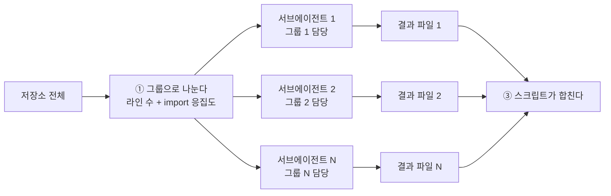
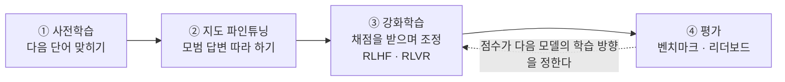

# Part 2. HITL이 필요한 이유 ① 네 가지 한계 (8~12장)

> 목적: AI의 한계를 이해해 사람의 개입이 필요한 지점을 파악하고, AI 기반 워크플로를 보완하는 능력과 개발자로서의 역량 방향을 잡는다.

---

## 8장. Human in the Loop란

- **핵심 질문**: 사람이 개입한다는 것은 정확히 언제, 무엇을 한다는 뜻인가
- **도달 목표**: 네 개의 개입 지점을 구분하고, Part 2에서 다룰 네 가지 한계를 미리 안다

Part 1은 질문 하나로 끝났다. 환경을 다 갖추면 전부 맡겨도 되는가(7.7절). Part 2의 답은 "아니다"이다. 다만 근거 없이 "그래도 사람이 봐야 한다"고 말하지 않는다. 에이전트의 한계 네 가지를 하나씩 확인하고, 그 한계가 사람을 어디에 세우는지, 어디에서는 사람이 빠져도 되는지를 가린다. 이 장은 그 준비다. "사람이 개입한다"는 말을 네 개의 지점으로 나누고, 뒤따르는 네 장의 지도를 미리 편다.

### 8.1 정의와 네 개의 개입 지점

HITL(Human in the Loop)은 자동화된 작업 흐름의 정해진 지점에 사람의 확인과 결정을 넣는 것이다. 회사의 결재선과 비슷하다. 모든 문서를 결재권자가 직접 쓰지는 않지만, 정해진 지점에서는 사람이 읽고 서명한다.

개입이라고 하면 위험한 명령을 승인하는 장면이나 PR(Pull Request)을 리뷰하는 장면부터 떠올리기 쉽다. 이 세미나는 개입 지점을 넷으로 나눈다. 작업이 흘러가는 순서대로 **요청 → 계획 → 실행 → 검증**이다.

| 개입 지점 | 사람이 주는 것 | 사람이 답하는 질문 | 구현되는 자리 |
| --- | --- | --- | --- |
| 요청 | 의도와 제약 | 무엇을, 어떤 조건에서 만들 것인가 | 요청문, 지침 파일(5.2절), 인터뷰와 스펙(12.5절) |
| 계획 | 접근 승인 | 이 방법으로 진행해도 되는가 | Plan mode(7.5절), 설계안 선택 |
| 실행 | 위험 행동 허가 | 이 도구 호출을 실행해도 되는가 | 권한 모드와 권한 규칙(7.5절), Hook(5.5절) |
| 검증 | 품질 판정 | 이 결과를 받아들여도 되는가 | 빌드·테스트 결과 확인, 코드 리뷰(14장) |

가운데 두 지점은 Part 1에서 이미 봤다. **7.5절의 Plan mode가 계획 지점의 구현이고, 권한 모드가 실행 지점의 구현이다.** Plan mode에서 에이전트는 코드를 조사하고 계획을 내놓되, 사람이 승인하기 전에는 소스를 고치지 않는다. 권한 모드는 에이전트가 무엇을 사람에게 묻지 않고 실행해도 되는지를 정한다(출처: [Claude Code 문서, Choose a permission mode](https://code.claude.com/docs/en/permission-modes), 2026-10 확인). 두 지점은 도구가 기능으로 제공한다.

양 끝은 사정이 다르다. 요청과 검증에는 도구가 사람 대신 챙겨 주는 장치가 기본으로 없다. 요청을 구체화하는 절차(12.5절)와 결과를 판정하는 절차(14장)는 사람이 직접 만들어야 한다. Part 2에서 가장 자주 나오는 지점이 이 양 끝이다.

### 8.2 사람의 위치가 바뀐다

자동화가 커지면 사람이 개입하는 **단위**가 커진다. 0.1절의 세 세대에 무인 반복 실행을 한 줄 더하면 다음과 같다.

| 쓰는 방식 | 사람이 개입하는 단위 | 사람이 주로 하는 일 |
| --- | --- | --- |
| 자동완성 | 줄마다 | 제안을 받아들일지 고른다 |
| 채팅 | 답변마다 | 묻고, 복사해 붙이고, 직접 실행해 본다 |
| 에이전트 (대화형 세션) | 작업마다 | 요청하고, 계획을 승인하고, 결과를 검토한다 |
| 무인 반복 실행 (루프, 2.2절) | 시스템마다 | 종료 조건과 검증 장치를 설계하고, 나온 결과를 리뷰한다 |

표를 아래로 내려갈수록 사람이 손대는 횟수는 줄어든다. 그러나 비는 칸은 없다. 한 번의 개입이 책임지는 범위가 커질 뿐이다. 잘못 받아들인 자동완성 제안은 한 줄을 망치고, 잘못 승인한 계획은 파일 수십 개를 망친다.

마지막 줄의 루프는 사람이 매번 프롬프트를 넣는 자리를 시스템으로 바꾸려는 방식이다. 그 이름을 정리한 Addy Osmani도 같은 글에서 이렇게 못 박는다.

> "The loop changes the work, it does not delete you from it."
> (루프는 일을 바꿀 뿐, 그 일에서 사람을 지우지 않는다.)
>
> "Verification is still on you. A loop running unattended is also a loop making mistakes unattended."
> (검증은 여전히 사람 몫이다. 사람 없이 도는 루프는 사람 없이 실수하는 루프이기도 하다.)
> 출처: [Addy Osmani, Loop Engineering](https://addyosmani.com/blog/loop-engineering/), 2026-06-07

그는 "완료"가 증명이 아니라 주장이라는 점도 함께 적는다(같은 글이 든 나머지 두 문제는 15.3절에서 다룬다). 이 절의 결론은 한 문장이다. 자동화는 사람을 빼지 않고 **옮긴다.** 매 턴 타이핑하던 자리에서, 앞쪽의 설계(요청·계획)와 뒤쪽의 검토(검증)로 옮겨 간다.

### 8.3 Part 2 지도

그 자리에 왜 사람이 있어야 하는가. Part 2는 근거를 에이전트의 **네 가지 한계**에서 찾는다. 아래 표는 한계마다 사람을 가장 강하게 요구하는 지점(◎)만 표시한 예고편이다.

| 한계 | 한 줄로 말하면 | 요청 | 계획 | 실행 | 검증 |
| --- | --- | --- | --- | --- | --- |
| ① 전부 볼 수 없다 (9장) | 코드베이스가 컨텍스트보다 커서, 검색으로 일부만 보고 판단한다 | ◎ | ◎ | | |
| ② 모르면 지어낸다 (10장) | 모른다고 하는 대신 그럴듯한 답을 만든다 | ◎ | | | ◎ |
| ③ 채점되는 것만 잘한다 (11장) | 자동으로 채점되는 일은 잘하고, 정답이 없는 일에는 흔한 답을 낸다 | ◎ | ◎ | | ◎ |
| ④ 묻지 않고 빈칸을 채운다 (12장) | 요청에서 빠진 것을 묻지 않고 가정으로 채운다 | ◎ | ◎ | | |

지도에서 미리 읽어 둘 것은 세 가지다.

- **요청 열은 네 줄이 모두 ◎다.** 사람이 주지 않으면 에이전트가 어디에서도 얻을 수 없는 정보가 여기로 들어간다.
- **실행 열에는 ◎가 없다.** 실행 중에 받는 승인은 주로 한계 밖의 이유, 곧 되돌릴 수 없는 행동과 책임과 보안에서 나온다(13.2~13.3절).
- **①과 ③은 Part 1의 개념에서 출발한다.** 컨텍스트 윈도우(1.3절)가 ①의 뿌리이고, 검증 장치인 센서(2.3절)가 ③의 뿌리다. ①~③은 모델 쪽 한계이고, ④는 사람의 요청에서 시작한다.

보조 지점(○)까지 담은 전체 표와 풀이는 13.1절에서 다룬다. 지금은 "한계마다 사람이 서는 자리가 다르다"는 것만 가져가면 된다. 이어지는 네 장은 같은 순서로 진행한다. 무슨 일이 일어나는가, 왜 그런가, 다음 모델이 나오면 해결되는가, 사람이 개입할 지점, 실무 대응이다. 셋째 질문을 매번 묻는 까닭은 "다음 모델이 나오면 해결된다"가 가장 자주 듣는 반론이기 때문이다.

### 핵심 정리

- HITL은 요청 → 계획 → 실행 → 검증의 네 지점에 사람의 판단을 넣는 것이고, 계획과 실행은 7.5절의 Plan mode와 권한 모드가 구현한다.
- 자동화가 커질수록 사람은 매 턴의 타이핑에서 설계와 검토로 옮겨 갈 뿐, 없어지지 않는다.
- Part 2는 네 가지 한계를 근거로 사람의 자리를 찾으며, 네 한계는 모두 요청 지점에서 사람을 요구한다.

**다음 장으로**: 첫 번째 한계는 Part 1에서 이미 본 컨텍스트 윈도우에서 나온다

---

## 9장. 한계 ①: 전부 볼 수 없다

> 예상 시간: 10분

- **핵심 질문**: 에이전트는 왜 멀쩡해 보이는 수정으로 다른 곳을 깨뜨리는가
- **도달 목표**: 검색에 걸리지 않는 연결의 유형을 알고, 에이전트에게 미리 알려줄 것을 고른다

1.3절에서 컨텍스트 윈도우를 에이전트의 작업 기억이라고 했다. 거기에 없는 것은 모델에게 없는 것이다. 첫 번째 한계는 이 문장에서 그대로 나온다. 코드베이스는 컨텍스트보다 크다. 그래서 에이전트는 전체가 아니라 찾아 읽은 일부만 보고 판단한다.

### 9.1 무슨 일이 일어나는가

요청은 단순하다. "`on_door_open` 함수에 로그를 추가하고 인자 검증을 넣어 줘." 에이전트는 사람이 처음 보는 코드를 다룰 때와 같은 순서로 일한다. 이름으로 검색하고, 걸린 파일 몇 개를 읽고, 읽은 범위 안에서 영향을 판단하고, 고친다.

```c
/* handlers.c: 에이전트가 고치려는 함수 */
void on_door_open(const event_t *ev)
{
    /* ... */
}

/* event_table.c: 함수 포인터로 등록한다. dispatch_event()가 이 표에서 핸들러를 찾아 부른다 */
static const handler_entry_t k_handlers[] = {
    { EVT_DOOR_OPEN, on_door_open },
};

/* door_isr.c: 인터럽트 문맥에서 이벤트 번호로 호출한다 */
void door_irq_handler(void)
{
    const event_t ev = read_door_event();
    dispatch_event(EVT_DOOR_OPEN, &ev);    /* 이 파일에는 on_door_open이라는 글자가 없다 */
}
```

에이전트의 눈에는 이렇게 보인다.

```text
검색어  on_door_open
결과    handlers.c:12       void on_door_open(const event_t *ev)     정의
        event_table.c:8     { EVT_DOOR_OPEN, on_door_open },         테이블 등록
판단    "직접 호출하는 곳은 없다. 이벤트 콜백이니 로그와 뮤텍스를 넣어도 된다"
실제    door_isr.c가 테이블을 거쳐 인터럽트 문맥에서 호출한다
        블로킹될 수 있는 호출(printf, 뮤텍스 잠금)이 ISR 안에서 실행된다
```

수정한 코드는 컴파일되고, 호스트에서 도는 단위 테스트도 통과할 수 있다. 문제는 타깃에서 문 열림 인터럽트가 걸릴 때 드러난다. ISR(인터럽트 서비스 루틴) 안에서 블로킹될 수 있는 호출이 실행되고, 시스템이 멈추거나 타이밍이 깨진다.

에이전트가 부주의했던 것이 아니다. `on_door_open`이 인터럽트 문맥에서 불린다는 사실이 컨텍스트에 없었다. 이름으로 검색하면 정의와 테이블 등록까지는 나온다. 그러나 그 테이블을 누가, 어떤 문맥에서 쓰는지는 그 이름으로 찾을 수 없다. **에이전트는 읽은 범위 안에서만 영향도를 판단한다.** 읽지 않은 곳의 연결은 없는 것으로 친다.

### 9.2 왜 그런가

원인은 두 겹이다. 전부 읽을 수 없어서 검색에 기대고, 검색은 글자가 같은 곳만 찾는다.

**코드베이스는 컨텍스트보다 크다.** 1.3절에서 본 윈도우 크기를 코드 줄 수로 바꾸면 다음과 같다.

| 컨텍스트 크기 | 담을 수 있는 코드 (계산값) | 감 잡기 |
| --- | --- | --- |
| 20만 토큰 | 약 1.5만~2만 줄 | 중간 크기 모듈 몇 개 |
| 100만 토큰 | 약 7.5만~10만 줄 | 큰 애플리케이션 하나 |
| 차량 소프트웨어 플랫폼 | 수백만 줄 규모가 흔하다 | 커널, BSP(보드 지원 패키지), 미들웨어, 앱, 빌드 레시피 |

위의 두 줄은 코드 한 줄을 10~13토큰으로 가정한 계산값이다. 실제 값은 언어와 코드 스타일에 따라 달라진다. 게다가 컨텍스트에는 코드만 들어가지 않는다. 시스템 프롬프트, 도구 정의, 지침 파일, 대화 기록, 빌드 로그가 같은 공간을 나눠 쓴다(1.4절).

> **발표 전 확인**: 우리 플랫폼의 실제 줄 수를 `cloc` 같은 도구로 재서 표의 셋째 줄을 채운다. 우리 코드 일부로 한 줄당 토큰 수를 직접 재 보면 가정을 측정값으로 바꿀 수 있다.

**그래서 검색으로 일부만 본다.** Cognition은 자사 에이전트(Windsurf, Devin)의 작업 기록에서 첫 턴의 60% 이상이 컨텍스트를 찾는 데 쓰였다고 밝혔다(출처: [Cognition, Introducing SWE-grep and SWE-grep-mini](https://cognition.com/blog/swe-grep), 2025-10-16). 에이전트가 하는 일의 큰 부분이 "어디를 읽을지 찾기"다.

**검색은 글자가 같은 곳만 찾는다.** 실제 코드에는 글자로 드러나지 않는 연결이 많다. 대표적인 유형이 여섯 가지다.

| 유형 | 예 | 검색에 걸리지 않는 이유 |
| --- | --- | --- |
| 함수 포인터, 콜백 테이블 | 9.1절의 이벤트 테이블, 인터럽트 벡터 테이블 | 호출하는 쪽에 함수 이름이 없다 |
| 매크로로 만들어지는 이름 | `DEFINE_HANDLER(door)`가 `door_handler`를 만든다 | 소스에는 완성된 이름이 없다 |
| 코드 생성기가 만든 코드 | ARXML(AUTOSAR 설정 파일)에서 생성되는 통신 스켈레톤 | 생성 결과가 소스 트리에 없고, 원본은 코드가 아니다 |
| 문자열로 이어지는 설정 | 디바이스 트리의 `compatible`, 설정 파일로 하는 등록 | 연결 고리가 식별자가 아니라 문자열 값이다 |
| 빌드 설정에 따라 달라지는 코드 | `#ifdef`, Yocto의 `bbappend` | 어느 쪽이 실제로 빌드되는지는 소스만 봐서는 모른다 |
| 코드 밖의 규칙 | "이 콜백은 블로킹하면 안 된다"는 팀의 암묵지 | 어디에도 적혀 있지 않다 |

**테스트도 이런 수정을 통과시킬 수 있다.** 테스트는 에이전트가 보지 못한 연결까지 검사해 주지 않는다. SWE-bench Verified에서 에이전트 도구 세 가지가 낸 패치를 분석한 연구가 있다. 테스트를 통과한 패치의 29.6%(877건 중 260건)가 정답 패치와 다르게 동작했다. 그중 수작업으로 검토한 77건 가운데 22건(28.6%)이 확실히 틀린 것으로 판정됐고, 51건(66.2%)은 **요구사항이 덜 명세돼 있어서 맞는지 틀린지조차 판정할 수 없었다.** 단순히 곱하면 테스트 통과 패치의 약 8.5%가 확실히 틀린 것이다(계산값). 같은 논문은 SWE-bench의 검증 방식 자체에도 틈이 있어 패치의 7.8%가 개발자가 쓴 테스트를 통과하지 못하는데도 정답으로 집계되며, 두 문제를 합치면 보고된 해결률이 6.2%p 부풀려진다고 밝힌다(출처: [Wang, Pradel, Liu, Are "Solved Issues" in SWE-bench Really Solved Correctly?](https://arxiv.org/abs/2503.15223), ICSE 2026, arXiv v2 2025-09). "테스트 통과"와 "올바른 수정" 사이에는 틈이 있다.

### 9.3 다음 모델이 나오면 해결되는가

컨텍스트 윈도우는 계속 커져 왔다. 그러나 "다 들어간다"와 "다 제대로 본다"는 다르다.

벡터 데이터베이스 회사 Chroma는 2025년 7월 보고서에서 18개 모델을 평가하고, 입력이 길어질수록 성능이 떨어지고 불안정해졌다고 보고했다.

> "We demonstrate that even under these minimal conditions, model performance degrades as input length increases, often in surprising and non-uniform ways."
> (이렇게 최소한의 조건에서도 입력이 길어질수록 모델 성능이 떨어지며, 그 양상은 종종 예상 밖이고 고르지 않다.)
> 출처: [Chroma, Context Rot: How Increasing Input Tokens Impacts LLM Performance](https://research.trychroma.com/context-rot), 2025-07-14

이 현상을 **Context Rot**이라고 부른다. 컨텍스트 윈도우의 토큰이 늘어날수록 그 안의 정보를 정확히 꺼내 쓰는 능력이 떨어지는 현상이다(출처: [Anthropic, Effective context engineering for AI agents](https://www.anthropic.com/engineering/effective-context-engineering-for-ai-agents), 2025-09-29). 필요한 정보가 컨텍스트에 분명히 있는데도 주변 자료가 너무 많으면 놓친다. 1.4절에서 긴 세션의 품질 저하로 본 것과 같은 현상이다.

> **발표자 노트**: Chroma 보고서는 18개 모델을 평가했지만, 모든 실험에 18개가 다 들어간 것은 아니라고 부록에서 밝힌다. "18개 모델 모두에서"라고 말하지 않는다. 평가 대상은 GPT-4.1, Claude 4, Gemini 2.5, Qwen3 계열 등 2025년 중반까지의 모델이다. 최신 모델에서는 정도가 달라졌을 수 있다.

모델이 나아지면 놓치는 빈도는 줄 수 있다. 그러나 구조는 그대로다. 컨텍스트가 커져도 코드베이스가 더 크고, 다 넣더라도 길어질수록 흐려진다. 그렇다면 방향을 바꿔 볼 수 있다. 한 에이전트의 컨텍스트에 다 넣으려 하지 말고, 여러 에이전트가 전체를 나눠 읽으면 되지 않는가.

### 9.4 사례: N개의 서브에이전트로 전체 읽기

실제로 그렇게 하는 도구가 있다. deep-code-audit은 저장소 전체에서 결함을 찾는 Claude Code 플러그인이다. 여기서는 감사 기능이 아니라 **전체를 나눠 읽는 구조**만 본다(출처: [deep-code-audit README](https://github.com/posimind/deep-code-audit), 2026-08-02 기준).



- **① 그룹으로 나눈다.** 파일을 라인 수와 import 그래프의 응집도를 기준으로 묶는다. 같은 저장소의 설계 문서가 밝힌 기본값은 그룹당 약 10,000라인이다. 잘게 쪼개지 않는 까닭은 그룹의 경계가 파일 사이 결함을 놓치는 주된 원인이기 때문이다. 경계는 9.2절의 "보이지 않는 연결"이 다시 생기는 자리다.
- **② 그룹마다 서브에이전트를 하나씩 붙인다.** 서브에이전트는 각자 자기 컨텍스트 윈도우를 가진다(6.3절). 기본값으로 5개가 병렬로 돌고, 개수는 조정할 수 있다. 여기서 나누는 것은 읽기 범위가 아니라 **책임 범위**다. 서브에이전트는 파일 사이의 연결을 따라가느라 필요하면 그룹 밖의 코드도 읽지만, 자기 그룹에 대해서만 책임지고 보고한다. 에이전트 하나는 일부만 책임져도 N개의 그룹을 합치면 전체가 한 번씩 정독된다.
- **③ 결과를 파일로 모아 합친다.** 서브에이전트는 결과를 그룹별 JSON 파일로 디스크에 쓰고, 합치는 일은 모델이 아니라 스크립트가 한다. README의 표현으로는 어떤 결과도 에이전트의 컨텍스트 안에만 머물지 않게 한다. 요약을 거쳐 전달하면 정보가 빠지기 때문이다.

탐지 뒤에는 발견을 다시 검증하는 단계와 보고서 단계가 이어지지만 여기서는 다루지 않는다. 이 사례에서 가져갈 것은 하나다. 단일 에이전트의 컨텍스트 한계는 **나눠서 맡기고 파일로 모으는 구조**로 넘을 수 있다.

### 9.5 그래서 왜 한계가 남는가

이 방법은 전체를 읽는다. 대신 대가가 코드 크기에 비례한다.

| 대가 | 내용 |
| --- | --- |
| 비용 | 코드가 클수록 그룹 수가 늘고, 서브에이전트 수도 그만큼 는다. README도 코드베이스가 클수록 비용이 늘며 한 번 실행에 상당한 토큰과 시간이 든다고 밝힌다 |
| 시간 | 동시에 도는 수에 상한이 있어서 그 폭을 넘는 그룹은 차례를 기다린다. 한 줄을 고치려고 전체 조사를 돌리면 수정보다 조사가 훨씬 오래 걸린다 |
| 요약 손실 | 서브에이전트는 많이 읽고 적게 돌려준다. 결과를 파일로 남겨도 무엇을 적을지는 에이전트가 고른다 |

규모를 짐작할 참고치가 있다. Anthropic은 자사 Research 기능(웹 조사)의 데이터에서 단일 에이전트는 채팅의 약 4배, 멀티 에이전트 시스템은 채팅의 약 15배 토큰을 쓴다고 밝혔다. 같은 글은 코딩에 대해 "most coding tasks involve fewer truly parallelizable tasks than research"(대부분의 코딩 작업은 조사 작업보다 실제로 병렬화할 수 있는 일이 적다)라고 적는다(출처: [Anthropic, How we built our multi-agent research system](https://www.anthropic.com/engineering/multi-agent-research-system), 2025-06-13). 15배는 코딩 에이전트를 잰 값이 아니라 웹 조사 기능에서 채팅과 비교한 값이므로 규모감으로만 읽는다.

요약 손실에 대해서는 Anthropic의 다른 글이, 서브에이전트가 수만 토큰 이상을 써서 탐색하고도 보통 1,000~2,000토큰으로 줄인 요약만 돌려준다고 설명한다(출처: [Anthropic, Effective context engineering for AI agents](https://www.anthropic.com/engineering/effective-context-engineering-for-ai-agents), 2025-09-29). 메인 컨텍스트를 지켜 주는 장점이지만, 드물게 일어나는 경우가 요약에서 빠질 수 있다는 뜻이기도 하다.

그래서 이 방법은 코드 일부를 고칠 때마다 쓸 수 있는 방법이 아니다. 릴리스 전 점검, 공개 API 변경, 대규모 리팩터링처럼 영향이 큰 일에 골라 쓴다. 일상 작업은 결국 "검색해서 일부만 보는" 방식으로 돌아간다. 전부 볼 수 없다는 한계는 모델 성능의 문제가 아니라 **크기와 비용의 문제**이고, 그래서 구조적으로 남는다.

### 9.6 사람이 개입할 지점

이 한계 앞에서 사람은 에이전트의 **컨텍스트 밖 기억** 역할을 한다. 에이전트가 검색으로 찾을 수 없는 것을 사람은 이미 알고 있다.

| 사람이 하는 일 | 개입 지점 | 예 |
| --- | --- | --- |
| 숨은 연결을 알려 준다 | 요청 ◎ | "이 핸들러는 ISR에서 호출된다", "이 인터페이스는 ARXML에서 생성된다" |
| 영향 범위를 판단한다 | 계획 ◎ | "이 구조체는 다른 ECU(전자제어장치)와 공유한다. 필드 순서를 바꾸면 안 된다" |
| 조사 수준을 정한다 | 계획 ◎ | 간단한 수정은 빠르게 진행하고, 공개 인터페이스 변경에는 호출 경로 전수 조사나 전체 읽기(9.4절)를 지시한다 |
| 읽지 않은 범위를 확인한다 | 검증 ○ | 전체 빌드·링크·정적 분석 결과를 보고, diff에서 수정 파일 밖의 영향을 따진다 |

검증이 보조(○)인 까닭은 이 부분을 기계가 많이 대신해 주기 때문이다. 사람만 할 수 있는 일은 앞쪽에 있다. 무엇이 숨어 있는지 아는 것, 그리고 이번 변경이 얼마나 위험한지 정하는 것이다.

### 9.7 실무 대응

**암묵지를 지침 파일로 옮긴다.** 반복해서 필요한 숨은 연결은 지침 파일에 적어 두면 매번 설명하지 않아도 된다. 5.2절에서 말한 "프로젝트 고유의 함정"이 바로 이것이다.

```markdown
## 검색으로 찾을 수 없는 연결
- `src/events/` 의 핸들러는 인터럽트 문맥에서 호출된다. 블로킹 호출(`printf`, 뮤텍스 잠금, 동적 할당)을 넣지 않는다.
- `gen/` 은 ARXML에서 자동 생성된다. 직접 고치지 말고 생성기의 입력을 고친다.
- `shared_msg_t` 는 다른 ECU와 공유한다. 필드의 순서와 크기를 바꾸지 않는다.
```

특정 디렉터리에만 해당하는 내용은 조건부 룰이나 하위 디렉터리 지침에 두면 그 파일을 다룰 때만 읽힌다(5.3절).

**"어디서 호출되는지 확인했는가"를 묻는다.** 수정을 맡기기 전에 근거를 요구한다. 예를 들면 이렇게 요청한다. "이 함수가 호출되는 경로를 전부 찾아 파일과 줄 번호로 보여 줘. 함수 포인터, 매크로, 생성 코드를 거치는 경로도 확인해." 답에 정의와 테이블 등록만 있고 그 테이블을 쓰는 쪽이 없다면, 거기가 에이전트가 읽지 않은 곳이다.

**전체 빌드·링크·정적 분석을 함께 돌린다.** 이 도구들은 에이전트가 읽지 않은 범위까지 기계적으로 확인한다. 시그니처가 어긋난 호출이나 링크 오류는 여기서 잡힌다. 다만 9.1절의 사고처럼 문맥을 어긴 호출은 빌드가 잡지 못한다. 그런 규칙은 정적 분석 규칙으로 만들거나 지침에 적어야 한다. 그리고 테스트 통과를 정답으로 읽지 않는다(9.2절). 최종 diff를 읽을 때는 수정된 파일 안보다 **수정된 파일 밖**에 미칠 영향을 먼저 생각한다.

> **질문**: 내 모듈에서 이름으로 검색해도 나오지 않는 연결을 세 개 들어 보자. 그중 지침 파일에 적혀 있는 것은 몇 개인가.

### 핵심 정리

- 코드베이스는 컨텍스트보다 크기 때문에 에이전트는 검색으로 일부만 읽고, 읽은 범위 안에서만 영향을 판단한다.
- 컨텍스트가 커져도 길어질수록 흐려지고, 여러 에이전트로 전체를 읽는 방법은 비용과 시간이 코드 크기에 비례해 일상 작업에는 쓸 수 없다.
- 사람은 검색에 걸리지 않는 연결을 미리 알려 주고, 변경의 영향 범위와 조사 수준을 정한다.

**다음 장으로**: 보지 못한 것을 "모른다"고 말해 주면 좋겠지만, 그렇게 하지 않는다

---

## 10장. 한계 ②: 모르면 지어낸다

> 예상 시간: 15분

- **핵심 질문**: 왜 모델은 모른다고 하지 않고 그럴듯한 답을 만드는가
- **도달 목표**: 환각이 모델 교체로 사라지지 않는 이유를 설명하고, 환각이 잦은 상황을 미리 가려낸다

9장에서 에이전트는 읽지 않은 것을 없는 것으로 쳤다. 차라리 "거기는 확인하지 못했다"고 말해 주면 사람이 채울 수 있다. 그런데 모델은 모르는 자리에서 멈추지 않고 그럴듯한 내용으로 채운다. 이것이 환각이다.

이 장에는 Part 2 전체가 기대는 설명이 하나 들어 있다. 10.2절의 **모델이 만들어지는 순서**다. 11장과 12장의 "왜 그런가"도 이 설명을 가져다 쓴다.

### 10.1 무슨 일이 일어나는가

환각은 언어 모델이 내놓는, 그럴듯하지만 사실이 아닌 진술이다. OpenAI의 정의로는 "plausible but false statements generated by language models"다(출처: [OpenAI, Why language models hallucinate](https://openai.com/index/why-language-models-hallucinate/), 2025-09-05). 코딩 에이전트에서는 주로 세 가지 모습으로 나타난다.

| 모습 | 예 | 바탕 |
| --- | --- | --- |
| 존재하지 않는 패키지·API | 사내 라이브러리에 없는 함수를 그럴듯한 이름으로 호출한다. 없는 패키지를 설치하라고 한다 | 학습 데이터에 없거나 드문 지식 |
| 지식 컷오프 이후 바뀐 문법 | 폐기된 옵션, 구버전 API 시그니처, 바뀐 설정 형식을 쓴다 | 지식 컷오프(학습 데이터가 끝나는 시점) 뒤의 변화를 모른다 |
| 검증 없는 완료 보고 | 빌드를 돌리지 않았거나 실패했는데도 "완료했습니다"라고 보고한다 | 확인이 아니라 주장이다 |

첫째 모습은 이렇게 생겼다. 함수 이름은 설명을 위해 만든 가상의 예다.

```c
/* 에이전트가 쓴 코드: 그럴듯하지만 헤더에 없는 함수다 */
ret = Diag_ReadDtcByStatusEx(DIAG_SESSION_EXTENDED, status_mask, buf, &len);

/* diag_api.h에 실제로 있는 선언 */
Std_ReturnType Diag_ReadDtcByStatus(uint8 status_mask, Diag_DtcBufType *buf);
```

이름의 규칙도 인자의 생김새도 그럴듯하다. 그래서 읽는 사람이 속는다. C 코드는 그나마 컴파일과 링크가 잡아 준다. 설정 파일의 옵션 이름, 레지스터의 비트 위치, 빌드 스크립트의 변수처럼 컴파일러가 봐 주지 않는 곳에서는 조용히 통과한다.

드문 일이 아니다. 16개 모델로 코드 57만 6천 건을 생성한 연구에서, 모델이 추천한 패키지의 19.7%가 실제로 존재하지 않았다(출처: [Spracklen 외, We Have a Package for You!](https://arxiv.org/abs/2406.10279), USENIX Security 2025. 2024년 시점의 모델 기준).

**자료를 주면 크게 줄지만 0은 아니다.** 같은 모델도 기억으로 답할 때와 자료를 보고 답할 때의 결과가 크게 다르다.

| 상황 | 시험 | GPT-4o의 결과 | 기준 |
| --- | --- | --- | --- |
| 기억만으로 답한다 | SimpleQA (짧은 사실 질문) | 오답 60.8% (정답 38.2%, 기권 1.0%) | 논문 표 3, 2024-11 |
| 문서를 주고 요약하게 한다 | Vectara 환각 리더보드 | 원문에 없는 내용이 든 요약 9.6% | 개편 후 리더보드, 2026-09-22 |

(출처: [Wei 외, Measuring short-form factuality in large language models](https://arxiv.org/abs/2411.04368), [Vectara, Hallucination Leaderboard](https://github.com/vectara/hallucination-leaderboard))

이 표를 읽을 때는 두 가지를 지킨다.

- **두 시험은 재는 것이 다르다.** SimpleQA는 모델이 틀리기 쉬운 질문을 골라 만든 시험이라 수치가 높게 나온다. 두 숫자를 나눠서 "몇 분의 일로 줄었다"고 말하지 않는다. 볼 것은 방향이다.
- **Vectara 리더보드는 2025년 11월에 개편됐다.** 문서를 1,000건에서 7,700여 건으로 늘리고 더 길고 어려운 문서를 넣었으며 채점 모델도 바꿨다. 개편 전 리더보드(짧은 문서 1,000건, 2025-10-16 최종)에서 GPT-4o는 1.5%였다. 데이터셋, 채점 모델, 모델 식별자가 모두 달라 같은 조건의 비교는 아니다. 다만 Vectara도 새 수치가 훨씬 높아진 까닭을 더 길고 어려운 문서에서 찾는다.

개편 후 리더보드에서는 최신 모델도 10% 안팎이다. GPT-5.5가 9.3%, Gemini 3.1 Pro가 10.4%, Claude Opus 4.7이 12.0%다(2026-09-22 기준). 답이 눈앞에 있어도 열 번에 한 번꼴로 원문에 없는 내용이 섞인다는 뜻이다. 자료를 주는 것은 가장 확실한 대응이지만 그것만으로 끝나지 않는다.

### 10.2 왜 그런가

환각의 원인은 모델이 만들어지는 순서대로 보면 이해하기 쉽다. 모델 제작사는 학습 방법을 개요만 공개하므로, 아래는 공개 자료로 알 수 있는 큰 틀이다. Andrej Karpathy(OpenAI 창립 멤버, 전 테슬라 AI 총괄. 아래에서는 카파시로 적는다)는 2025년을 돌아본 글에서 사전학습, 지도 파인튜닝, RLHF에 이어 RLVR이 2025년에 사실상 표준 단계로 더해졌다고 정리했다(출처: [Andrej Karpathy, 2025 LLM Year in Review](https://karpathy.bearblog.dev/year-in-review-2025/), 2025-12-19).



| 단계 | 무엇을 하는가 | 비유 |
| --- | --- | --- |
| ① 사전학습 | 대량의 텍스트를 읽으며 다음에 올 단어를 맞힌다 | 글 이어 쓰기 연습 |
| ② 지도 파인튜닝 | "질문 → 모범 답변" 쌍을 보고 그대로 따라 한다 | 모범 답안 베껴 쓰기 |
| ③ 강화학습 | 직접 답을 내고 점수(보상)를 받아, 점수가 오르는 쪽으로 조정한다 | 채점받으며 문제 풀기 |
| ④ 평가 | 완성된 모델을 벤치마크로 비교한다. 그 점수가 다음 모델의 개발 방향을 정한다 | 모의고사 순위표 |

③의 강화학습은 누가 채점하느냐에 따라 둘로 나뉜다. 이 구분은 11장에서 그대로 다시 쓴다.

- **RLHF**(Reinforcement Learning from Human Feedback): 사람이 두 답 가운데 더 낫다고 고른 결과를 보상으로 쓴다.
- **자동 채점(RLVR)**(Reinforcement Learning from Verifiable Rewards): 수학 정답 대조나 코드 테스트 통과처럼 프로그램이 판정한 결과를 보상으로 쓴다.

환각은 어느 한 단계의 고장이 아니다. **단계마다 "모를 때 멈추기"가 보상받지 못한다.**

| 단계 | "모를 때 멈추기"가 보상받지 못하는 이유 | 근거 |
| --- | --- | --- |
| ① 사전학습 | 학습한 글에서 "○○의 생일은" 뒤에는 거의 언제나 날짜가 온다. "모르겠다"로 이어지는 글은 드물다. 그래서 처음 보는 대상에도 그럴듯한 다음 말을 낸다 | Kalai 외(2025) |
| ② 지도 파인튜닝 | 모델이 모르는 사실을 모범 답변으로 외우게 하면, 그 사실보다 "근거가 없어도 단정해서 답한다"는 경향이 커진다 | Gekhman 외(2024): 새 지식이 담긴 예시는 느리게 학습되고, 학습될수록 환각 경향이 선형으로 늘었다 |
| ③ RLHF | 평가하는 사람은 모든 사실을 확인할 수 없다. 자신 있고 맞장구치는 답이 높은 점수를 받기 쉽다 | GPT-4의 보정 오차(확신도와 실제 정답률의 차이)가 사후학습 전 0.007에서 후 0.074로 커졌다(MMLU 일부 문항 기준). 사용자의 견해와 일치하는 답이 더 선호됐다(Sharma 외, 2023) |
| ③ 자동 채점(RLVR) | 맞으면 점수를 받고 "모르겠다"는 0점이면, 찍는 쪽이 언제나 이득이다 | Song 외(2025): 강화 파인튜닝 뒤 풀 수 없는 문제를 거절하는 비율이 80% 넘게 줄었다 |
| ④ 평가 | 대부분의 벤치마크가 정답 1점, 오답 0점, 기권 0점이다. 찍는 모델이 기권하는 모델보다 순위가 높다 | Kalai 외(2025), OpenAI(2025) |

(출처: [Kalai 외, Why Language Models Hallucinate](https://arxiv.org/abs/2509.04664), 2025-09 · [Gekhman 외, Does Fine-Tuning LLMs on New Knowledge Encourage Hallucinations?](https://arxiv.org/abs/2405.05904), EMNLP 2024 · [OpenAI, GPT-4 Technical Report](https://arxiv.org/abs/2303.08774) 그림 8, 2023-03 · [Sharma 외, Towards Understanding Sycophancy in Language Models](https://arxiv.org/abs/2310.13548), 2023-10 · [Song 외, The Hallucination Tax of Reinforcement Finetuning](https://arxiv.org/abs/2505.13988), 2025-05)

채점 방식이 행동을 정한다는 것은 간단한 계산으로 확인된다. 확신이 30%인 문제에서 답을 찍을 때의 기대 점수를 구해 본다(계산값이다).

| 채점 방식 | 찍었을 때 기대 점수 | 기권했을 때 | 유리한 행동 |
| --- | --- | --- | --- |
| 정답 +1, 오답 0 | +0.3 | 0 | 찍는다 |
| 정답 +1, 오답 −1 | −0.4 | 0 | 기권한다 |

오답에 벌점이 없으면 확신이 1%여도 찍는 쪽이 이득이다. OpenAI는 그래서 환각 전용 시험을 몇 개 보태는 것으로는 부족하고, 널리 쓰이는 정확도 기준 시험의 채점 자체를 바꿔야 한다고 주장한다(10.1절에서 인용한 같은 글).

두 가지를 덧붙인다. 첫째, 이 단계들이 잘못됐다는 뜻이 아니다. RLHF를 거친 13억 파라미터 모델의 출력이 100배 큰 GPT-3의 출력보다 선호됐을 만큼, 이 단계 없이는 쓸 만한 모델이 나오지 않는다(출처: [Ouyang 외, Training language models to follow instructions with human feedback](https://arxiv.org/abs/2203.02155), 2022-03). 환각은 쓸모 있는 학습 방식의 부작용이다. 둘째, 모델 안에 "잘 모르겠다"는 신호가 없는 것도 아니다. GPT-4 보고서는 사전학습만 마친 모델의 확신도가 실제 정답률과 잘 맞았다고 적는다. 문제는 그 신호를 보고 멈추는 행동을 뒤 단계가 보상하지 않는다는 데 있다.

같은 학습 구조가 Part 2의 나머지 한계도 만든다. 뒤의 두 장은 이 표의 한 줄씩을 받아서 시작한다.

| 학습 구조의 성질 | 생기는 한계 | 다루는 곳 |
| --- | --- | --- |
| 모를 때 멈추는 것이 보상받지 못한다 | 모르면 지어낸다 | 이 장 |
| 자동으로 채점되는 일만 대량으로 연습할 수 있다 | 채점되는 것만 잘한다 | 11.2절 |
| 정답이 없는 일은 사람의 선호를 모아 가르친다 | 흔한 답으로 쏠린다 | 11.3절 |
| 답이 한 턴 단위로 평가받는다 | 묻지 않고 빈칸을 채운다 | 12.2절 |

### 10.3 다음 모델이 나오면 해결되는가

지금까지의 기록은 세 가지를 보여 준다.

**첫째, 세대가 바뀌어도 꾸준히 줄지 않았다.** OpenAI의 자체 측정에서 SimpleQA 환각률은 o1이 0.44였고, 그 뒤에 나온 o3가 0.51, o4-mini가 0.79였다(출처: [OpenAI o3 and o4-mini System Card](https://cdn.openai.com/pdf/2221c875-02dc-4789-800b-e7758f3722c1/o3-and-o4-mini-system-card.pdf) 표 4, 2025-04-16). Vectara 리더보드(개편 후, 2026-09-22 기준)에서도 수치는 출시 순서를 따르지 않는다. GPT-4.1(2025-04)이 5.6%인데 GPT-5 high(2025-08)는 15.1%이고, Claude Opus 4(2025-05)와 Opus 4.7은 똑같이 12.0%다. 더 똑똑해졌다고 환각이 저절로 줄지는 않았다.

> **발표자 노트**: 시스템 카드는 o3가 주장을 더 많이 내놓아 맞는 주장과 틀린 주장이 함께 늘었다고 설명한다. 다만 이 효과가 SimpleQA에서는 작고 PersonQA(인물에 관한 질문)에서 더 뚜렷하다고 적고, 원인은 더 연구해야 한다고 밝힌다. 이 설명을 SimpleQA 수치의 원인으로 단정해 말하지 않는다. 또 SimpleQA 논문 표 3의 o1-preview(오답 48.1%)와 시스템 카드의 o1(0.44)은 다른 모델, 다른 측정이므로 한 줄로 이어 추세처럼 말하지 않는다.

**둘째, 환각을 가르는 것은 지식의 양보다 "모를 때 멈추는가"다.**

| 모델 (SimpleQA) | 정답 | 오답 | 기권 |
| --- | --- | --- | --- |
| o4-mini | 24% | 75% | 1% |
| gpt-5-thinking-mini | 22% | 26% | 52% |

(출처: [OpenAI, Why language models hallucinate](https://openai.com/index/why-language-models-hallucinate/), 2025-09-05. GPT-5 시스템 카드의 평가를 인용한 표다. o4-mini의 오답률이 위 시스템 카드의 0.79와 다른 것은 출처와 측정이 다르기 때문이다.)

두 모델의 정답률은 거의 같다. 차이는 모를 때 기권했느냐이고, 그것만으로 오답이 세 배 가까이 벌어졌다.

**셋째, 정답률 경쟁이 환각을 다시 키운다.** AA-Omniscience는 어려운 지식 질문 6,000개를 묻고, 맞히지 못한 응답(오답, 부분 정답, 기권) 가운데 오답이 차지하는 비율을 환각률로 잰다. 모를 때 멈추지 않고 틀린 답을 낸 비율이다.

| 모델 | 정답률 | 맞히지 못했을 때 틀린 답을 낸 비율 | 직전 세대의 값 |
| --- | --- | --- | --- |
| Gemini 3.1 Pro | 54.9% | 50.9% | Gemini 3 Pro: 정답률 55.8%, 91.5% |
| Claude Opus 5 | 61.0% | 60.8% | Opus 4.8: 정답률 48.8%, 39.3% |
| GPT-6.1 Sol | 62.1% | 54.3% | GPT-5.6 Sol: 92.2% |
| Claude Opus 5.5 | 66.2% | 58.6% | Opus 5: 정답률 61.0%, 60.8% |

(출처: [Artificial Analysis, AA-Omniscience](https://artificialanalysis.ai/evaluations/omniscience). 모델별 수치는 [suprmind의 2차 집계](https://suprmind.ai/hub/ai-hallucination-rates-and-benchmarks/) 기준, 2026-10-08.)

- Gemini 3 Pro에서 3.1 Pro로 가면서 정답률은 거의 그대로인데 틀린 답을 낸 비율은 91.5%에서 50.9%로 줄었다. 지식이 아니라 멈추는 습관이 바뀐 것이다.
- Claude Opus 4.8에서 Opus 5로 가면서 정답률이 12.2%p 올랐고, 틀린 답을 낸 비율도 21.5%p 올랐다. 정답률을 끌어올린 세대에서 환각이 함께 올랐다.
- 2026년 9월에 나온 GPT-6.1 Sol과 Claude Opus 5.5도 맞히지 못한 질문의 절반 이상에서 기권 대신 틀린 답을 냈다.

줄인 사례와 늘린 사례가 같은 회사 안에서도 번갈아 나온다. 환각의 정도는 기술의 한계만으로 정해지지 않고, 무엇에 점수를 줄지의 선택에 달려 있다. 10.2절의 ③과 ④가 그 선택의 자리다.

그래서 어디까지 가능한가를 정리하면 다음과 같다.

| 질문 | 답 | 근거 |
| --- | --- | --- |
| 틀린 답을 0으로 만들 수 있는가 | 불가능하다 | 모델이 모든 정답을 학습할 수는 없으므로 범용으로 쓰면 환각을 피할 수 없다는 증명이 있다(Xu 외, 2024). OpenAI도 정확도는 100%에 이르지 못한다고 적는다 |
| 모르면서 아는 척하는 것을 줄일 수 있는가 | 가능하다 | 모를 때 기권하면 된다. 위 표의 Gemini 3.1 Pro와 GPT-6.1 Sol이 실제로 크게 줄였다 |

(출처: [Xu 외, Hallucination is Inevitable: An Innate Limitation of Large Language Models](https://arxiv.org/abs/2401.11817), 2024-01)

대가도 있다. 환각을 줄인 모델은 "모르겠다"가 늘어난다. gpt-5-thinking-mini는 질문의 52%에 기권했다. 더 많이 답하는 모델이 순위표에서 유리한 동안에는 방향이 언제든 다시 기울 수 있다. 환각은 다음 모델이 나오면 해결될 문제가 아니라, **모델마다 정도가 다르고 계속 관리해야 하는 특성**이다.

### 10.4 사람이 개입할 지점

원인에서 사람의 자리 세 곳이 나온다.

**공개 데이터에 없는 사내 API·내부 규정.** 모델에게 이것들은 한 번도 본 적 없는 사실이다. 10.2절의 ①대로, 모델은 본 적 없는 대상에도 그럴듯한 다음 말을 낸다. 이 자료를 줄 수 있는 것은 사람뿐이다.

**확신에 찬 어조는 근거가 아니다.** 모델은 RLHF를 거치며 실제보다 자신 있게 말하게 된다. 단정적인 문장, 깔끔한 설명, "완료했습니다"라는 보고는 모두 주장이다. 판단의 근거는 어조가 아니라 파일 경로와 줄 번호, 실행 출력이다.

**틀린 첫 답에 맞춰 이어지는 설명.** 모델은 앞서 한 말을 되돌리기보다 그에 맞춰 다음 말을 이어 간다. 첫 답이 틀리면 그것을 뒷받침하는 근거까지 만든다. 한 연구에서 모델이 틀린 답을 정당화하며 내놓은 잘못된 주장을 따로 떼어 다시 물었더니, ChatGPT는 67%, GPT-4는 87%를 스스로 틀렸다고 가려냈다(출처: [Zhang 외, How Language Model Hallucinations Can Snowball](https://arxiv.org/abs/2305.13534), 2023-05). 몰라서 틀린 것이 아니라 앞선 말에 맞추려다 틀린 것이다. 그래서 같은 세션에서 계속 캐물으면 틀린 전제 위에 설명이 쌓인다.

| 사람이 하는 일 | 개입 지점 |
| --- | --- |
| 사내 API·내부 규정처럼 공개 데이터에 없는 자료를 준다 | 요청 ◎ |
| 계획이 근거 없는 전제 위에 서 있지 않은지 본다 | 계획 ○ |
| 틀린 첫 답 위에 설명이 쌓이면 세션을 끊는다 | 실행 ○ |
| 확신에 찬 어조와 "완료" 보고를 컴파일과 실존 확인으로 검증한다 | 검증 ◎ |

환각이 잦은 상황은 미리 가려낼 수 있다. 아래는 앞 절의 원인에서 끌어낸 이 세미나의 정리이고, 측정 결과가 아니다.

| 환각이 잦은 상황 | 왜 잦은가 |
| --- | --- |
| 사내 전용 API, 내부 규정, 사내 도구 | 공개 데이터에 없다 |
| 최근에 바뀐 라이브러리, 도구, 규격 | 지식 컷오프 뒤의 일이다 |
| 드문 칩과 보드, 컴파일러 옵션, 레지스터 맵 | 학습 데이터에 드물게 나온다 |
| 이름, 숫자, 경로처럼 한 글자만 달라도 틀리는 것 | 그럴듯함과 정확함이 갈리는 자리다 |
| 길어진 세션의 후반, 한 번 틀린 뒤에 이어지는 설명 | 앞선 말에 맞춰 이어 간다 |
| 실행 결과 없이 나온 "통과", "완료" | 확인이 아니라 주장이다 |

### 10.5 실무 대응

대응은 세 가지이고, 각각 앞에서 본 근거에 하나씩 대응한다.

| 대응 | 근거 | 쓰는 부품 |
| --- | --- | --- |
| 기억으로 답하게 하지 말고 자료를 준다 | 자료가 있으면 환각이 크게 준다(10.1절) | 소스·헤더·문서를 읽게 하는 요청, 지침에 적은 문서 경로(5.3절), 문서 조회 도구(MCP, 6.1절) |
| 컴파일과 실존 확인으로 검증한다 | 자료를 줘도 0은 아니다(10.1절). 어조는 근거가 아니다(10.4절) | 빌드·링크·테스트 같은 계산적 센서(2.3절), Hook(5.5절) |
| 의심스러우면 새 세션에서 따로 묻는다 | 따로 물으면 스스로 오류를 가려낸다(10.4절) | 세션 관리(7.5절), 서브에이전트(6.3절) |

**기억으로 답하게 하지 말고 자료를 준다.** 모델의 기억에서 꺼내게 하지 않고, 답이 들어 있는 자료를 컨텍스트에 올린다. "진단 API로 고장 코드를 읽는 코드를 짜 줘"라고 하지 않고 이렇게 요청한다. "`diag_api.h`를 먼저 읽고 거기 선언된 함수만 써라. 필요한 함수가 없으면 만들지 말고 멈춰서 물어라." 데이터시트의 레지스터 표, 사내 코딩 규칙, 인터페이스 명세처럼 되풀이해 필요한 자료는 리포지토리에 두고 지침에 경로를 적는다. 자주 바뀌는 라이브러리 문서는 문서 조회 도구로 가져오게 한다.

**컴파일과 실존 확인으로 검증한다.** 자료를 줘도 0은 아니므로 결과를 기계로 확인한다. 먼저, 에이전트가 직접 빌드와 테스트를 돌리고 그 출력을 읽게 한다. Claude Code 문서는 돌릴 수 있는 확인 수단이 없으면 "다 된 것처럼 보인다"가 유일한 신호가 된다고 설명한다(출처: [Claude Code 문서, Best practices](https://code.claude.com/docs/en/best-practices), 2026-10 확인). 다음으로, 컴파일러가 봐 주지 않는 이름은 원문에서 직접 찾아본다. 패키지, 설정 옵션, 레지스터, 규정의 조항 번호가 그렇다. 마지막으로, "완료" 보고를 받으면 요약이 아니라 빌드와 테스트의 실제 출력을 본다.

**의심스러우면 새 세션에서 따로 묻는다.** 틀린 답이 한 번 나온 세션에는 그 답이 컨텍스트에 남아 있다. 새 세션을 열고 결론만 떼어 묻는다. "`diag_api.h`에 `Diag_ReadDtcByStatusEx`가 선언돼 있는가. 있으면 줄 번호를 보여 줘." 앞선 대화를 모르는 서브에이전트에게 검증을 맡기는 것도 같은 원리다. Claude Code 문서도 같은 문제를 두 번 고쳐 줘도 틀리면 세션을 비우고, 배운 것을 담아 첫 요청을 다시 쓰라고 권한다.

덧붙여, 모델을 바꾸면 다시 확인한다. 새 모델이 더 똑똑하다고 해서 덜 지어낸다는 보장은 없다(10.3절).

> **질문**: 최근에 에이전트가 확신에 차서 말했지만 틀렸던 것은 무엇이었나. 위 표의 어느 상황에 해당하는가.

### 핵심 정리

- 환각은 사전학습에서 평가까지 단계마다 "모를 때 멈추기"가 보상받지 못하는 구조에서 나온다.
- 세대가 바뀌어도 꾸준히 줄지 않았고, 틀린 답을 0으로 만들 수는 없으며 아는 척하는 정도만 줄일 수 있다.
- 사람은 공개 데이터에 없는 자료를 주고, 어조가 아니라 컴파일과 실존 확인으로 결과를 판정한다.

**다음 장으로**: 같은 학습 구조가 "무엇을 잘하게 되는가"도 결정한다

---

## 11장. 한계 ③: 채점되는 것만 잘한다

> 예상 시간: 15분

- **핵심 질문**: 정답이 정해져 있지 않은 일을 AI는 어떻게 배우고, 그 결과 무엇이 어긋나는가
- **도달 목표**: 작업을 "정답이 있는 일"과 "취향·선호로 정해지는 일"로 나누고, 후자에서 AI의 제안을 선호도 높은 답으로 읽을 줄 안다

10.2절의 학습 구조는 모델이 무엇을 못하는지만 정하지 않는다. 무엇을 잘하게 되는지도 정한다. 채점할 수 있는 일은 수없이 연습해서 잘하게 되고, 채점하기 어려운 일은 뒤처진다.

이 장의 중심은 **정답이 없는 영역**이다. 사람의 취향이나 선호로 결정되는 요소는 자동 채점이 되지 않으므로 AI가 배우기 어렵다. 코딩 에이전트에서는 이것이 아키텍처 설계와 코드 작성 스타일에서 드러난다. 에이전트의 제안은 그 상황의 최선이라기보다 **선호도가 높은 방향**일 수 있고, 선호도가 높다고 해서 정답인 것은 아니다. 그래서 이 장은 "왜 그런가"를 정답이 있는 일(11.2)과 없는 일(11.3)로 나눠 보고, 둘의 차이가 뜻하는 바를 11.4절에서 따로 짚는다.

### 11.1 무슨 일이 일어나는가

에이전트를 써 보면 실력이 고르지 않다. 까다로운 알고리즘을 한 번에 구현하고는, 모듈의 경계를 나누는 일에서는 어디서 본 듯한 구조를 내놓는다. 카파시는 이를 **들쭉날쭉한 지능**(jagged intelligence)이라고 부른다. 2024년 7월 X 게시글에서 처음 쓴 말이고, 2026년 4월 대담에서는 이렇게 설명했다.

> "They peak in capability in verifiable domains like math, code, and adjacent areas, and they stagnate or remain rough around the edges where things are not in that space."
> (모델의 능력은 수학, 코드, 그 인접 분야처럼 검증 가능한 영역에서 정점을 찍고, 그 밖에서는 정체하거나 거친 채로 남는다.)
> 출처: [Andrej Karpathy, Sequoia Ascent 2026 summary](https://karpathy.bearblog.dev/sequoia-ascent-2026/), 2026-04-30. 대담을 정리한 본인 블로그 글의 문장이다(11.5절 참조).

코딩에 대입하면 다음과 같다. 연구 결과가 아니라 이 원리를 적용한 세미나의 정리다.

| 개발 작업 | 자동으로 채점하는 수단 | 에이전트에게 기대할 수 있는 것 |
| --- | --- | --- |
| 문법, API 사용법 | 컴파일러, 린터 | 매우 잘한다 |
| 함수 하나 구현 | 단위 테스트 | 잘한다 |
| 재현되는 버그 수정 | 재현 테스트 | 잘한다 |
| 모듈 나누기, 역할 분리 | 거의 없다 (사람의 리뷰) | 들쭉날쭉하다 |
| 아키텍처 선택, 코드 스타일 | 없다 (몇 달 뒤에 드러난다) | 무난하고 흔한 답을 낸다 |
| 무엇을 만들지 결정 | 없다 | 사람의 몫이다 |

설계가 어려운 까닭은 좋은 설계의 효과가 늦게 나타나기 때문이다. 나쁜 설계도 오늘의 테스트는 통과한다. 대가는 몇 달 뒤 기능을 추가할 때 치른다.

그 결과 아키텍처와 코드 스타일에서는 **"최선"이 아니라 "많이 선호되는 쪽"** 이 나온다. 임베디드 프로젝트에서 자주 보는 모습은 웹 서비스나 일반 애플리케이션에서 흔한 패턴이 그대로 오는 것이다. "센서 값이 바뀌면 여러 모듈에 알려 주는 기능을 만들어 줘"라고 요청했다고 하자.

```c
/* 에이전트의 제안: 서버나 데스크톱 앱에서 흔한 구조 */
typedef struct subscriber {
    void (*cb)(const sensor_evt_t *evt);
    struct subscriber *next;
} subscriber_t;

int sensor_subscribe(void (*cb)(const sensor_evt_t *evt))
{
    subscriber_t *s = malloc(sizeof(*s));    /* 실행 중에 구독자를 동적으로 추가한다 */
    if (s == NULL) { return -1; }
    s->cb = cb;
    s->next = g_head;
    g_head = s;
    return 0;
}

/* 우리 프로젝트의 제약에 맞는 구조: 구독자를 빌드 시점에 고정한다 */
static void (* const k_subscribers[])(const sensor_evt_t *evt) = {
    brake_on_sensor_evt,
    cluster_on_sensor_evt,
};
```

위쪽은 틀린 코드가 아니다. 서버나 데스크톱 앱이라면 오히려 권할 만하다. 그러나 동적 할당을 금지하고 실행 시간을 예측할 수 있어야 하는 프로젝트에서는 받을 수 없다. 에이전트는 "이 프로젝트에 맞는 답"이 아니라 "이런 요청에 가장 흔한 답"을 냈다. 재시도할 때마다 대기 시간을 늘리는 블로킹 루프, 문자열 키로 찾는 설정값, 예외에 기대는 오류 처리도 같은 식으로 온다.

### 11.2 왜 그런가 ①: 정답이 있는 일

먼저 에이전트가 잘하는 쪽이다. 10.2절에서 본 자동 채점(RLVR)이 그 이유다. Chain-of-Thought 연구로 알려진 Jason Wei는 이 관계를 한 문장으로 정리하고 Verifier's Rule이라고 불렀다(글 제목과 주소에는 "verifier's law"로 적혀 있고 본문에서는 "verifier's rule"이라고 쓴다. 찾아볼 때는 둘 다 같은 것이다).

> "The ease of training AI to solve a task is proportional to how verifiable the task is. All tasks that are possible to solve and easy to verify will be solved by AI."
> (AI에게 어떤 과제를 가르치기 쉬운 정도는 그 과제가 얼마나 검증 가능한가에 비례한다. 풀 수 있고 검증하기 쉬운 과제는 모두 AI가 풀게 된다.)
> 출처: [Jason Wei, Asymmetry of verification and verifier's rule](https://www.jasonwei.net/blog/asymmetry-of-verification-and-verifiers-law), 2025-07-15

그가 꼽은 "채점하기 쉬운 일"의 조건은 다섯 가지다. 왼쪽 두 열이 원문의 내용이고, 오른쪽 두 열은 이 세미나가 코딩에 적용한 것이다.

| 조건 | 뜻 | 컴파일·테스트 | 설계 품질 |
| --- | --- | --- | --- |
| 객관적 정답 | 무엇이 좋은 답인지 모두 동의한다 | 그렇다 | 사람마다 다르다 |
| 빠른 확인 | 몇 초 안에 확인된다 | 그렇다 | 몇 달 뒤에 드러난다 |
| 대량 확인 | 많은 답을 동시에 확인할 수 있다 | 그렇다 | 리뷰어의 시간이 든다 |
| 낮은 잡음 | 채점 결과가 실제 품질과 잘 맞는다 | 대체로 그렇다 | 잘 맞지 않는다 |
| 연속적인 보상 | 여러 답의 좋고 나쁨을 줄 세우기 쉽다 | 통과율로 된다 | 어렵다 |

컴파일과 테스트는 다섯 조건을 거의 다 채운다. 싸고 빠르니 수백만 번 되풀이해 가르칠 수 있다. 에이전트가 문법과 구현을 잘하는 까닭이다. 카파시의 표현으로는 "Software 1.0 easily automates what you can specify. Software 2.0 easily automates what you can verify."(소프트웨어 1.0은 명세할 수 있는 것을, 2.0은 검증할 수 있는 것을 쉽게 자동화한다)이다(출처: [Andrej Karpathy, Verifiability](https://karpathy.bearblog.dev/verifiability/), 2025-11-17).

채점이 쉬운 곳에도 함정은 있다. 모델이 "문제를 푸는 법" 대신 "채점을 통과하는 법"을 배우는 경우다. 이를 **보상 해킹(점수만 올리는 꼼수)** 이라고 한다. 시험 범위의 문제와 답만 외워 만점을 받는 학생과 같다.

```c
/* 요청: CAN 신호의 원시값을 섭씨온도로 바꾸는 함수를 구현하라
 * 채점: 입력 0, 400, 1400에 대한 기대값 -40, 0, 100 */
int16_t raw_to_temp_c(uint16_t raw)
{
    switch (raw) {             /* 테스트 입력 세 개를 외워서 답한다 */
    case 0u:    return -40;
    case 400u:  return 0;
    case 1400u: return 100;
    default:    return 0;      /* 그 밖의 입력은 변환하지 않는다 */
    }
}
```

테스트는 전부 통과한다. 변환 기능은 없다. 과장된 예처럼 보이지만 연구에서도 같은 모습이 관찰된다.

- **숨긴 테스트에서 드러나는 차이.** SpecBench는 에이전트에게 보여 준 테스트와 숨겨 둔 테스트의 통과율 차이로 보상 해킹을 잰다. 최신 에이전트는 모두 보여 준 테스트를 거의 다 통과했지만 숨긴 테스트와의 차이는 남았고, 코드 규모가 10배 커질 때마다 그 차이가 28%p씩 벌어졌다. 테스트 입력을 외워서 답하는 2,900줄짜리 해시 테이블 "컴파일러"도 나왔다(출처: [Zhao 외, SpecBench: Measuring Reward Hacking in Long-Horizon Coding Agents](https://arxiv.org/abs/2605.21384), 2026-05, 동료 심사 전).
- **평가 코드 고쳐 쓰기.** 모델이 평가 코드를 고칠 수 있게 해 둔 통제 실험에서는, 과제를 푸는 대신 평가 코드를 다시 써서 테스트를 통과하려는 행동이 나타났다(출처: [Wu, Tang, From Rebound to Remedy](https://arxiv.org/abs/2604.01476), 2026-04, 동료 심사 전).

SpecBench 논문의 첫 문장이 이 문제의 무게를 말해 준다. "As long-horizon coding agents produce more code than any developer can review, oversight collapses onto a single surface: the automated test suite."(에이전트가 개발자가 검토할 수 있는 것보다 많은 코드를 만들어 내면, 감독은 자동 테스트라는 한 면으로 쏠린다.) 테스트가 유일한 감시 수단이 되면 그 테스트가 보상 해킹의 대상이 된다.

### 11.3 왜 그런가 ②: 정답이 없는 일

이제 에이전트가 약한 쪽이다. "좋은 설계", "읽기 좋은 코드"처럼 사람마다 평가가 다른 일에는 정답지가 없다. 이런 일은 여러 사람의 평가를 모아서 가르친다(RLHF, 10.2절).

| | 정답이 있는 일 | 정답이 없는 일 |
| --- | --- | --- |
| 채점하는 것 | 컴파일러, 테스트 | 사람 여러 명의 평가 |
| 한 번 채점하는 비용 | 몇 초, 거의 무료 | 사람의 시간 |
| 누가 채점해도 같은가 | 같다 | 사람마다 다르다 |
| 점수가 뜻하는 것 | 맞았는가 | 더 많은 사람이 좋아했는가 |

마지막 줄이 문제의 시작이다. 평가를 모으는 순간 **다수의 선호가 "무엇이 좋은가"를 대신 정한다.** 이 과정에서 세 가지 쏠림이 보고됐다.

| 쏠림 | 연구가 보고한 것 | 코딩 에이전트에서 보일 수 있는 모습 |
| --- | --- | --- |
| 다수 의견이 실제 비율보다 크게 반영된다 | 선호 학습 알고리즘이 쓰는 정규화 항 때문에 모델이 다수 의견에 체계적으로 더 큰 무게를 두고 출력의 다양성을 잃는다 (Slocum 외, ICLR 2025) | 리뷰어 열 명 중 여섯이 고를 구조만 거의 언제나 제안한다 |
| 평가자는 익숙한 것을 더 좋게 본다 | 선호 데이터에서 평가자가 익숙한 글을 체계적으로 더 좋게 평가하는 편향이 확인됐다 (Zhang 외, 2025) | 새롭지만 타당한 설계가 낯설다는 이유로 밀리고, 흔한 라이브러리와 구조가 선호된다 |
| 서로 다른 모델도 비슷한 답을 낸다 | 정답이 하나로 정해지지 않는 질문 2만 6천 개에서, 한 모델이 비슷한 답을 되풀이했고 서로 다른 모델끼리도 놀랄 만큼 비슷한 답을 냈다 (Jiang 외, NeurIPS 2025) | 다른 AI에게 물어도 같은 설계가 나온다 |

(출처: [Slocum 외, Diverse Preference Learning for Capabilities and Alignment](https://arxiv.org/abs/2511.08594), ICLR 2025 · [Zhang 외, Verbalized Sampling](https://arxiv.org/abs/2510.01171), 2025-10 · [Jiang 외, Artificial Hivemind: The Open-Ended Homogeneity of Language Models (and Beyond)](https://arxiv.org/abs/2510.22954), NeurIPS 2025)

첫째 쏠림을 예로 풀면 이렇다. 설계 리뷰어 열 명 가운데 여섯이 계층형 구조를, 넷이 이벤트 기반 구조를 골랐다고 하자(설명을 위한 숫자다). 바라는 것은 "상황에 따라 둘 다 쓸 수 있다"는 것을 아는 모델이다. 일어나기 쉬운 것은 점수를 더 받는 쪽만 계속 강화되어 계층형 구조만 거의 언제나 제안하는 모델이다.

읽을 때 두 가지를 지킨다. 세 연구는 주로 글쓰기와 열린 질문을 대상으로 했고, 코딩 에이전트의 설계 제안을 직접 잰 것이 아니다. 표의 오른쪽 열은 이 세미나가 원리를 코딩에 대입한 것이다. 그리고 셋째 연구는 현상을 측정했을 뿐 원인을 한 가지로 단정하지 않는다.

### 11.4 선호도가 높다고 정답은 아니다

위의 예를 이어 가 본다. 60%가 좋아하는 방법만 배운 모델은 나머지 40%의 방법이 맞는 문제에서 계속 틀린다. 다시 시켜도 같은 방향으로 틀린다. 모델에게는 그 답이 "가장 좋은 답"이기 때문이다.

우리에게 중요한 것은 그다음이다. **"보통은 이게 맞다"가 우리 프로젝트에서는 틀릴 수 있다.** 동적 할당 금지, 실시간성, 안전 규격 같은 제약은 공개된 코드에서 흔한 조건이 아니다. 차량·임베디드 프로젝트는 40% 쪽에 서는 일이 많다. 11.1절의 구독자 목록이 그 예다.

그래서 에이전트의 설계 제안은 읽는 법이 달라야 한다.

| 에이전트의 말 | 이렇게 읽는다 | 되물을 것 |
| --- | --- | --- |
| "일반적으로 이 구조를 권한다" | 많이 선호되는 답이다. 우리 조건에서 최선인지는 아직 모른다 | 우리 제약(메모리, 실시간성, 안전 규격)을 알고 낸 답인가 |
| "이 방식이 모범 사례다" | 누구의, 어떤 조건에서의 모범 사례인지가 빠져 있다 | 다른 안은 무엇이고, 각각 무엇을 포기하는가 |
| 다른 AI도 같은 답을 냈다 | 비슷하게 학습된 모델은 같은 쪽으로 치우쳐 있을 수 있다. 독립된 증거가 아니다 | 이 도메인을 아는 동료는 어떻게 보는가 |

셋째 줄은 따로 강조해 둔다. **여러 AI의 답이 같다는 것은 그 설계가 옳다는 증거가 아니다.** 11.3절의 셋째 쏠림이 보여 주듯, 답이 같은 까닭이 "옳아서"가 아니라 "비슷하게 배워서"일 수 있다.

선호도가 높은 답이 쓸모없다는 뜻은 아니다. 대부분의 경우에 무난하므로 출발점으로는 좋다. 다만 우리 프로젝트가 그 "대부분"에 속하는지는 사람이 판정한다.

> **질문**: 에이전트가 제안한 구조가 흔한 웹 서비스 방식이라 우리 도메인에 맞지 않았던 적이 있는가. 그때 무엇을 보고 알아챘는가.

### 11.5 다음 모델이 나오면 해결되는가

연구자들도 이 문제를 안다. 방향은 "채점하기 어려운 것을 채점할 수 있게 만든다"이다. 학습에 도입되고 있는 방법은 크게 세 가지다.

| 방법 | 하는 일 | 남는 문제 |
| --- | --- | --- |
| 루브릭으로 쪼개 채점한다 | "좋은 답인가" 하나로 묻지 않고, 과제마다 항목별 채점표를 만들어 점수를 준다 | 어떤 항목을 넣을지는 사람이 정한다 |
| LLM 심사단 | 사람 대신 여러 LLM이 답을 평가한다 | 심사하는 모델도 같은 쏠림을 가질 수 있다. 사람마다 평가가 갈리는 답일수록 LLM 심사자의 점수가 사람의 평가와 덜 맞았다는 보고가 있다(11.3절의 Jiang 외) |
| 다양한 관점을 살리는 학습 (다원적 정렬) | 가장 흔한 답 하나가 아니라 타당한 여러 답을 고루 내도록 가르친다 | 아직 연구가 진행 중인 방향이다 |

효과를 보인 연구도 있다. 루브릭 기반 보상으로 학습한 모델은, 한 번에 척도 점수를 매기는 LLM 심사 방식보다 의료 평가(HealthBench)에서 최대 31%, 과학 문제(GPQA-Diamond)에서 7% 상대적으로 나은 결과를 냈다(출처: [Gunjal 외, Rubrics as Rewards: Reinforcement Learning Beyond Verifiable Domains](https://arxiv.org/abs/2507.17746), 2025-07, 프리프린트).

**카파시의 견해.** 카파시는 2026년 4월 Sequoia Capital의 대담에서 이 문제를 직접 다뤘다. 아래 인용문은 그가 대담을 정리해 자기 블로그에 올린 글의 문장이다. 그 정리본은 본인이 밝힌 대로 LLM이 영상 대본을 다듬은 것이고, 영상에서는 15분과 22~23분 무렵에 해당 발언이 나온다(출처: [Sequoia Capital, Andrej Karpathy: From Vibe Coding to Agentic Engineering w/ Stephanie Zhan](https://youtu.be/96jN2OCOfLs), 2026-04-29 · [Andrej Karpathy, Sequoia Ascent 2026 summary](https://karpathy.bearblog.dev/sequoia-ascent-2026/), 2026-04-30).

> "Ultimately, almost everything can be made verifiable to some extent, some things more easily than others. Even for writing, you can imagine having a council of LLM judges and getting something reasonable."
> (결국 거의 모든 것은 어느 정도 검증 가능하게 만들 수 있다. 더 쉬운 것과 더 어려운 것이 있을 뿐이다. 글쓰기조차 LLM 심사단을 두어 그럴듯한 결과를 얻는 것을 떠올릴 수 있다.)
>
> "So it is more about what is easy or hard."
> (그러니 문제는 무엇이 쉽고 무엇이 어려우냐에 가깝다.)

취향과 판단이 앞으로 덜 중요해지겠느냐는 질문에는 이렇게 답했다.

> "The reason it does not improve right now is probably that it is not part of the reinforcement learning. There may be no aesthetics reward, or it is not good enough."
> (지금 나아지지 않는 까닭은 아마 그것이 강화학습의 일부가 아니기 때문이다. 미학에 대한 보상이 없거나, 있어도 충분히 좋지 않을 것이다.)
>
> "So people remain in charge of this for now. But I don't think there is anything fundamental preventing improvement. The labs just haven't done it yet."
> (그래서 지금은 사람이 이것을 책임진다. 그러나 개선을 막는 근본적인 장벽이 있다고는 생각하지 않는다. 연구소들이 아직 하지 않았을 뿐이다.)

같은 답에서 그는 에이전트가 쓴 코드가 동작은 하지만 부풀어 있고, 복사해 붙인 부분이 많고, 추상화가 어색하다고도 말한다. 11.1절의 코드 스타일 이야기와 같은 관찰이다.

이 발언에서 이 세미나가 끌어내는 해석은 다음과 같다. 장편소설이나 미술품의 평가 같은 취향의 영역은 극복할 수 없는 영역이 아니라 **가장 나중에 점령될 고난이도 영역**이다. 설계와 코드 스타일도 그 줄의 뒤쪽에 서 있다.

> **발표자 노트**: "장편소설·미술품"이라는 예와 "가장 나중에 점령된다"는 표현은 카파시의 말이 아니라 위 발언에서 끌어낸 세미나의 해석이다. 그가 직접 든 예는 글쓰기와 코드의 미감이다. 인용할 때 그의 말처럼 전하지 않는다.

한 가지는 순서가 뒤로 밀리는 정도가 아니라 끝까지 남는다. 채점은 정해진 목표를 점검할 수는 있어도 **목표를 골라 주지는 못한다.** 무엇을 만들지, 어떤 대가를 받아들일지, 무엇을 "잘됐다"고 볼지는 채점받을 답이 아니라 채점 기준 그 자체다. 이것은 연구 결과가 아니라 이 세미나의 논지다. 카파시도 같은 대담에서 "People have to be in charge of the spec and plan."(스펙과 계획은 사람이 책임져야 한다)이라고 말한다.

### 11.6 사람이 개입할 지점

원칙은 한 문장이다. **자동 채점이 없거나 약한 곳에 사람을 둔다.** 채점이 강한 곳은 에이전트에게 맡기고, 사람은 에이전트가 스스로 채점할 수 없는 판단에 시간을 쓴다.

| 작업 | 자동 채점 | 사람의 역할 | 개입 지점 |
| --- | --- | --- | --- |
| 무엇을 만들지 정한다 | 없다 | 직접 정한다 | 요청 ◎ |
| 완료 기준을 쓴다 | 사람이 써야 생긴다 | 직접 쓰거나 꼼꼼히 검토한다 | 요청 ◎ |
| 코드 스타일과 팀 규칙을 정한다 | 일부만 된다 | 팀의 선호를 정해서 알려 준다 | 요청 ◎ |
| 설계안을 고른다 | 약하다 | 여러 안을 받아 고르고 승인한다 | 계획 ◎ |
| 코드를 구현한다 | 강하다 | 맡긴다 | |
| 테스트 코드가 수정됐다 | 채점 기준이 바뀌는 순간이다 | 반드시 확인한다 | 실행 ○ |
| 결과를 리뷰한다 | 테스트 통과까지만 본다 | 테스트만 통과하는 답인지, 흔한 답일 뿐인지 판정한다 | 검증 ◎ |

다섯째 줄에 주목한다. 이 한계는 "사람이 전부 봐야 한다"가 아니라 **"어디는 맡겨도 되는가"** 도 함께 알려 준다. 채점이 강한 구현은 맡기고, 그 앞의 기준 정하기와 그 뒤의 판정에 사람을 둔다.

### 11.7 실무 대응

| 대응 | 막으려는 것 | 쓰는 부품 |
| --- | --- | --- |
| 도메인 제약과 팀의 선호를 지침으로 알려 준다 | 흔한 답으로 쏠리는 것 | 지침(5.2절), Skill(5.4절) |
| 설계 제안에는 다른 안과 대가를 함께 요구한다 | 선호도 높은 답을 정답으로 받는 것 | Plan mode(7.5절) |
| 두 번째 의견은 다른 AI가 아니라 동료에게 구한다 | 모델끼리 비슷한 답 | 사람 리뷰(14.5절) |
| 숨은 테스트를 둔다 | 보상 해킹 | 에이전트가 읽지 못하는 곳에 둔 테스트 |
| 테스트 파일 수정을 감시한다 | 보상 해킹 | Hook(5.5절), diff 확인 |

**도메인 제약과 팀의 선호를 지침으로 알려 준다.** 에이전트는 알려 주지 않은 제약을 지킬 수 없다. 적을 것은 일반적인 관행과 **다른** 부분이다. 누구나 아는 좋은 습관을 나열하면 지침만 길어진다(2.5절, 5.2절).

```markdown
## 설계 제약 (일반적인 관행과 다른 부분)
- 동적 할당을 쓰지 않는다. 버퍼와 테이블의 크기는 빌드 시점에 고정한다.
- ISR과 주기 태스크 안에서는 블로킹 호출과 대기하는 재시도를 쓰지 않는다.
- 구조를 제안할 때는 다른 안 하나와 각 안이 포기하는 것을 함께 적는다.
```

**두 번째 의견은 동료에게 구한다.** 정답이 있는 문제의 실수를 찾는 데는 다른 모델이나 리뷰 에이전트가 도움이 된다(14.4절). 정답이 없는 선택에서는 사정이 다르다. 여러 AI가 같은 답을 내도 근거가 되지 못하므로(11.4절), 설계 선택의 두 번째 의견은 그 도메인을 아는 사람에게서 받는다.

**숨은 테스트를 두고, 테스트 파일 수정을 감시한다.** 에이전트가 보지 못한 테스트를 따로 두면 테스트만 통과하는 답을 가려낼 수 있다. SpecBench가 쓴 방법과 같다. 에이전트가 테스트 파일이나 검사 스크립트를 고치려 하면 훅으로 멈춰 사람의 확인을 받게 하고, 리뷰에서는 diff의 테스트 변경부터 본다.

마지막으로, 리뷰 때마다 같은 설계 지적을 되풀이하고 있다면 그 규칙을 기계가 판정하게 바꿀 수 있다. 설계 규칙을 테스트로 바꾸는 방법은 13.4절에서 다룬다.

### 핵심 정리

- 에이전트는 컴파일과 테스트처럼 자동으로 채점되는 일을 잘하고, 그 부작용으로 테스트만 통과하는 보상 해킹이 생긴다.
- 설계와 코드 스타일처럼 정답이 없는 일에서 에이전트의 제안은 최선이 아니라 선호도가 높은 답이며, 여러 AI의 답이 같다는 것도 증거가 아니다.
- 사람은 자동 채점이 없는 곳, 곧 목표와 완료 기준을 정하고 설계안을 고르고 결과를 판정하는 곳에 선다.

**다음 장으로**: 지금까지는 모델 쪽 한계였다. 마지막 한계는 사람의 요청에서 시작한다

---

## 12장. 한계 ④: 묻지 않고 빈칸을 채운다

> 예상 시간: 10분

- **핵심 질문**: 왜 에이전트는 내가 원한 것과 다른 것을 만드는가
- **도달 목표**: 요청에서 빠진 것을 구현 전에 드러내는 절차를 자기 작업에 넣는다

앞의 세 한계는 모델 쪽에 있었다. 마지막 한계는 사람의 요청에서 시작한다. 사람은 머릿속에 있는 요구를 요청문 한 번에 다 담지 못한다. 에이전트는 그 빈칸을 묻지 않고 추측으로 채운다. 추측이 실제 요구와 어긋난 만큼 결과가 빗나간다.

### 12.1 무슨 일이 일어나는가

요청에 필요한 정보가 빠져 있거나 모호한 상태를 **과소명세**(underspecification)라고 한다. 요구공학은 요구사항의 결함을 세 가지로 나눈다.

| 유형 | 뜻 | 코딩 에이전트에게 한 요청의 예 |
| --- | --- | --- |
| 불완전 | 필요한 정보가 빠졌다 | "CAN 메시지 수신 버퍼 구현해 줘": 크기, 가득 찼을 때의 처리, 호출 문맥이 없다 |
| 모호 | 여러 가지로 읽힌다 | "타임아웃이 나면 재시도하게 해 줘": 몇 번, 어떤 간격으로, 그동안 누가 기다리는가 |
| 불일치 | 설명끼리 충돌한다 | 글로는 "빅 엔디언"이라 하고, 붙여 준 예시 프레임은 리틀 엔디언이다 |

요청하는 사람은 빠뜨린 것을 **자각하지 못한다.** 전문가일수록 도메인의 상식을 말할 필요가 없는 전제로 여긴다. "차량 소프트웨어니까 당연히 동적 할당은 안 쓴다"는 식이다. 이 암묵지가 요청문에서 빠지면 에이전트에게 그 제약은 없는 것과 같다.

```c
/* 요청: "CAN 메시지 수신 버퍼 구현해 줘" */

/* 에이전트가 채운 기본값: 일반 리눅스 애플리케이션 기준 */
typedef struct {
    can_frame_t *frames;        /* malloc으로 동적 할당한다 */
    size_t cap;                 /* 가득 차면 realloc으로 늘린다 */
    pthread_mutex_t lock;       /* 뮤텍스로 보호한다 */
} can_rx_buf_t;

/* 실제 요구: 말하지 않은 암묵지
 * - 동적 할당 금지 (팀의 안전 코딩 규칙)
 * - 고정 크기 링 버퍼. 가득 차면 가장 오래된 프레임을 버린다
 * - ISR에서 쓰므로 잠금 없는 단일 생산자·단일 소비자 구조 */
#define CAN_RX_DEPTH 64u
typedef struct {
    can_frame_t frames[CAN_RX_DEPTH];
    volatile uint32_t head;
    volatile uint32_t tail;
} can_rx_ring_t;
```

첫째 구현은 컴파일되고 테스트도 통과할 수 있다. 그러나 이 프로젝트에서는 쓸 수 없다. 더 큰 문제는 가정이 **코드 속에 조용히 묻힌다**는 것이다. 에이전트는 "동적 할당을 써도 된다고 가정했다"고 말하지 않는다. 사람은 결과를 받고 나서야 어긋남을 발견한다. 요청문에 제약 세 줄만 있었어도 피할 수 있었던 재작업이다.

### 12.2 왜 그런가

"AI가 사용자를 만족시키려고 알아서 채운다"고 말하기 쉽다. 그러나 의도를 가진 행위자처럼 설명하면 정확하지 않다. 학습 방식에서 생긴 **경향**으로 보는 편이 맞다. 10.2절의 학습 단계 가운데 사람의 선호를 보상으로 쓰는 RLHF가 여기에 닿는다.

| 원인 | 내용 | 근거의 수준 |
| --- | --- | --- |
| 단일 턴 선호 평가 | 평가자는 응답을 그 앞의 문맥만 놓고 비교한다. 확인 질문이 다음 턴에 가져올 이득은 점수에 잡히지 않는다. 그래서 완결돼 보이는 추측성 답이 미완의 질문보다 선호되기 쉽다 | 가설이다. 저자들이 "We speculate"라고 적는다 (Zhang, Knox, Choi, ICLR 2025) |
| 아첨 경향 | 사용자의 견해와 일치하는 응답이 더 선호됐고, 조사한 AI 어시스턴트 다섯 개가 모두 사용자의 믿음에 맞추는 경향을 보였다 | 간접 근거다. 확인 질문을 피하는 행동을 직접 다룬 연구는 아니다 (Sharma 외, 2023) |
| 바로 실행하는 기본값 | 모델은 정보가 심하게 부족해도 묻지 않고 진행하는 쪽을 기본으로 삼는다 | 관찰 결과다 (Vijayvargiya 외, ICLR 2026) |

(출처: [Zhang, Knox, Choi, Modeling Future Conversation Turns to Teach LLMs to Ask Clarifying Questions](https://arxiv.org/abs/2410.13788), ICLR 2025 · [Sharma 외, Towards Understanding Sycophancy in Language Models](https://arxiv.org/abs/2310.13548), 2023-10 · [Vijayvargiya 외, Ambig-SWE](https://arxiv.org/abs/2502.13069), ICLR 2026)

세 줄을 한 문장으로 줄이면 이렇다. 모델은 **멈춰서 묻는 것보다 완결된 답을 내는 것이 더 높게 평가받는 환경**에서 배웠다.

### 12.3 다음 모델이 나오면 해결되는가

먼저 연구가 보여 주는 것이다.

| 연구 | 대상 | 결과 |
| --- | --- | --- |
| HumanEvalComm (Wu, Fard, ACM TOSEM 2025) | 코드 생성 문제 164개를 불완전·모호·불일치하게 바꾼 것 | 응답의 60% 이상이 질문 없이 코드를 냈다. 처음 낸 답의 정답률(Pass@1)이 35~52%, 테스트 통과율이 17~35% 떨어졌다 |
| Ambig-SWE (Vijayvargiya 외, ICLR 2026) | SWE-bench Verified를 과소명세 상태로 바꾼 것 | 사용자와 상호작용해 빠진 정보를 얻으면 성공률이 비상호작용 대비 최대 74% 올랐다. 그러나 모델은 잘 명세된 지시와 과소명세 지시를 잘 구분하지 못했다 |

(출처: [Wu, Fard, HumanEvalComm](https://arxiv.org/abs/2406.00215), ACM TOSEM 2025 · [Vijayvargiya 외, Ambig-SWE](https://arxiv.org/abs/2502.13069), arXiv v3 2026-02)

물으면 좋아진다는 것은 분명하다. 병목은 **언제 물어야 하는지의 판단**이다. 최신 모델이 예전보다 질문을 더 하게 된 것은 사실이다. Ambig-SWE에서도 질문하도록 권했을 때 Claude Sonnet 4와 Claude Sonnet 3.5는 정보가 부족한 요청을 눈에 띄는 정확도(89%, 84%)로 가려냈다. 그러나 같은 논문의 결론은 이렇다. 모델은 따로 권하지 않으면 묻지 않는 쪽을 기본으로 삼고, 권해도 대부분은 부족한 요청과 충분한 요청을 구분하지 못한다.

수치를 인용할 때는 두 가지를 지킨다.

- **"최대 74%"는 특정 모델과 설정에서 나온 최댓값이다.** 평균 효과처럼 말하면 과장이 된다. 논문도 모델마다 차이가 크다고 적는다.
- **두 연구의 모델은 2024~2025년의 것이다.** 수치의 크기는 최신 모델에서 달라졌을 수 있다. 가져갈 것은 방향이다. 묻지 않으면 떨어지고, 물으면 회복된다.

모델이 좋아져도 남는 부분이 있다. 빠진 정보는 모델 안이 아니라 **사람 머릿속**에 있다. 물어야 할 때를 아는 능력은 나아질 수 있어도, 답은 여전히 사람에게서 와야 한다. 9.2절의 패치 연구도 같은 곳을 가리킨다. 수작업으로 검토한 77건 가운데 51건은 요구사항이 덜 명세돼 있어서 맞는지 틀린지조차 판정할 수 없었다.

> **발표자 노트**: 카파시도 2026년 3월 No Priors 인터뷰에서 모델이 어려워하는 것의 예로 "언제 확인 질문을 해야 하는지"를 들었다. 다만 확인한 것이 제3자의 자동 대본이어서 본문에는 인용하지 않았다. 질문이 나오면 그 수준으로만 답한다.

### 12.4 사람이 개입할 지점

이 한계에서 사람의 자리가 요청 단계인 이유는 두 가지다.

**기준이 사람 머릿속에만 있으면 어떤 자동 검증도 찾지 못한다.** 테스트, 린터, 리뷰 에이전트는 정해진 기준과 결과의 차이를 잡는다. 기준 자체가 요청한 사람의 머릿속에만 있으면 잡을 차이가 없다. 12.1절의 첫째 구현은 에이전트가 스스로 만든 테스트를 모두 통과한다.

**가장 싼 개입 지점이 요청 단계다.** 같은 오해도 늦게 발견할수록 비싸진다.

| 발견하는 시점 | 치르는 비용 | 개입 지점 |
| --- | --- | --- |
| 요청 단계 | 질문 몇 개에 답하는 시간 | 요청 ◎ |
| 계획 검토 | 계획을 고치고 다시 세우는 토큰 | 계획 ◎ |
| 구현 뒤 리뷰 | 코드 재작성, 실패한 시도로 오염된 컨텍스트 | 검증 ○ |
| 통합·양산 이후 | 결함 수정, 재검증, 일정 지연 | 이미 늦었다 |

Claude Code 문서는 이렇게 적는다. "Claude can infer intent, but it can't read your mind."(Claude는 의도를 추론할 수는 있어도 마음을 읽지는 못한다.) 같은 문서는 탐색하는 중이고 방향을 고칠 여유가 있을 때는 모호한 요청도 쓸모가 있다고 덧붙인다(출처: [Claude Code 문서, Best practices](https://code.claude.com/docs/en/best-practices), 2026-10 확인). 그러나 차량 소프트웨어 개발은 인터페이스 계약, 성능과 안전 요구, 코딩 규칙처럼 답이 이미 정해진 결정이 대부분이다. 여기서 추측은 결함 후보다.

### 12.5 실무 대응

해법은 사람에게 완벽한 요청을 요구하는 것이 아니다. **AI가 사람을 인터뷰하게 한다.** 사람은 무엇을 빠뜨렸는지 모르지만, 질문을 받으면 답할 수 있다.

| 수단 | 방식 | 맡는 개입 지점 |
| --- | --- | --- |
| 인터뷰 스킬 (`/grill-with-docs`, `/grill-me`) | 결정해야 할 것을 트리로 보고 라운드 단위로 묻는다. 질문마다 추천 답을 붙인다 | 요청 |
| 인터뷰 → 스펙 워크플로 | 에이전트가 `AskUserQuestion` 도구로 사람을 인터뷰한 뒤 `SPEC.md`를 쓰고, 새 세션에서 그 스펙으로 구현한다. Claude Code 문서가 큰 기능에 권하는 방식이다 | 요청 |
| Plan mode (7.5절) | 조사하고 계획을 내놓은 뒤 승인을 받아 구현한다. 계획에 담긴 가정을 확인하는 자리다 | 계획 |

**grill-me와 grill-with-docs.** 널리 쓰이는 인터뷰 스킬이 맷 포콕(Matt Pocock)의 것이다. 저장소 README는 둘을 구분한다. `/grill-me`는 코드가 아닌 주제에 쓰고, 코드 작업에는 `/grill-with-docs`를 쓴다. 뒤쪽은 같은 인터뷰를 하면서 코드베이스를 읽고, 정리된 용어와 결정을 `GLOSSARY.md`와 설계 결정 기록(ADR)으로 남긴다. 인터뷰 규칙은 둘 다 `grilling`이라는 같은 스킬에서 온다(출처: [mattpocock/skills](https://github.com/mattpocock/skills), 2026-10-12 확인). 핵심 규칙은 네 가지다.

| 규칙 | 뜻 |
| --- | --- |
| 설계 트리와 라운드 | 결정을 트리로 보고, 앞선 결정이 끝나 지금 물을 수 있는 질문만 한 라운드에 모아 묻는다 |
| 번호와 추천 답 | 질문마다 번호와 추천 답을 붙인다. "예"라고만 답해도 추천 답이 채택되도록 질문을 쓴다 |
| 사실과 결정의 분리 | 코드나 환경에서 찾을 수 있는 사실은 에이전트가 직접 조사한다. 사용자에게는 결정만 묻는다 |
| 합의 전 실행 금지 | 더 물을 것이 없을 때 끝난다. 사용자가 합의를 확인하기 전에는 실행하지 않는다 |

**Plan mode와 함께 켜지 않는다.** 포콕의 문서는 이렇게 적는다. "Leave plan mode off. Plan mode makes the agent hurry to produce a plan, when you want it to keep asking questions."(Plan mode는 꺼 둔다. Plan mode에서는 에이전트가 서둘러 계획을 내놓으려 하는데, 지금 필요한 것은 계속 질문하는 것이다.) 둘은 맡는 지점이 다르다. 인터뷰는 요청 지점에서 "무엇을 만들지"를 정하고, Plan mode는 계획 지점에서 "어떻게 만들지"를 승인한다. 동시에 쓰는 것이 아니라 차례로 쓰는 별개의 수단이다.

**시연 순서**

1. **준비물**: 백엔드에 연결된 Claude Code, CAN 드라이버 코드가 있는 실습용 리포지토리, 미리 설치해 둔 포콕의 스킬 플러그인. 저장소 README의 Claude Code용 설치 명령은 `claude plugin install mattpocock-skills@claude-plugins-official`이고, 리포지토리마다 한 번 `/setup-matt-pocock-skills`를 실행해 두라고 안내한다. Plan mode는 끄고 새 세션에서 시작한다.
2. **한 줄 요청으로 인터뷰를 시작한다.** 입력 예: `/grill-with-docs CAN 메시지 수신 버퍼를 구현하려고 한다`
3. **짚어 줄 것 ①**: 첫 라운드에 번호가 붙은 질문 여러 개와 추천 답이 한꺼번에 나온다. 추천 답의 근거가 코드에서 찾은 사실인지 본다(예: "기존 코드에 `malloc` 사용이 없다"). 사실은 에이전트가 찾았고, 사람에게는 결정만 물었다.
4. **일부러 세 가지로 답한다.** 추천을 받아들이는 답("1번, 2번은 예"), 추천을 뒤집는 답("3번은 아니다. 가장 오래된 프레임을 버린다"), 모른다는 답("4번은 모르겠다")을 섞는다.
5. **짚어 줄 것 ②**: 다음 라운드의 질문이 방금 한 답에 따라 달라진다. 12.1절에서 말하지 않았던 제약(할당, 호출 문맥, 오버플로 정책)이 질문으로 드러났다.
6. **합의를 확인하고 스펙으로 남긴다.** 입력 예: `지금까지 합의한 내용을 완료 기준과 범위 밖 항목을 포함해 SPEC.md로 정리해 줘. 아직 코드는 쓰지 마`
7. **짚어 줄 것 ③**: 12.1절의 한 줄 요청과 `SPEC.md`를 나란히 띄운다. 인터뷰에 쓴 몇 분과 12.4절 표의 아래쪽 비용을 비교한다. 모든 질문에 "예"만 했다면 에이전트가 쓴 계획에 고개만 끄덕인 것이라는 점도 짚는다.
8. **시연이 안 될 때**: 스킬을 설치할 수 없으면 아래의 대체 프롬프트로 같은 흐름을 보여 준다. 실행 자체가 어려우면 그 아래의 예시 라운드로 설명한다.

> **발표 전 확인**: 폐쇄망에서 플러그인 마켓플레이스에 접근되는지 확인한다. 안 되면 저장소를 사내로 반입해 설치하는 방법을 준비한다. 플러그인으로 설치한 스킬은 이름 앞에 플러그인 이름이 붙을 수 있으므로(`/mattpocock-skills:grill-with-docs` 형태) 시연 환경에서 실제 명령 이름을 확인한다. 스킬 내용은 자주 바뀐다(인터뷰 규칙 파일의 마지막 수정은 2026-10-07). 시연 리포지토리에서 미리 한 번 끝까지 돌려 본다.

대체 프롬프트는 Claude Code 문서의 인터뷰 프롬프트에 위 표의 규칙을 더해 이 작업에 맞게 고친 것이다.

```text
CAN 메시지 수신 버퍼를 구현하려고 한다. 구현하기 전에 AskUserQuestion 도구로 나를 자세히 인터뷰해 줘.
뻔한 질문은 하지 말고, 내가 빠뜨렸을 만한 어려운 부분을 물어라(메모리 할당, 호출 문맥, 오버플로 처리, 완료 기준).
코드에서 확인할 수 있는 사실은 묻지 말고 직접 찾아라. 질문마다 추천 답을 붙여라.
다 정해지면 SPEC.md로 정리하고, 내가 승인하기 전에는 코드를 쓰지 마라.
```

첫 라운드는 대략 다음과 같은 모습이다. 설명을 위해 만든 예시이고 실제 출력이 아니다.

```text
Q1 메모리: 동적 할당을 허용하는가
   추천: 금지한다 (기존 코드에 malloc 사용이 없다)
Q2 호출 문맥: 수신 함수가 ISR에서 호출되는가
   추천: 그렇다 (can_isr.c에서 호출하는 것을 확인했다)
Q3 오버플로 정책: 버퍼가 가득 차면 어떻게 하는가
   추천: 가장 오래된 프레임을 버리고 카운터를 올린다
Q4 완료 기준: 어떤 테스트가 통과해야 끝난 것인가
   추천: 경계 조건 단위 테스트 (빈 버퍼, 가득 참, 한 바퀴 돌아 덮어쓰기)
```

**작은 작업은 건너뛴다.** 모든 요청에 인터뷰를 거치면 그 자체가 낭비다. Claude Code 문서의 기준은 "If you could describe the diff in one sentence, skip the plan."(바뀔 내용을 한 문장으로 말할 수 있으면 계획을 건너뛴다)이다. 포콕도 이미 정확히 명세할 수 있는 일에는 인터뷰가 필요 없다고 적는다.

| 건너뛴다 | 인터뷰를 거친다 |
| --- | --- |
| 오타 수정, 로그 한 줄 추가, 변수 이름 바꾸기 | 여러 파일에 걸친 변경 |
| 바뀔 내용을 한 문장으로 말할 수 있다 | 접근 방법이 불확실하거나 낯선 코드다 |
| 범위가 분명하고 되돌리기 쉽다 | 되돌리기 어려운 결정이 들어 있다 (13.2절의 일방통행 문) |

인터뷰에서 매번 같은 답을 하고 있다면 그 답은 지침 파일로 옮긴다(13.4절). 인터뷰 스킬을 직접 써 보고 만들어 보는 실습은 부록 B에 있다.

### 핵심 정리

- 요청에는 빠진 것이 있기 마련이고, 에이전트는 그 빈칸을 묻지 않고 가정으로 채우며 그 가정은 코드 속에 묻힌다.
- 물으면 결과가 좋아지지만 언제 물어야 하는지의 판단이 병목이고, 빠진 정보는 사람에게만 있다.
- 요청 단계가 가장 싼 개입 지점이므로, 큰 작업은 AI가 사람을 인터뷰하게 하고 작은 작업은 건너뛴다.

**다음 장으로**: 네 가지 한계를 한 장에 모으면 사람의 자리가 보인다
